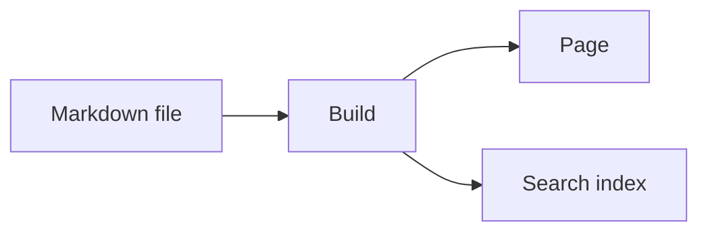

These components need the setup from [Set up components]($docs.set-up-components). [Component reference]($docs.components#write-props) explains how to write props.

Write formulas with `$…$` in a text and with `$$…$$` as a block of their own. They render with KaTeX, already in the HTML from the server: the area of a circle is $A = \pi r^2$.

$$
\int_0^1 x^2 \, dx = \frac{1}{3}
$$

A code block with the language `mermaid` becomes a diagram. It is drawn in the browser:

KaTeX and Mermaid load only when a page needs them.
