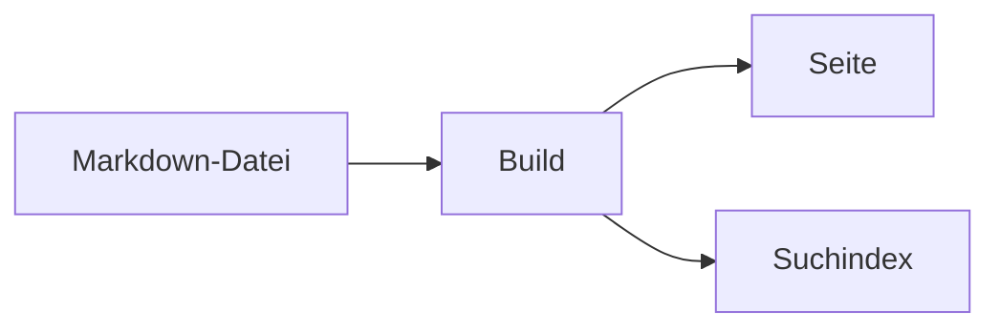

Diese Komponenten brauchen die Einrichtung aus [Komponenten einrichten]($docs.set-up-components). Die [Komponenten-Referenz]($docs.components#props-schreiben) erklärt, wie du Props schreibst.

Formeln schreibst du mit `$…$` im Text und mit `$$…$$` als eigenen Block. Sie erscheinen mit KaTeX, schon im HTML vom Server: Die Fläche eines Kreises ist $A = \pi r^2$.

$$
\int_0^1 x^2 \, dx = \frac{1}{3}
$$

Ein Code-Block mit der Sprache `mermaid` wird zum Diagramm. Es entsteht im Browser:

KaTeX und Mermaid werden nur geladen, wenn eine Seite sie braucht.
