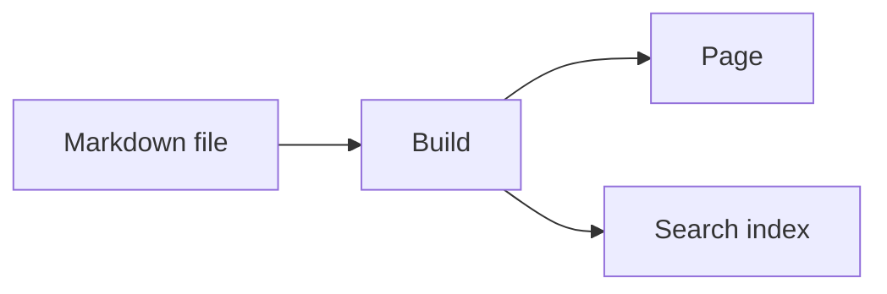

## What the package gives you

`@lupinum/ginko-components` provides building blocks for Markdown text: notices, tabs, cards, code groups, video, quizzes and more. The package has three parts:

- **The registry.** This is pure data, without Vue. It says which tags exist, which props they have and where they may stand. Your `ginko.config.ts` loads it in Node.
- **The Vue components.** They draw the tags. All classes start with `ginko-`. Colours come from the tokens `--border`, `--muted`, `--foreground` and `--primary`. Notices also use `--ginko-info`, `--ginko-warning`, `--ginko-error` and `--ginko-success`.
- **The Nuxt module.** It connects every tag to its component. `<GinkoMarkdown>` uses this mapping by itself.

This page shows every component live. Under each example is the Markdown text that produces it. All props are listed in the README of the package.

## Set up

You need three steps.

::steps
### Install the package
```bash
pnpm add @lupinum/ginko-components
```

### Add the module
The module goes into `nuxt.config.ts`:

```ts
export default defineNuxtConfig({
  modules: ['@lupinum/ginko/nuxt', '@lupinum/ginko-components'],
})
```

This docs site does not need the entry. The `@lupinum/ginko-docs` layer already loads the module.

### Pass the registry to `defineSite`
```ts
import { defineSite } from '@lupinum/ginko'
import { components } from '@lupinum/ginko-components/registry'

export default defineSite({
  // …
  components,
})
```
::

With `components`, Ginko checks the Markdown of your pages strictly. An unknown tag, an unknown prop or an unknown slot makes the build fail. A typo like `::callot` shows up at build time and not for your readers. Without `components`, the parser refuses slots.

## Replace one component

`<GinkoMarkdown>` has a `:components` prop. A tag you give there wins over the mapping of the module, per tag. All other tags stay as they are.

```vue
<script setup lang="ts">
import MyCallout from '~/components/MyCallout.vue'
</script>

<template>
  <GinkoMarkdown :value="page.body" :components="{ callout: MyCallout }" />
</template>
```

The Vue components of the package are exported from `@lupinum/ginko-components/components`. This way you can, for example, wrap `Callout` in your own variant instead of rewriting it.

## Change the UI texts

Fixed texts, for example “Copy code”, “Play” or the quiz buttons, live in the package's language files under the namespace `components`. They follow the language of the page. A site overrides one key in its own `i18n/<locale>.json`:

```json
{ "components": { "code": { "copy": "Copy" } } }
```

## Appearance

Every framed component is *quiet* (a border) or *tint* (a filled area). Notices and excerpts are tint, everything else quiet. `appearance="quiet"` or `appearance="tint"` changes a single component; cards follow their group.

````md preview
::note{title="Quiet" appearance="quiet"}
A border, no fill.
::

::note{title="Tint"}
A fill, no border.
::
````

For the whole site, set two tokens in your CSS:

```css
:root { --ginko-surface: var(--muted); --ginko-surface-border: transparent; }
```

Code always sits on a dark panel. Its colours come from the tokens `--ginko-code-frame`, `--ginko-code-bg`, `--ginko-code-fg`, `--ginko-code-muted` and `--ginko-code-hover`.

## Notices

### `callout`

Highlights a paragraph as a notice, with an icon and an optional title. `type` picks the kind: `note`, `info` (default), `warning`, `error`, `success` or `idea`.

````md preview
::callout{type="warning" title="Careful"}
This applies to new pages only.
::
````

### `note`, `info`, `warning`, `error`, `success`, `idea`

The same boxes with a fixed type. You write the name of the kind instead of `callout`.

````md preview
::note{title="Note"}
A short thought on the side.
::

::info{title="Good to know"}
The change applies at once.
::

::warning{title="Careful"}
You cannot undo this.
::

::error{title="Not possible"}
The file is too large.
::

::success{title="Done"}
The page is published.
::

::idea{title="Tip"}
A photo makes the page livelier.
::
````

## Text

### `aside`

A quiet remark next to the main text, with an optional heading.

````md preview
::aside{label="Background"}
The club was founded in 1998.
::
````

### `excerpt`

A highlighted quote or excerpt, with an optional source. `size="display"` makes the text large.

````md preview
::excerpt{source="Anna Muster, 2024" size="display"}
Whoever plants believes in tomorrow.
::
````

### `dropcap`

The first letter of the paragraph is shown large. `lines` sets the height in lines (2 to 4).

````md preview
::dropcap{lines="3"}
Once upon a time there was a small garden at the edge of the town.
::
````

### `kbd`

Shows a key press as a key. This is an inline tag: you write it with one colon in the middle of a sentence.

````md preview
Press :kbd[Ctrl] + :kbd[S] to save.
````

### `badge`

A small coloured mark in the text, for example “new”. Also an inline tag. `color` is `neutral`, `primary`, `success`, `warning` or `danger`.

````md preview
The feature is :badge[new]{color="success"}.
````

### `read-more`

A prominent link to another page, optionally with an icon (`icon`). Several in a row form one list.

````md preview
::read-more{href="/en/docs/getting-started" label="To getting started" icon="lucide:rocket"}
How it all starts.
::
::read-more{href="/en/docs/languages" label="Languages" icon="lucide:languages"}
Pages in several languages.
::
````

### `inline-toc`

Lists the headings of this page as links. It stays closed until someone opens it; `open` shows the list right away. The example shows the sections of this page.

````md preview
::inline-toc{title="On this page" depth="2"}
::
````

## Layout

### `flow`

Keeps the text at a comfortable line length, with a background if you want (`surface`: `default`, `muted`, `tint`).

````md preview
::flow{surface="muted"}
A longer text that sits at reading width.
::
````

### `layout`, `column`

Places columns side by side; on small screens they stack. `layout` is the frame, `column` is one column. `size` on the column sets the width.

````md preview
:::layout
::column{size="lg"}
Wide column
::
::column{size="sm"}
Narrow column
::
:::
````

### `center`

Centers the content in a narrow column, with a frame if you want (`type="card"` and others).

````md preview
::center{size="sm" type="card"}
See you soon!
::
````

### `timeline`, `timeline-item`

A vertical list of events in time order. `active` highlights one event, `icon` shows an icon instead of the dot.

````md preview
:::timeline
::timeline-item{date="2024" title="Founding"}
The club starts.
::
::timeline-item{date="2026" title="New garden" icon="lucide:sprout" active}
The second plot is open.
::
:::
````

### `steps`

Numbered steps; each heading in the block starts a step. `mode="check"` shows check marks instead of numbers.

````md preview
::steps
#### Create an account
Open the start page.

#### Fill the page
Enter the texts.
::
````

### `cards`, `card`

Places cards side by side (`cols` 1 to 3). A card has a title, text, and if you want an icon (`icon`, coloured with `iconColor`), an image and a link.

````md preview
:::cards
::card{title="First card" icon="lucide:rocket" iconColor="primary" href="/en/docs/getting-started"}
Short text.
::
::card{title="Second card" icon="lucide:settings-2"}
Another text.
::
:::
````

## Interactive

### `tabs`, `tab`

Shows several contents as tabs, one of which is always visible. The first one is selected; `icon` puts an icon before the name. You can use the tabs with the keyboard. `layout="line"` underlines the selected tab and drops the frame; `padded="false"` lets a code block fill the tab.

````md preview
:::tabs
::tab{label="Readers" icon="lucide:book-open"}
Readers find translated pages with search.
::
::tab{label="Agents" icon="lucide:bot"}
Agents read every page as Markdown.
::
:::
````

````md preview
:::tabs{layout="line"}
::tab{label="Monthly"}
€12 a month.
::
::tab{label="Yearly"}
€120 a year, two months free.
::
:::
````

### `accordion`, `accordion-item`

A list of entries that open one by one. Opening one closes the others; `multiple` keeps several open. It uses `<details>` and works without JavaScript.

````md preview
:::accordion
::accordion-item{label="How do I sign in?"}
By email, with a code.
::
::accordion-item{label="Does it cost anything?" open}
No.
::
:::
````

### `collapse`

With `label`, a section with a heading that readers open and close.

````md preview
::collapse{label="More details"}
The longer text is here.
::
````

Without `label`, long content (usually a code block) is cut off; “Show all … lines” opens it fully.

::collapse
```ts [ginko.config.ts]
import { defineSite } from '@lupinum/ginko'
import { docsCollection, docsHome } from '@lupinum/ginko-docs/config'
import { components } from '@lupinum/ginko-components/registry'

export default defineSite({
  name: 'docs',
  locales: ['de', 'en'],
  bricks: {
    home: docsHome(),
    docs: docsCollection(['de', 'en']),
  },
  components,
  routes: {
    docs: { de: '/docs/[slug]', en: '/en/docs/[slug]' },
  },
  seo: {
    title: 'Ginko',
    description: 'Content for Nuxt sites',
  },
})
```
::

`````md
::collapse
```ts [ginko.config.ts]
import { defineSite } from '@lupinum/ginko'
import { docsCollection, docsHome } from '@lupinum/ginko-docs/config'
import { components } from '@lupinum/ginko-components/registry'

export default defineSite({
  name: 'docs',
  locales: ['de', 'en'],
  bricks: {
    home: docsHome(),
    docs: docsCollection(['de', 'en']),
  },
  components,
  routes: {
    docs: { de: '/docs/[slug]', en: '/en/docs/[slug]' },
  },
  seo: {
    title: 'Ginko',
    description: 'Content for Nuxt sites',
  },
})
```
::
`````

## Code

### `code-group`

Shows several code blocks as tabs, named after file name or language.

````md preview
::code-group
```bash [npm]
npm install ginko
```
```bash [pnpm]
pnpm add ginko
```
::
````

### `code-tree`

Shows a file tree and next to it the code of the selected file. Each code block needs the path as its file name.

````md preview
::code-tree{defaultValue="app/app.vue"}
```vue [app/app.vue]
<template><NuxtPage /></template>
```
```ts [nuxt.config.ts]
export default defineNuxtConfig({})
```
::
````

### `files`

Shows files and folders as a list. A nested list becomes a folder, text after ` # ` a note at the end of the row. Known file types get their icon.

````md preview
::files{active="app/app.config.ts"}
- app
  - app.config.ts # name and logo
  - app.vue
  - components
    - Header.vue
- content
  - index.md
- nuxt.config.ts
- package.json
::
````

## Media

### `figure`

An image with a caption. A click enlarges the image. `alt` is required.

````md preview
::figure{src="/favicon.svg" alt="The Ginko leaf" caption="The Ginko mark" aspect="square" fit="contain"}
::
````

### `video`

A YouTube, Vimeo or video link. Nothing is loaded from YouTube or Vimeo until the visitor clicks “Play”: no iframe, no thumbnail. Use `poster` to show your own image.

````md preview
::video{src="https://www.youtube.com/watch?v=M7lc1UVf-VE" title="YouTube player sample video" start="30"}
::
````

## Learning

### `quiz`, `quiz-question`

Questions for self-checking. The questions appear one after another, the result comes at the end. No data is sent. The answers are a task list: `- [x]` is right, `- [ ]` is wrong. The explanation sits in the `#explanation` slot and appears only after checking.

````md preview
:::quiz{title="Quick check" description="Two questions about the garden."}
::quiz-question{question="When is the best time to water?"}
- [ ] At noon
- [x] In the morning

#explanation
Less water evaporates in the morning.
::
::quiz-question{question="What grows in the shade?" type="multiple"}
- [x] Fern
- [ ] Tomato
- [x] Hosta
::
:::
````

## API

### `api`, `api-param`

Describes an HTTP interface: method and path, and below them the parameters and fields. Parameters with the same `group` sit together, one tab per group. The content of `api-param` is the description.

````md preview
:::api{method="get" path="/v1/gardens"}
::api-param{name="limit" group="Query" type="number" presence="optional" defaultValue="20" since="1.2"}
Number of entries, at most `100`.
::
::api-param{name="id" group="Response" type="string" presence="required"}
The ID of the garden.
::
:::
````

## Formulas and diagrams

Write formulas with `$…$` in a text and with `$$…$$` as a block of their own. They render with KaTeX, already in the HTML from the server: the area of a circle is $A = \pi r^2$.

$$
\int_0^1 x^2 \, dx = \frac{1}{3}
$$

A code block with the language `mermaid` becomes a diagram. It is drawn in the browser:



KaTeX and Mermaid load only when a page needs them.
