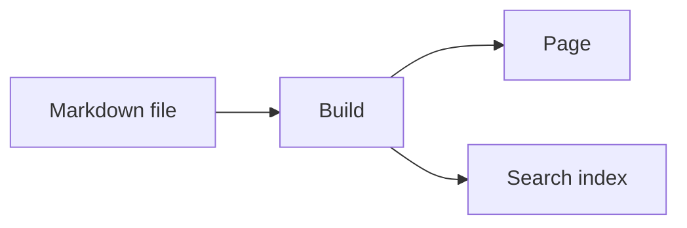

## What the package gives you

`@lupinum/ginko-components` provides building blocks for Markdown text: notices, tabs, cards, code groups, video, quizzes and more. The package has three parts:

- **The registry.** This is pure data, without Vue. It says which tags exist, which props they have and where they may stand. Your `ginko.config.ts` loads it in Node.
- **The Vue components.** They draw the tags. All classes start with `ginko-`. Colours come from the shadcn tokens of your site (see [Theming](#theming)).
- **The Nuxt module.** It connects every tag to its component. `<GinkoMarkdown>` uses this mapping by itself.

This page shows every component live. Under each example is the Markdown text that produces it, and after it the list of props. The [README of the package](https://github.com/lupinum-dev/ginko/tree/main/packages/ginko-components#readme) has the same lists as tables.

## Set up

You need three steps.

::steps
### Install the package
```bash
npm install @lupinum/ginko @lupinum/ginko-i18n @lupinum/ginko-components
```

### Add the module
The module goes into `nuxt.config.ts`:

```ts
export default defineNuxtConfig({
  modules: ['@lupinum/ginko/nuxt', '@lupinum/ginko-components'],
})
```

With the `@lupinum/ginko-docs` layer you do not need the second entry: the layer loads the module. The module needs `@lupinum/ginko/nuxt` for its texts; without it the build stops and says so.

### Pass the registry to `defineSite`
```ts
import { defineSite } from '@lupinum/ginko'
import { components } from '@lupinum/ginko-components/registry'

export default defineSite({
  // …
  components,
})
```
::

With `components`, Ginko checks the Markdown of your pages strictly. An unknown tag, an unknown prop or an unknown slot makes the build fail. A typo like `::callot` shows up at build time and not for your readers. Without `components`, the parser refuses slots.

## Write props

Props go in curly braces after the tag: `::card{title="Garden" iconColor="primary"}`. Write each name exactly as in the lists on this page. Names with two words are camelCase (`iconColor`, `defaultValue`); `icon-color` is an unknown prop. A yes/no prop works on its own (`open`) or with `"true"` and `"false"`.

Two props appear on many tags:

- `icon` takes an Iconify name such as `lucide:book-open`; a bare name means Lucide. It renders with the `<Icon>` of `@nuxt/icon`, which the docs layer includes. Only icon sets your site installs work. Notices also know six built-in names (see `callout`).
- `appearance` is `quiet` or `tint` (see [Appearance](#appearance)).

## Replace one component

`<GinkoMarkdown>` has a `:components` prop. A tag you give there wins over the mapping of the module, per tag. All other tags stay as they are.

```vue
<script setup lang="ts">
import MyCallout from '~/components/MyCallout.vue'

const route = useRoute()
const doc = useGinkoEntry('docs', String(route.params.slug))
</script>

<template>
  <GinkoMarkdown :value="doc.data.body" :components="{ callout: MyCallout }" />
</template>
```

The Vue components of the package are exported from `@lupinum/ginko-components/components`. This way you can, for example, wrap `Callout` in your own variant instead of rewriting it.

## Change the UI texts

Fixed texts, for example “Copy code”, “Play” or the quiz buttons, live in the package's language files under the namespace `components`. They follow the language of the page. A site overrides one key in its own `i18n/<locale>.json`:

```json
{ "components": { "code": { "copy": "Copy" } } }
```

## Copy a component into your app (shadcn-vue)

The npm package is the simple path: you get updates with the package. If you want to own and change the code of a component, copy it into your app with the [shadcn-vue](https://www.shadcn-vue.com) CLI. This site serves the registry:

```bash
npx shadcn-vue@latest add https://ginko-docs.vercel.app/r/callout.json
```

The CLI writes the component and its helper files to `components/ginko/` and installs the npm packages they need. Item names are the file names in kebab case (`callout`, `code-block`, `timeline-item`); [`/r/registry.json`](https://ginko-docs.vercel.app/r/registry.json) lists them all. Import the stylesheet once in your main CSS:

```css
@import "./components/ginko/ginko-components.css";
```

A copied component has no Nuxt module behind it. Its texts are the English ones in `components/ginko/texts.ts`; change them there.

## Appearance

Every framed component is *quiet* (a border) or *tint* (a filled area). Notices and excerpts are tint, everything else quiet. `appearance="quiet"` or `appearance="tint"` changes a single component; cards follow their group. In the HTML it becomes `data-appearance`.

````md preview
::note{title="Quiet" appearance="quiet"}
A border, no fill.
::

::note{title="Tint"}
A fill, no border.
::
````

For the whole site, set two tokens in your CSS:

```css
:root { --ginko-surface: var(--muted); --ginko-surface-border: transparent; }
```

## Theming

The components read the shadcn tokens of your site: `--background`, `--foreground`, `--card`, `--muted`, `--muted-foreground`, `--border`, `--primary`, `--primary-foreground`, `--ring`, `--radius` and `--font-mono`. Each colour must be a full colour value (`oklch(…)`, `hsl(…)` or hex). Old shadcn themes for Tailwind 3 store only numbers (`--muted: 210 40% 96%`); those give no colour here. Without the tokens the components use neutral colours that follow the colour mode of your site: dark with `color-scheme: dark`, the class `.dark` or `data-theme="dark"`.

These names stay stable; everything else is internal:

- Tokens: `--ginko-surface` and `--ginko-surface-border` (see above), `--ginko-tint`, the notice colours `--ginko-info`, `--ginko-warning`, `--ginko-error`, `--ginko-success` and `--ginko-idea`, and `--ginko-scroll-margin` (space above an API entry a link jumps to).
- Code always sits on a dark panel: `--ginko-code-frame`, `--ginko-code-bg`, `--ginko-code-fg`, `--ginko-code-muted` and `--ginko-code-hover`.
- The class `ginko-<tag>` on the outer element of each tag, for example `ginko-callout` or `ginko-card`, and the attribute `data-appearance`.

## Notices

### `callout`

Highlights a paragraph as a notice, with an icon and an optional title. `type` picks the kind: `note`, `info` (default), `warning`, `error`, `success` or `idea`.

````md preview
::callout{type="warning" title="Careful"}
This applies to new pages only.
::
````

Props: `type`, `title`, `icon` (one of `file-text`, `info`, `triangle-alert`, `circle-x`, `circle-check`, `lightbulb`, or an Iconify name), `appearance`.

### `note`, `info`, `warning`, `error`, `success`, `idea`

The same boxes with a fixed type. You write the name of the kind instead of `callout`.

````md preview
::note{title="Note"}
A short thought on the side.
::

::info{title="Good to know"}
The change applies at once.
::

::warning{title="Careful"}
You cannot undo this.
::

::error{title="Not possible"}
The file is too large.
::

::success{title="Done"}
The page is published.
::

::idea{title="Tip"}
A photo makes the page livelier.
::
````

Props: `title`, `icon`, `appearance`, as on `callout`.

## Text

### `aside`

A quiet remark next to the main text, with an optional heading.

````md preview
::aside{title="Background"}
The club was founded in 1998.
::
````

Props: `title` (the heading), `appearance`.

### `excerpt`

A highlighted quote or excerpt, with an optional source. `size="display"` makes the text large.

````md preview
::excerpt{source="Anna Muster, 2024" size="display"}
Whoever plants believes in tomorrow.
::
````

Props: `title`, `source`, `size` (`body` default, `display`), `appearance`.

### `dropcap`

The first letter of the paragraph is shown large. `lines` sets the height in lines (2 to 4).

````md preview
::dropcap{lines="3"}
Once upon a time there was a small garden at the edge of the town.
::
````

Props: `lines` (2 to 4, default 2).

### `kbd`

Shows a key press as a key. This is an inline tag: you write it with one colon in the middle of a sentence.

````md preview
Press :kbd[Ctrl] + :kbd[S] to save.
````

### `badge`

A small coloured mark in the text, for example “new”. Also an inline tag. `color` is `neutral`, `primary`, `success`, `warning` or `error`.

````md preview
The feature is :badge[new]{color="success"}.
````

Props: `color` (`neutral` default, `primary`, `success`, `warning`, `error`).

### `read-more`

A prominent link to another page, optionally with an icon (`icon`). Several in a row form one list.

````md preview
::read-more{href="/en/docs/getting-started" title="To getting started" icon="lucide:rocket"}
How it all starts.
::
::read-more{href="/en/docs/languages" title="Languages" icon="lucide:languages"}
Pages in several languages.
::
````

Props: `href` (required), `title` (without it the address shows), `icon`, `appearance`.

### `inline-toc`

Lists the headings of the page as links. It stays closed until someone opens it; `open` shows the list right away. Without headings it shows nothing. Here it lists the sections of this page:

::inline-toc{title="On this page" depth="2"}
::

```md
::inline-toc{title="On this page" depth="2"}
::
```

Props: `title`, `depth` (2 to 4: down to which heading level), `open`, `appearance`.

## Layout

### `flow`

Keeps the text at a comfortable line length, with a background if you want (`background`: `none`, `muted`, `tint`).

````md preview
::flow{background="muted"}
A longer text that sits at reading width.
::
````

Props: `width` (`reading` default, `wide`), `background` (`none` default, `muted`, `tint`).

### `layout`, `column`

Places columns side by side; on small screens they stack. `layout` is the frame, `column` is one column. `size` on the column sets the width.

````md preview
:::layout
::column{size="lg"}
Wide column
::
::column{size="sm"}
Narrow column
::
:::
````

Props of `layout`: `frame` (`none` default, `card`, `border`, `border-dashed`, `outline`, `outline-dashed`), `align` (`start`, `center`, `end`), `gap` (`none`, `sm`, `md` default, `lg`), `stack` (`sm`, `md` default, `lg`: from which width the columns sit side by side), `background` (`none` default, `muted`, `tint`).

Props of `column`: `size` (`xs` to `xl`, default `md`), `align` (`start`, `center`, `end`), `fit` (`natural` default, `cover`, `contain`: how an image fills the column).

### `center`

Centers the content in a narrow column, with a frame if you want (`frame="card"` and others).

````md preview
::center{size="sm" frame="card"}
See you soon!
::
````

Props: `size` (`sm`, `md` default, `lg`), `frame` (as on `layout`).

### `timeline`, `timeline-item`

A vertical list of events in time order. `active` highlights one event, `icon` shows an icon instead of the dot.

````md preview
:::timeline
::timeline-item{date="2024" title="Founding"}
The club starts.
::
::timeline-item{date="2026" title="New garden" icon="lucide:sprout" active}
The second plot is open.
::
:::
````

`timeline` has no props. Props of `timeline-item`: `date`, `meta`, `title`, `icon`, `active`.

### `steps`

Numbered steps; each heading in the block starts a step. `mode="check"` shows check marks instead of numbers.

````md preview
::steps
#### Create an account
Open the start page.

#### Fill the page
Enter the texts.
::
````

Props: `mode` (`numbered` default, `check`), `appearance`.

### `cards`, `card`

Places cards side by side (`cols` 1 to 3). A card has a title, text, and if you want an icon (`icon`, coloured with `iconColor`), an image and a link.

````md preview
:::cards
::card{title="First card" icon="lucide:rocket" iconColor="primary" href="/en/docs/getting-started"}
Short text. Links inside work too: [languages](/en/docs/languages).
::
::card{title="Second card" icon="lucide:settings-2"}
Another text.
::
:::
````

Props of `cards`: `cols` (1 to 3, default 2), `appearance`.

Props of `card`: `title`, `description`, `footer`, `href` (the whole card becomes the link), `icon`, `iconColor` (`primary`, `info`, `success`, `warning`, `error`), `image`, `horizontal` (image beside the text), `appearance`.

## Interactive

### `tabs`, `tab`

Shows several contents as tabs, one of which is always visible. The first one is selected; `icon` puts an icon before the name. You can use the tabs with the keyboard. `layout="line"` underlines the selected tab and drops the frame; `padded="false"` lets a code block fill the tab. Without JavaScript only the first tab shows.

````md preview
:::tabs
::tab{title="Readers" icon="lucide:book-open"}
Readers find translated pages with search.
::
::tab{title="Agents" icon="lucide:bot"}
Agents read every page as Markdown.
::
:::
````

````md preview
:::tabs{layout="line"}
::tab{title="Monthly"}
€12 a month.
::
::tab{title="Yearly"}
€120 a year, two months free.
::
:::
````

Props of `tabs`: `layout` (`separate` default, `line`), `padded` (default on), `appearance`. Props of `tab`: `title` (required), `icon`.

### `accordion`, `accordion-item`

A list of entries that open one by one. Opening one closes the others; `multiple` keeps several open. It uses `<details>` and works without JavaScript.

````md preview
:::accordion
::accordion-item{title="How do I sign in?"}
By email, with a code.
::
::accordion-item{title="Does it cost anything?" open}
No.
::
:::
````

Props of `accordion`: `multiple`, `appearance`. Props of `accordion-item`: `title` (required), `open`.

### `collapse`

With `title`, a section with a heading that readers open and close.

````md preview
::collapse{title="More details"}
The longer text is here.
::
````

Without `title`, long content (usually a code block) is cut off; “Show all … lines” opens it fully. The example is the `ginko.config.ts` of this site.

````md preview
::collapse
```ts [ginko.config.ts]
// The Ginko docs. Every page comes from Markdown in content/docs; the layout,
// search and components come from @lupinum/ginko-docs. This site never asks the platform.
import { defineSite } from '@lupinum/ginko'
import { blogCollections, blogPages, changelogCollection, changelogPages, docsCollection, docsHome } from '@lupinum/ginko-docs/config'
import { components } from '@lupinum/ginko-components/registry'

const locales = ['de', 'en'] as const

export default defineSite({
  site: 'ginko-docs',
  name: 'Ginko',
  url: 'https://ginko-docs.vercel.app',
  timezone: 'Europe/Vienna',
  locales,
  currency: 'EUR',
  pages: { home: { de: '/', en: '/en' }, blog: blogPages({ locales }), changelog: changelogPages({ locales }) },
  components,
  bricks: { home: docsHome(), docs: docsCollection({ locales }), ...blogCollections({ locales }), changelog: changelogCollection() },
})
```
::
````

Props: `title`, `open` (with `title`: open from the start), `appearance`.

## Code

### `code-group`

Shows several code blocks as tabs, named after file name or language.

````md preview
::code-group
```bash [npm]
npm install @lupinum/ginko
```
```bash [pnpm]
pnpm add @lupinum/ginko
```
::
````

`code-group` has no props. Every code block in Markdown, also outside a group, shows its file name or language and a copy button.

### `code-tree`

Shows a file tree and next to it the code of the selected file. Each code block needs the path as its file name.

````md preview
::code-tree{file="app/app.vue"}
```vue [app/app.vue]
<template><NuxtPage /></template>
```
```ts [nuxt.config.ts]
export default defineNuxtConfig({})
```
::
````

Props: `file` (path of the file that is open first), `expandAll` (all folders open).

### `files`

Shows files and folders as a list. A nested list becomes a folder, text after ` # ` a note at the end of the row. Known file types get their icon.

````md preview
::files{active="app/app.config.ts"}
- app
  - app.config.ts # name and logo
  - app.vue
  - components
    - Header.vue
- content
  - index.md
- nuxt.config.ts
- package.json
::
````

Props: `active` (path of the entry to mark), `appearance`.

## Media

### `figure`

An image with a caption. A click enlarges the image. `alt` is required. Plain Markdown images (``) load lazily too.

````md preview
::figure{src="/favicon.svg" alt="The Ginko leaf" caption="The Ginko mark" aspect="square" fit="contain"}
::
````

Props: `src` and `alt` (required), `caption`, `width`, `height`, `bleed` (wider than the text), `aspect` (`auto` default, `video`, `wide`, `square`, `portrait`), `fit` (`cover` default, `contain`), `placement` (`inline` default, `start`, `end`: float beside the text), `frame` (`border` default, `none`), `focus` (`center` default, `top`, `bottom`, `left`, `right`), `zoom` (default on).

### `video`

A YouTube, Vimeo or video link. Nothing is loaded from YouTube or Vimeo until the visitor clicks “Play”: no iframe, no thumbnail. Use `poster` to show your own image.

````md preview
::video{src="https://www.youtube.com/watch?v=M7lc1UVf-VE" title="YouTube player sample video" start="30"}
::
````

Props: `src` (required: a YouTube or Vimeo link, or an `.mp4` or `.webm` file), `title` (required), `poster`, `start` (seconds).

### `embed`

A map, a music player or a booking widget from a known provider. Like `video`, it loads nothing before the click: the visitor sees your `poster` or a neutral area, a button and one line that names the provider. An address that no provider knows becomes a plain link. Ginko never renders the HTML element `embed` or `iframe` from your Markdown: `::embed` is always this component.

````md preview
::embed{src="https://www.openstreetmap.org/export/embed.html?bbox=13.35%2C52.50%2C13.45%2C52.54&layer=mapnik" title="Map of Berlin-Mitte"}
::
````

Props: `src` (required: the address the provider gives you to embed), `title` (required: the label of the button and the title of the frame), `poster`.

#### Providers

Built in:

| Id | Address | Where you get it |
|---|---|---|
| `google-maps` | `https://www.google.com/maps/embed?pb=…` | Google Maps: Share → Embed a map |
| `openstreetmap` | `https://www.openstreetmap.org/export/embed.html?…` | openstreetmap.org: Share → HTML |
| `spotify`, `spotify-list` | `https://open.spotify.com/track/…` (also `episode`, `album`, `playlist`, `show`) | The link of the track or list |
| `calendly` | `https://calendly.com/<user>/<event>` | The link of your booking page |

You add a provider, replace one or turn one off in `nuxt.config.ts`:

```ts
export default defineNuxtConfig({
  ginkoComponents: {
    embeds: {
      providers: {
        peertube: {
          name: 'PeerTube',
          pattern: '^https://peertube\\.example\\.org/w/([\\w-]+)$',
          embed: 'https://peertube.example.org/videos/embed/$1',
          allow: 'fullscreen',
        },
        spotify: false,
      },
    },
  },
})
```

`name` appears in the line before the click. `pattern` is a regular expression for the whole address and must start with `^https://`. `embed` is the address of the frame, with `$1` for the first group of the pattern, and must start with `https://`. `ratio` sets the shape (default `16/9`), `height` a fixed height in pixels, `allow` the `allow` attribute of the frame. The first provider that matches wins. A wrong provider stops the build with a message that names it.

Only add providers you trust: every provider lets editors show that site in a frame on your pages.

## Learning

### `quiz`, `quiz-question`

Questions for self-checking. The questions appear one after another, the result comes at the end. No data is sent. The answers are a task list: `- [x]` is right, `- [ ]` is wrong. The explanation sits in the `#explanation` slot and appears only after checking.

````md preview
:::quiz{title="Quick check" description="Two questions about the garden."}
::quiz-question{question="When is the best time to water?"}
- [ ] At noon
- [x] In the morning

#explanation
Less water evaporates in the morning.
::
::quiz-question{question="What grows in the shade?" mode="multiple"}
- [x] Fern
- [ ] Tomato
- [x] Hosta
::
:::
````

Props of `quiz`: `title`, `description`, `appearance`. Props of `quiz-question`: `question` (required), `mode` (`single` default: one right answer, `multiple`: one or more).

## API

### `api`, `api-param`

Describes an HTTP interface: method and path, and below them the parameters and fields. Parameters with the same `group` sit together, one tab per group. The content of `api-param` is the description.

````md preview
:::api{method="get" path="/v1/gardens"}
::api-param{name="limit" group="Query" type="number" defaultValue="20" since="1.2"}
Number of entries, at most `100`.
::
::api-param{name="id" group="Response" type="string" required}
The ID of the garden.
::
:::
````

Props of `api`: `title`, `method` (`get`, `post`, `put`, `patch`, `delete`, `head`, `options`), `path`, `appearance`. Props of `api-param`: `name` (required), `group`, `type`, `required` (shows a badge), `deprecated`, `since`, `defaultValue`.

## Formulas and diagrams

Write formulas with `$…$` in a text and with `$$…$$` as a block of their own. They render with KaTeX, already in the HTML from the server: the area of a circle is $A = \pi r^2$.

$$
\int_0^1 x^2 \, dx = \frac{1}{3}
$$

A code block with the language `mermaid` becomes a diagram. It is drawn in the browser:



KaTeX and Mermaid load only when a page needs them.
