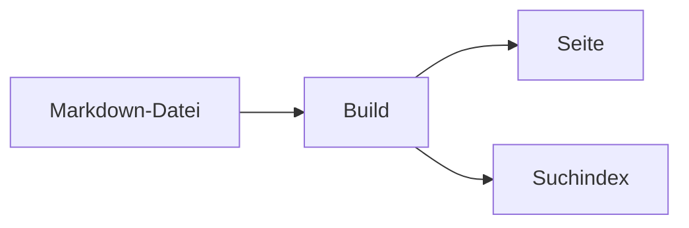

## Was das Paket bringt

`@lupinum/ginko-components` liefert Bausteine für Markdown-Text: Hinweise, Reiter, Karten, Code-Gruppen, Video, Quiz und mehr. Das Paket hat drei Teile:

- **Die Registry.** Das sind reine Daten, ohne Vue. Sie sagt, welche Tags es gibt, welche Props sie haben und wo sie stehen dürfen. Deine `ginko.config.ts` lädt sie in Node.
- **Die Vue-Komponenten.** Sie zeichnen die Tags. Alle Klassen beginnen mit `ginko-`. Die Farben kommen aus den shadcn-Tokens deiner Seite (siehe [Gestaltung](#gestaltung)).
- **Das Nuxt-Modul.** Es verbindet jeden Tag mit seiner Komponente. `<GinkoMarkdown>` nutzt diese Zuordnung von selbst.

Diese Seite zeigt jede Komponente live. Unter jedem Beispiel steht der Markdown-Text, aus dem es entsteht, und danach die Liste der Props. Die [README des Pakets](https://github.com/lupinum-dev/ginko/tree/main/packages/ginko-components#readme) hat dieselben Listen als Tabellen.

## Einrichten

Du brauchst drei Schritte.

::steps
### Paket installieren
```bash
npm install @lupinum/ginko @lupinum/ginko-i18n @lupinum/ginko-components
```

### Modul eintragen
Das Modul gehört in die `nuxt.config.ts`:

```ts
export default defineNuxtConfig({
  modules: ['@lupinum/ginko/nuxt', '@lupinum/ginko-components'],
})
```

Mit dem Layer `@lupinum/ginko-docs` brauchst du den zweiten Eintrag nicht: Das Layer lädt das Modul. Das Modul braucht `@lupinum/ginko/nuxt` für seine Texte; ohne es bricht der Build ab und sagt das.

### Registry an `defineSite` geben
```ts
import { defineSite } from '@lupinum/ginko'
import { components } from '@lupinum/ginko-components/registry'

export default defineSite({
  // …
  components,
})
```
::

Mit `components` prüft Ginko das Markdown der Seiten streng. Ein unbekannter Tag, eine unbekannte Prop oder ein unbekannter Bereich (Slot) lässt den Build fehlschlagen. Ein Tippfehler wie `::callot` fällt so beim Build auf und nicht erst bei den Lesern. Ohne `components` lehnt der Parser Slots ab.

## Props schreiben

Props stehen in geschweiften Klammern nach dem Tag: `::card{title="Garten" iconColor="primary"}`. Schreib jeden Namen genau wie in den Listen auf dieser Seite. Namen aus zwei Wörtern sind camelCase (`iconColor`, `defaultValue`); `icon-color` ist eine unbekannte Prop. Eine Ja/Nein-Prop wirkt allein (`open`) oder mit `"true"` und `"false"`.

Zwei Props gibt es bei vielen Tags:

- `icon` nimmt einen Iconify-Namen wie `lucide:book-open`; ein Name ohne Präfix meint Lucide. Es erscheint über `<Icon>` von `@nuxt/icon`, das im Doku-Layer steckt. Es gehen nur Symbolsätze, die deine Seite installiert. Hinweise kennen außerdem sechs eingebaute Namen (siehe `callout`).
- `appearance` ist `quiet` oder `tint` (siehe [Darstellung](#darstellung)).

## Eine Komponente ersetzen

`<GinkoMarkdown>` hat die Prop `:components`. Ein Tag, den du dort angibst, gewinnt gegen die Zuordnung des Moduls, und zwar je Tag. Alle anderen Tags bleiben, wie sie sind.

```vue
<script setup lang="ts">
import MyCallout from '~/components/MyCallout.vue'

const route = useRoute()
const doc = useGinkoEntry('docs', String(route.params.slug))
</script>

<template>
  <GinkoMarkdown :value="doc.data.body" :components="{ callout: MyCallout }" />
</template>
```

Die Vue-Komponenten des Pakets kommen aus `@lupinum/ginko-components/components`. So kannst du zum Beispiel `Callout` in deiner Variante umhüllen, statt sie neu zu schreiben.

## Texte der Oberfläche ändern

Feste Texte, zum Beispiel „Code kopieren“, „Abspielen“ oder die Quiz-Knöpfe, liegen in den Sprachdateien des Pakets unter dem Namensraum `components`. Sie folgen der Sprache der Seite. Eine Seite überschreibt einen Schlüssel in ihrer eigenen `i18n/<sprache>.json`:

```json
{ "components": { "code": { "copy": "Kopieren" } } }
```

## Eine Komponente in die eigene App kopieren (shadcn-vue)

Das npm-Paket ist der einfache Weg: Updates kommen mit dem Paket. Wenn du den Code einer Komponente selbst besitzen und ändern willst, kopierst du sie mit der CLI von [shadcn-vue](https://www.shadcn-vue.com) in deine App. Diese Seite stellt die Registry bereit:

```bash
npx shadcn-vue@latest add https://ginko-docs.vercel.app/r/callout.json
```

Die CLI schreibt die Komponente und ihre Hilfsdateien nach `components/ginko/` und installiert die npm-Pakete, die sie brauchen. Die Namen der Einträge sind die Dateinamen in Kebab-Case (`callout`, `code-block`, `timeline-item`); [`/r/registry.json`](https://ginko-docs.vercel.app/r/registry.json) listet alle. Binde das Stylesheet einmal in dein Haupt-CSS ein:

```css
@import "./components/ginko/ginko-components.css";
```

Hinter einer kopierten Komponente steht kein Nuxt-Modul. Ihre Texte sind die englischen in `components/ginko/texts.ts`; dort änderst du sie.

## Darstellung

Jede Komponente mit Rahmen ist *ruhig* (ein Rahmen) oder *getönt* (eine Fläche). Hinweise und Zitate sind getönt, alles andere ruhig. `appearance="quiet"` oder `appearance="tint"` ändert eine einzelne Komponente; Karten folgen ihrer Gruppe. Im HTML wird daraus `data-appearance`.

````md preview
::note{title="Ruhig" appearance="quiet"}
Mit Rahmen, ohne Fläche.
::

::note{title="Getönt"}
Mit Fläche, ohne Rahmen.
::
````

Für die ganze Seite setzt du zwei Tokens in deinem CSS:

```css
:root { --ginko-surface: var(--muted); --ginko-surface-border: transparent; }
```

## Gestaltung

Die Komponenten lesen die shadcn-Tokens deiner Seite: `--background`, `--foreground`, `--card`, `--muted`, `--muted-foreground`, `--border`, `--primary`, `--primary-foreground`, `--ring`, `--radius` und `--font-mono`. Jede Farbe muss ein ganzer Farbwert sein (`oklch(…)`, `hsl(…)` oder Hex). Alte shadcn-Themes für Tailwind 3 speichern nur Zahlen (`--muted: 210 40% 96%`); damit gibt es hier keine Farbe. Ohne die Tokens nutzen die Komponenten neutrale Farben, die dem Farbmodus deiner Seite folgen: dunkel mit `color-scheme: dark`, der Klasse `.dark` oder `data-theme="dark"`.

Diese Namen bleiben stabil; alles andere ist intern:

- Tokens: `--ginko-surface` und `--ginko-surface-border` (siehe oben), `--ginko-tint`, die Hinweisfarben `--ginko-info`, `--ginko-warning`, `--ginko-error`, `--ginko-success` und `--ginko-idea`, und `--ginko-scroll-margin` (Abstand über einem API-Eintrag, zu dem ein Link springt).
- Code steht immer auf einer dunklen Fläche: `--ginko-code-frame`, `--ginko-code-bg`, `--ginko-code-fg`, `--ginko-code-muted` und `--ginko-code-hover`.
- Die Klasse `ginko-<tag>` am äußeren Element jedes Tags, zum Beispiel `ginko-callout` oder `ginko-card`, und das Attribut `data-appearance`.

## Hinweise

### `callout`

Hebt einen Absatz als Hinweis hervor, mit Symbol und optionalem Titel. `type` wählt die Art: `note`, `info` (Standard), `warning`, `error`, `success` oder `idea`.

````md preview
::callout{type="warning" title="Achtung"}
Das gilt nur für neue Seiten.
::
````

Props: `type`, `title`, `icon` (einer von `file-text`, `info`, `triangle-alert`, `circle-x`, `circle-check`, `lightbulb` oder ein Iconify-Name), `appearance`.

### `note`, `info`, `warning`, `error`, `success`, `idea`

Dieselben Kästen mit festem Typ. Du schreibst den Namen der Art statt `callout`.

````md preview
::note{title="Notiz"}
Ein kurzer Gedanke am Rand.
::

::info{title="Gut zu wissen"}
Die Änderung gilt sofort.
::

::warning{title="Achtung"}
Das lässt sich nicht rückgängig machen.
::

::error{title="Nicht möglich"}
Die Datei ist zu groß.
::

::success{title="Geschafft"}
Die Seite ist veröffentlicht.
::

::idea{title="Tipp"}
Ein Foto macht die Seite lebendiger.
::
````

Props: `title`, `icon`, `appearance`, wie bei `callout`.

## Text

### `aside`

Eine ruhige Anmerkung neben dem Haupttext, mit optionaler Überschrift.

````md preview
::aside{title="Hintergrund"}
Der Verein wurde 1998 gegründet.
::
````

Props: `title` (die Überschrift), `appearance`.

### `excerpt`

Ein hervorgehobenes Zitat oder Textauszug, mit optionaler Quelle. `size="display"` macht den Text groß.

````md preview
::excerpt{source="Anna Muster, 2024" size="display"}
Wer pflanzt, glaubt an morgen.
::
````

Props: `title`, `source`, `size` (`body` Standard, `display`), `appearance`.

### `dropcap`

Der erste Buchstabe des Absatzes wird groß dargestellt. `lines` setzt die Höhe in Zeilen (2 bis 4).

````md preview
::dropcap{lines="3"}
Es war einmal ein kleiner Garten am Rand der Stadt.
::
````

Props: `lines` (2 bis 4, Standard 2).

### `kbd`

Zeigt eine Tastatureingabe als Taste. Das ist ein Inline-Tag: du schreibst ihn mit einem Doppelpunkt mitten im Satz.

````md preview
Drücke :kbd[Strg] + :kbd[S] zum Speichern.
````

### `badge`

Eine kleine farbige Marke im Text, zum Beispiel „neu“. Auch ein Inline-Tag. `color` ist `neutral`, `primary`, `success`, `warning` oder `error`.

````md preview
Die Funktion ist :badge[neu]{color="success"}.
````

Props: `color` (`neutral` Standard, `primary`, `success`, `warning`, `error`).

### `read-more`

Ein auffälliger Link zu einer weiteren Seite, auf Wunsch mit Symbol (`icon`). Mehrere direkt hintereinander bilden eine Liste.

````md preview
::read-more{href="/docs/einstieg" title="Zum Einstieg" icon="lucide:rocket"}
Wie alles anfängt.
::
::read-more{href="/docs/sprachen" title="Sprachen" icon="lucide:languages"}
Seiten in mehreren Sprachen.
::
````

Props: `href` (Pflicht), `title` (ohne steht dort die Adresse), `icon`, `appearance`.

### `inline-toc`

Listet die Überschriften der Seite als Links auf. Es bleibt zugeklappt, bis jemand es öffnet; `open` zeigt die Liste sofort. Ohne Überschriften zeigt es nichts. Hier listet es die Abschnitte dieser Seite:

::inline-toc{title="Auf dieser Seite" depth="2"}
::

```md
::inline-toc{title="Auf dieser Seite" depth="2"}
::
```

Props: `title`, `depth` (2 bis 4: bis zu welcher Überschriftenebene), `open`, `appearance`.

## Layout

### `flow`

Hält den Text in einer angenehmen Zeilenlänge, auf Wunsch mit Hintergrund (`background`: `none`, `muted`, `tint`).

````md preview
::flow{background="muted"}
Ein längerer Text, der in Lesebreite steht.
::
````

Props: `width` (`reading` Standard, `wide`), `background` (`none` Standard, `muted`, `tint`).

### `layout`, `column`

Ordnet Spalten nebeneinander an; auf kleinen Bildschirmen stehen sie untereinander. `layout` ist der Rahmen, `column` eine Spalte. `size` an der Spalte setzt die Breite.

````md preview
:::layout
::column{size="lg"}
Breite Spalte
::
::column{size="sm"}
Schmale Spalte
::
:::
````

Props von `layout`: `frame` (`none` Standard, `card`, `border`, `border-dashed`, `outline`, `outline-dashed`), `align` (`start`, `center`, `end`), `gap` (`none`, `sm`, `md` Standard, `lg`), `stack` (`sm`, `md` Standard, `lg`: ab welcher Breite die Spalten nebeneinander stehen), `background` (`none` Standard, `muted`, `tint`).

Props von `column`: `size` (`xs` bis `xl`, Standard `md`), `align` (`start`, `center`, `end`), `fit` (`natural` Standard, `cover`, `contain`: wie ein Bild die Spalte füllt).

### `center`

Zentriert den Inhalt in einer schmalen Spalte, auf Wunsch mit Rahmen (`frame="card"` und andere).

````md preview
::center{size="sm" frame="card"}
Bis bald!
::
````

Props: `size` (`sm`, `md` Standard, `lg`), `frame` (wie bei `layout`).

### `timeline`, `timeline-item`

Eine senkrechte Liste von Ereignissen in zeitlicher Reihenfolge. `active` hebt ein Ereignis hervor, `icon` zeigt ein Symbol statt des Punkts.

````md preview
:::timeline
::timeline-item{date="2024" title="Gründung"}
Der Verein startet.
::
::timeline-item{date="2026" title="Neuer Garten" icon="lucide:sprout" active}
Die zweite Fläche ist offen.
::
:::
````

`timeline` hat keine Props. Props von `timeline-item`: `date`, `meta`, `title`, `icon`, `active`.

### `steps`

Nummerierte Schritte; jede Überschrift im Block beginnt einen Schritt. `mode="check"` zeigt Haken statt Zahlen.

````md preview
::steps
#### Konto anlegen
Öffne die Startseite.

#### Seite füllen
Trage die Texte ein.
::
````

Props: `mode` (`numbered` Standard, `check`), `appearance`.

### `cards`, `card`

Ordnet Karten nebeneinander an (`cols` 1 bis 3). Eine Karte hat Titel, Text und auf Wunsch Symbol (`icon`, gefärbt mit `iconColor`), Bild und Link.

````md preview
:::cards
::card{title="Erste Karte" icon="lucide:rocket" iconColor="primary" href="/docs/einstieg"}
Kurzer Text. Links darin gehen auch: [Sprachen](/docs/sprachen).
::
::card{title="Zweite Karte" icon="lucide:settings-2"}
Noch ein Text.
::
:::
````

Props von `cards`: `cols` (1 bis 3, Standard 2), `appearance`.

Props von `card`: `title`, `description`, `footer`, `href` (die ganze Karte wird zum Link), `icon`, `iconColor` (`primary`, `info`, `success`, `warning`, `error`), `image`, `horizontal` (Bild neben dem Text), `appearance`.

## Interaktiv

### `tabs`, `tab`

Zeigt mehrere Inhalte als Reiter, von denen immer einer sichtbar ist. Der erste ist vorgewählt, `icon` setzt ein Symbol vor den Namen. Die Reiter lassen sich per Tastatur bedienen. `layout="line"` unterstreicht den gewählten Reiter und lässt den Rahmen weg; `padded="false"` lässt einen Codeblock den Reiter füllen. Ohne JavaScript ist nur der erste Reiter zu sehen.

````md preview
:::tabs
::tab{title="Leser" icon="lucide:book-open"}
Leser finden übersetzte Seiten mit Suche.
::
::tab{title="Agenten" icon="lucide:bot"}
Agenten lesen jede Seite als Markdown.
::
:::
````

````md preview
:::tabs{layout="line"}
::tab{title="Monatlich"}
12 € im Monat.
::
::tab{title="Jährlich"}
120 € im Jahr, zwei Monate gratis.
::
:::
````

Props von `tabs`: `layout` (`separate` Standard, `line`), `padded` (Standard an), `appearance`. Props von `tab`: `title` (Pflicht), `icon`.

### `accordion`, `accordion-item`

Eine Liste von Einträgen, die sich einzeln aufklappen lassen. Öffnen eines Eintrags schließt die anderen; `multiple` lässt mehrere offen. Sie nutzt `<details>` und funktioniert auch ohne JavaScript.

````md preview
:::accordion
::accordion-item{title="Wie melde ich mich an?"}
Per E-Mail mit einem Code.
::
::accordion-item{title="Kostet das etwas?" open}
Nein.
::
:::
````

Props von `accordion`: `multiple`, `appearance`. Props von `accordion-item`: `title` (Pflicht), `open`.

### `collapse`

Mit `title` ein Bereich mit Überschrift, den Leser auf- und zuklappen.

````md preview
::collapse{title="Mehr Details"}
Hier steht der längere Text.
::
````

Ohne `title` wird langer Inhalt, meist ein Codeblock, gekürzt; „Alle … Zeilen anzeigen“ öffnet ihn ganz. Das Beispiel ist die `ginko.config.ts` dieser Seite.

````md preview
::collapse
```ts [ginko.config.ts]
// The Ginko docs. Every page comes from Markdown in content/docs; the layout,
// search and components come from @lupinum/ginko-docs. This site never asks the platform.
import { defineSite } from '@lupinum/ginko'
import { blogCollections, blogPages, changelogCollection, changelogPages, docsCollection, docsHome } from '@lupinum/ginko-docs/config'
import { components } from '@lupinum/ginko-components/registry'

const locales = ['de', 'en'] as const

export default defineSite({
  site: 'ginko-docs',
  name: 'Ginko',
  url: 'https://ginko-docs.vercel.app',
  timezone: 'Europe/Vienna',
  locales,
  currency: 'EUR',
  pages: { home: { de: '/', en: '/en' }, blog: blogPages({ locales }), changelog: changelogPages({ locales }) },
  components,
  bricks: { home: docsHome(), docs: docsCollection({ locales }), ...blogCollections({ locales }), changelog: changelogCollection() },
})
```
::
````

Props: `title`, `open` (mit `title`: von Anfang an offen), `appearance`.

## Code

### `code-group`

Zeigt mehrere Codeblöcke als Reiter, benannt nach Dateiname oder Sprache.

````md preview
::code-group
```bash [npm]
npm install @lupinum/ginko
```
```bash [pnpm]
pnpm add @lupinum/ginko
```
::
````

`code-group` hat keine Props. Jeder Codeblock in Markdown, auch außerhalb einer Gruppe, zeigt Dateinamen oder Sprache und einen Kopierknopf.

### `code-tree`

Zeigt einen Dateibaum und daneben den Code der gewählten Datei. Jeder Codeblock braucht den Pfad als Dateinamen.

````md preview
::code-tree{file="app/app.vue"}
```vue [app/app.vue]
<template><NuxtPage /></template>
```
```ts [nuxt.config.ts]
export default defineNuxtConfig({})
```
::
````

Props: `file` (Pfad der Datei, die zuerst offen ist), `expandAll` (alle Ordner offen).

### `files`

Zeigt Dateien und Ordner als Liste. Eine eingerückte Liste ergibt einen Ordner, Text nach ` # ` eine Notiz am Ende der Zeile. Bekannte Dateiarten bekommen ihr Symbol.

````md preview
::files{active="app/app.config.ts"}
- app
  - app.config.ts # Name und Logo
  - app.vue
  - components
    - Header.vue
- content
  - index.md
- nuxt.config.ts
- package.json
::
````

Props: `active` (Pfad des Eintrags, der markiert wird), `appearance`.

## Medien

### `figure`

Ein Bild mit Bildunterschrift. Ein Klick vergrößert das Bild. `alt` ist Pflicht. Normale Markdown-Bilder (``) laden ebenfalls erst bei Bedarf.

````md preview
::figure{src="/favicon.svg" alt="Das Ginko-Blatt" caption="Das Zeichen von Ginko" aspect="square" fit="contain"}
::
````

Props: `src` und `alt` (Pflicht), `caption`, `width`, `height`, `bleed` (breiter als der Text), `aspect` (`auto` Standard, `video`, `wide`, `square`, `portrait`), `fit` (`cover` Standard, `contain`), `placement` (`inline` Standard, `start`, `end`: neben dem Text), `frame` (`border` Standard, `none`), `focus` (`center` Standard, `top`, `bottom`, `left`, `right`), `zoom` (Standard an).

### `video`

Ein YouTube-, Vimeo- oder Video-Link. Von YouTube oder Vimeo wird erst nach einem Klick auf „Abspielen“ etwas geladen: kein iframe, kein Vorschaubild. Mit `poster` zeigst du ein eigenes Bild.

````md preview
::video{src="https://www.youtube.com/watch?v=M7lc1UVf-VE" title="Beispielvideo des YouTube-Players" start="30"}
::
````

Props: `src` (Pflicht: ein YouTube- oder Vimeo-Link oder eine `.mp4`- oder `.webm`-Datei), `title` (Pflicht), `poster`, `start` (Sekunden).

### `embed`

Eine Karte, ein Musik-Player oder ein Buchungs-Widget von einem bekannten Anbieter. Wie bei `video` lädt vor dem Klick nichts: Besucher sehen dein `poster` oder eine neutrale Fläche, einen Knopf und eine Zeile, die den Anbieter nennt. Eine Adresse, die kein Anbieter kennt, wird ein normaler Link. Ginko zeichnet dabei nie das HTML-Element `embed` oder `iframe` aus deinem Markdown: `::embed` ist immer diese Komponente.

````md preview
::embed{src="https://www.openstreetmap.org/export/embed.html?bbox=13.35%2C52.50%2C13.45%2C52.54&layer=mapnik" title="Karte von Berlin-Mitte"}
::
````

Props: `src` (Pflicht: die Adresse, die der Anbieter zum Einbetten gibt), `title` (Pflicht: Beschriftung des Knopfs und Titel des Rahmens), `poster`.

#### Anbieter

Eingebaut:

| Id | Adresse | Wo du sie bekommst |
|---|---|---|
| `google-maps` | `https://www.google.com/maps/embed?pb=…` | Google Maps: Teilen → Karte einbetten |
| `openstreetmap` | `https://www.openstreetmap.org/export/embed.html?…` | openstreetmap.org: Teilen → HTML |
| `spotify`, `spotify-list` | `https://open.spotify.com/track/…` (auch `episode`, `album`, `playlist`, `show`) | Der Link des Titels oder der Liste |
| `calendly` | `https://calendly.com/<user>/<event>` | Der Link deiner Buchungsseite |

In der `nuxt.config.ts` fügst du einen Anbieter hinzu, ersetzt einen oder schaltest einen ab:

```ts
export default defineNuxtConfig({
  ginkoComponents: {
    embeds: {
      providers: {
        peertube: {
          name: 'PeerTube',
          pattern: '^https://peertube\\.example\\.org/w/([\\w-]+)$',
          embed: 'https://peertube.example.org/videos/embed/$1',
          allow: 'fullscreen',
        },
        spotify: false,
      },
    },
  },
})
```

`name` steht in der Zeile vor dem Klick. `pattern` ist ein regulärer Ausdruck für die ganze Adresse und muss mit `^https://` beginnen. `embed` ist die Adresse des Rahmens, mit `$1` für die erste Gruppe des Musters, und muss mit `https://` beginnen. `ratio` setzt die Form (Standard `16/9`), `height` eine feste Höhe in Pixeln, `allow` das `allow`-Attribut des Rahmens. Der erste passende Anbieter gewinnt. Ein fehlerhafter Anbieter stoppt den Build mit einer Meldung, die ihn nennt.

Nimm nur Anbieter auf, denen du vertraust: Jeder Anbieter erlaubt Redakteuren, diese Seite in einem Rahmen auf deinen Seiten zu zeigen.

## Lernen

### `quiz`, `quiz-question`

Fragen zur Selbstkontrolle. Die Fragen erscheinen nacheinander, am Ende steht das Ergebnis. Es werden keine Daten gesendet. Die Antworten sind eine Aufgabenliste: `- [x]` ist richtig, `- [ ]` ist falsch. Die Erklärung steht im Bereich `#explanation` und erscheint erst nach dem Prüfen.

````md preview
:::quiz{title="Kurz geprüft" description="Zwei Fragen zum Garten."}
::quiz-question{question="Wann gießt man am besten?"}
- [ ] Mittags
- [x] Morgens

#explanation
Am Morgen verdunstet weniger Wasser.
::
::quiz-question{question="Was wächst im Schatten?" mode="multiple"}
- [x] Farn
- [ ] Tomate
- [x] Funkie
::
:::
````

Props von `quiz`: `title`, `description`, `appearance`. Props von `quiz-question`: `question` (Pflicht), `mode` (`single` Standard: eine richtige Antwort, `multiple`: eine oder mehrere).

## API

### `api`, `api-param`

Beschreibt eine HTTP-Schnittstelle: Methode und Pfad, darunter die Parameter und Felder. Parameter mit gleicher `group` stehen zusammen, je Gruppe ein Reiter. Der Inhalt von `api-param` ist die Beschreibung.

````md preview
:::api{method="get" path="/v1/gaerten"}
::api-param{name="limit" group="Query" type="number" defaultValue="20" since="1.2"}
Anzahl der Einträge, höchstens `100`.
::
::api-param{name="id" group="Antwort" type="string" required}
Die Kennung des Gartens.
::
:::
````

Props von `api`: `title`, `method` (`get`, `post`, `put`, `patch`, `delete`, `head`, `options`), `path`, `appearance`. Props von `api-param`: `name` (Pflicht), `group`, `type`, `required` (zeigt eine Marke), `deprecated`, `since`, `defaultValue`.

## Formeln und Diagramme

Formeln schreibst du mit `$…$` im Text und mit `$$…$$` als eigenen Block. Sie erscheinen mit KaTeX, schon im HTML vom Server: Die Fläche eines Kreises ist $A = \pi r^2$.

$$
\int_0^1 x^2 \, dx = \frac{1}{3}
$$

Ein Code-Block mit der Sprache `mermaid` wird zum Diagramm. Es entsteht im Browser:



KaTeX und Mermaid werden nur geladen, wenn eine Seite sie braucht.
