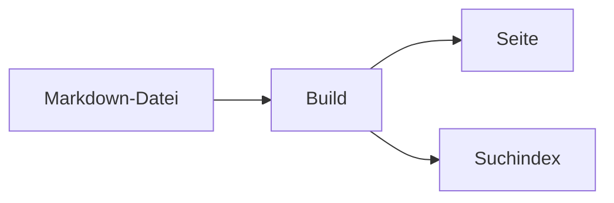

## Was das Paket bringt

`@lupinum/ginko-components` liefert Bausteine für Markdown-Text: Hinweise, Reiter, Karten, Code-Gruppen, Video, Quiz und mehr. Das Paket hat drei Teile:

- **Die Registry.** Das sind reine Daten, ohne Vue. Sie sagt, welche Tags es gibt, welche Props sie haben und wo sie stehen dürfen. Deine `ginko.config.ts` lädt sie in Node.
- **Die Vue-Komponenten.** Sie zeichnen die Tags. Alle Klassen beginnen mit `ginko-`. Die Farben kommen aus den Tokens `--border`, `--muted`, `--foreground` und `--primary`. Hinweise nutzen zusätzlich `--ginko-info`, `--ginko-warning`, `--ginko-error` und `--ginko-success`.
- **Das Nuxt-Modul.** Es verbindet jeden Tag mit seiner Komponente. `<GinkoMarkdown>` nutzt diese Zuordnung von selbst.

Diese Seite zeigt jede Komponente live. Unter jedem Beispiel steht der Markdown-Text, aus dem es entsteht. Alle Props stehen in der README des Pakets.

## Einrichten

Du brauchst drei Schritte.

::steps
### Paket installieren
```bash
pnpm add @lupinum/ginko-components
```

### Modul eintragen
Das Modul gehört in die `nuxt.config.ts`:

```ts
export default defineNuxtConfig({
  modules: ['@lupinum/ginko/nuxt', '@lupinum/ginko-components'],
})
```

Diese Doku-Seite braucht den Eintrag nicht. Das Layer `@lupinum/ginko-docs` lädt das Modul schon.

### Registry an `defineSite` geben
```ts
import { defineSite } from '@lupinum/ginko'
import { components } from '@lupinum/ginko-components/registry'

export default defineSite({
  // …
  components,
})
```
::

Mit `components` prüft Ginko das Markdown der Seiten streng. Ein unbekannter Tag, eine unbekannte Prop oder ein unbekannter Bereich (Slot) lässt den Build fehlschlagen. Ein Tippfehler wie `::callot` fällt so beim Build auf und nicht erst bei den Lesern. Ohne `components` lehnt der Parser Slots ab.

## Eine Komponente ersetzen

`<GinkoMarkdown>` hat die Prop `:components`. Ein Tag, den du dort angibst, gewinnt gegen die Zuordnung des Moduls, und zwar je Tag. Alle anderen Tags bleiben, wie sie sind.

```vue
<script setup lang="ts">
import MyCallout from '~/components/MyCallout.vue'
</script>

<template>
  <GinkoMarkdown :value="page.body" :components="{ callout: MyCallout }" />
</template>
```

Die Vue-Komponenten des Pakets kommen aus `@lupinum/ginko-components/components`. So kannst du zum Beispiel `Callout` in deiner Variante umhüllen, statt sie neu zu schreiben.

## Texte der Oberfläche ändern

Feste Texte, zum Beispiel „Code kopieren“, „Abspielen“ oder die Quiz-Knöpfe, liegen in den Sprachdateien des Pakets unter dem Namensraum `components`. Sie folgen der Sprache der Seite. Eine Seite überschreibt einen Schlüssel in ihrer eigenen `i18n/<sprache>.json`:

```json
{ "components": { "code": { "copy": "Kopieren" } } }
```

## Darstellung

Jede Komponente mit Rahmen ist *ruhig* (ein Rahmen) oder *getönt* (eine Fläche). Hinweise und Zitate sind getönt, alles andere ruhig. `appearance="quiet"` oder `appearance="tint"` ändert eine einzelne Komponente; Karten folgen ihrer Gruppe.

````md preview
::note{title="Ruhig" appearance="quiet"}
Mit Rahmen, ohne Fläche.
::

::note{title="Getönt"}
Mit Fläche, ohne Rahmen.
::
````

Für die ganze Seite setzt du zwei Tokens in deinem CSS:

```css
:root { --ginko-surface: var(--muted); --ginko-surface-border: transparent; }
```

Code steht immer auf einer dunklen Fläche. Die Farben kommen aus den Tokens `--ginko-code-frame`, `--ginko-code-bg`, `--ginko-code-fg`, `--ginko-code-muted` und `--ginko-code-hover`.

## Hinweise

### `callout`

Hebt einen Absatz als Hinweis hervor, mit Symbol und optionalem Titel. `type` wählt die Art: `note`, `info` (Standard), `warning`, `error`, `success` oder `idea`.

````md preview
::callout{type="warning" title="Achtung"}
Das gilt nur für neue Seiten.
::
````

### `note`, `info`, `warning`, `error`, `success`, `idea`

Dieselben Kästen mit festem Typ. Du schreibst den Namen der Art statt `callout`.

````md preview
::note{title="Notiz"}
Ein kurzer Gedanke am Rand.
::

::info{title="Gut zu wissen"}
Die Änderung gilt sofort.
::

::warning{title="Achtung"}
Das lässt sich nicht rückgängig machen.
::

::error{title="Nicht möglich"}
Die Datei ist zu groß.
::

::success{title="Geschafft"}
Die Seite ist veröffentlicht.
::

::idea{title="Tipp"}
Ein Foto macht die Seite lebendiger.
::
````

## Text

### `aside`

Eine ruhige Anmerkung neben dem Haupttext, mit optionaler Überschrift.

````md preview
::aside{label="Hintergrund"}
Der Verein wurde 1998 gegründet.
::
````

### `excerpt`

Ein hervorgehobenes Zitat oder Textauszug, mit optionaler Quelle. `size="display"` macht den Text groß.

````md preview
::excerpt{source="Anna Muster, 2024" size="display"}
Wer pflanzt, glaubt an morgen.
::
````

### `dropcap`

Der erste Buchstabe des Absatzes wird groß dargestellt. `lines` setzt die Höhe in Zeilen (2 bis 4).

````md preview
::dropcap{lines="3"}
Es war einmal ein kleiner Garten am Rand der Stadt.
::
````

### `kbd`

Zeigt eine Tastatureingabe als Taste. Das ist ein Inline-Tag: du schreibst ihn mit einem Doppelpunkt mitten im Satz.

````md preview
Drücke :kbd[Strg] + :kbd[S] zum Speichern.
````

### `badge`

Eine kleine farbige Marke im Text, zum Beispiel „neu“. Auch ein Inline-Tag. `color` ist `neutral`, `primary`, `success`, `warning` oder `danger`.

````md preview
Die Funktion ist :badge[neu]{color="success"}.
````

### `read-more`

Ein auffälliger Link zu einer weiteren Seite, auf Wunsch mit Symbol (`icon`). Mehrere direkt hintereinander bilden eine Liste.

````md preview
::read-more{href="/docs/einstieg" label="Zum Einstieg" icon="lucide:rocket"}
Wie alles anfängt.
::
::read-more{href="/docs/sprachen" label="Sprachen" icon="lucide:languages"}
Seiten in mehreren Sprachen.
::
````

### `inline-toc`

Listet die Überschriften dieser Seite als Links auf. Es bleibt zugeklappt, bis jemand es öffnet; `open` zeigt die Liste sofort. Das Beispiel zeigt die Abschnitte dieser Seite.

````md preview
::inline-toc{title="Auf dieser Seite" depth="2"}
::
````

## Layout

### `flow`

Hält den Text in einer angenehmen Zeilenlänge, auf Wunsch mit Hintergrund (`surface`: `default`, `muted`, `tint`).

````md preview
::flow{surface="muted"}
Ein längerer Text, der in Lesebreite steht.
::
````

### `layout`, `column`

Ordnet Spalten nebeneinander an; auf kleinen Bildschirmen stehen sie untereinander. `layout` ist der Rahmen, `column` eine Spalte. `size` an der Spalte setzt die Breite.

````md preview
:::layout
::column{size="lg"}
Breite Spalte
::
::column{size="sm"}
Schmale Spalte
::
:::
````

### `center`

Zentriert den Inhalt in einer schmalen Spalte, auf Wunsch mit Rahmen (`type="card"` und andere).

````md preview
::center{size="sm" type="card"}
Bis bald!
::
````

### `timeline`, `timeline-item`

Eine senkrechte Liste von Ereignissen in zeitlicher Reihenfolge. `active` hebt ein Ereignis hervor, `icon` zeigt ein Symbol statt des Punkts.

````md preview
:::timeline
::timeline-item{date="2024" title="Gründung"}
Der Verein startet.
::
::timeline-item{date="2026" title="Neuer Garten" icon="lucide:sprout" active}
Die zweite Fläche ist offen.
::
:::
````

### `steps`

Nummerierte Schritte; jede Überschrift im Block beginnt einen Schritt. `mode="check"` zeigt Haken statt Zahlen.

````md preview
::steps
#### Konto anlegen
Öffne die Startseite.

#### Seite füllen
Trage die Texte ein.
::
````

### `cards`, `card`

Ordnet Karten nebeneinander an (`cols` 1 bis 3). Eine Karte hat Titel, Text und auf Wunsch Symbol (`icon`, gefärbt mit `iconColor`), Bild und Link.

````md preview
:::cards
::card{title="Erste Karte" icon="lucide:rocket" iconColor="primary" href="/docs/einstieg"}
Kurzer Text.
::
::card{title="Zweite Karte" icon="lucide:settings-2"}
Noch ein Text.
::
:::
````

## Interaktiv

### `tabs`, `tab`

Zeigt mehrere Inhalte als Reiter, von denen immer einer sichtbar ist. Der erste ist vorgewählt, `icon` setzt ein Symbol vor den Namen. Die Reiter lassen sich per Tastatur bedienen. `layout="line"` unterstreicht den gewählten Reiter und lässt den Rahmen weg; `padded="false"` lässt einen Codeblock den Reiter füllen.

````md preview
:::tabs
::tab{label="Leser" icon="lucide:book-open"}
Leser finden übersetzte Seiten mit Suche.
::
::tab{label="Agenten" icon="lucide:bot"}
Agenten lesen jede Seite als Markdown.
::
:::
````

````md preview
:::tabs{layout="line"}
::tab{label="Monatlich"}
12 € im Monat.
::
::tab{label="Jährlich"}
120 € im Jahr, zwei Monate gratis.
::
:::
````

### `accordion`, `accordion-item`

Eine Liste von Einträgen, die sich einzeln aufklappen lassen. Öffnen eines Eintrags schließt die anderen; `multiple` lässt mehrere offen. Sie nutzt `<details>` und funktioniert auch ohne JavaScript.

````md preview
:::accordion
::accordion-item{label="Wie melde ich mich an?"}
Per E-Mail mit einem Code.
::
::accordion-item{label="Kostet das etwas?" open}
Nein.
::
:::
````

### `collapse`

Mit `label` ein Bereich mit Überschrift, den Leser auf- und zuklappen.

````md preview
::collapse{label="Mehr Details"}
Hier steht der längere Text.
::
````

Ohne `label` wird langer Inhalt, meist ein Codeblock, gekürzt; „Alle … Zeilen anzeigen“ öffnet ihn ganz.

::collapse
```ts [ginko.config.ts]
import { defineSite } from '@lupinum/ginko'
import { docsCollection, docsHome } from '@lupinum/ginko-docs/config'
import { components } from '@lupinum/ginko-components/registry'

export default defineSite({
  name: 'docs',
  locales: ['de', 'en'],
  bricks: {
    home: docsHome(),
    docs: docsCollection(['de', 'en']),
  },
  components,
  routes: {
    docs: { de: '/docs/[slug]', en: '/en/docs/[slug]' },
  },
  seo: {
    title: 'Ginko',
    description: 'Content for Nuxt sites',
  },
})
```
::

`````md
::collapse
```ts [ginko.config.ts]
import { defineSite } from '@lupinum/ginko'
import { docsCollection, docsHome } from '@lupinum/ginko-docs/config'
import { components } from '@lupinum/ginko-components/registry'

export default defineSite({
  name: 'docs',
  locales: ['de', 'en'],
  bricks: {
    home: docsHome(),
    docs: docsCollection(['de', 'en']),
  },
  components,
  routes: {
    docs: { de: '/docs/[slug]', en: '/en/docs/[slug]' },
  },
  seo: {
    title: 'Ginko',
    description: 'Content for Nuxt sites',
  },
})
```
::
`````

## Code

### `code-group`

Zeigt mehrere Codeblöcke als Reiter, benannt nach Dateiname oder Sprache.

````md preview
::code-group
```bash [npm]
npm install ginko
```
```bash [pnpm]
pnpm add ginko
```
::
````

### `code-tree`

Zeigt einen Dateibaum und daneben den Code der gewählten Datei. Jeder Codeblock braucht den Pfad als Dateinamen.

````md preview
::code-tree{defaultValue="app/app.vue"}
```vue [app/app.vue]
<template><NuxtPage /></template>
```
```ts [nuxt.config.ts]
export default defineNuxtConfig({})
```
::
````

### `files`

Zeigt Dateien und Ordner als Liste. Eine eingerückte Liste ergibt einen Ordner, Text nach ` # ` eine Notiz am Ende der Zeile. Bekannte Dateiarten bekommen ihr Symbol.

````md preview
::files{active="app/app.config.ts"}
- app
  - app.config.ts # Name und Logo
  - app.vue
  - components
    - Header.vue
- content
  - index.md
- nuxt.config.ts
- package.json
::
````

## Medien

### `figure`

Ein Bild mit Bildunterschrift. Ein Klick vergrößert das Bild. `alt` ist Pflicht.

````md preview
::figure{src="/favicon.svg" alt="Das Ginko-Blatt" caption="Das Zeichen von Ginko" aspect="square" fit="contain"}
::
````

### `video`

Ein YouTube-, Vimeo- oder Video-Link. Von YouTube oder Vimeo wird erst nach einem Klick auf „Abspielen“ etwas geladen: kein iframe, kein Vorschaubild. Mit `poster` zeigst du ein eigenes Bild.

````md preview
::video{src="https://www.youtube.com/watch?v=M7lc1UVf-VE" title="Beispielvideo des YouTube-Players" start="30"}
::
````

## Lernen

### `quiz`, `quiz-question`

Fragen zur Selbstkontrolle. Die Fragen erscheinen nacheinander, am Ende steht das Ergebnis. Es werden keine Daten gesendet. Die Antworten sind eine Aufgabenliste: `- [x]` ist richtig, `- [ ]` ist falsch. Die Erklärung steht im Bereich `#explanation` und erscheint erst nach dem Prüfen.

````md preview
:::quiz{title="Kurz geprüft" description="Zwei Fragen zum Garten."}
::quiz-question{question="Wann gießt man am besten?"}
- [ ] Mittags
- [x] Morgens

#explanation
Am Morgen verdunstet weniger Wasser.
::
::quiz-question{question="Was wächst im Schatten?" type="multiple"}
- [x] Farn
- [ ] Tomate
- [x] Funkie
::
:::
````

## API

### `api`, `api-param`

Beschreibt eine HTTP-Schnittstelle: Methode und Pfad, darunter die Parameter und Felder. Parameter mit gleicher `group` stehen zusammen, je Gruppe ein Reiter. Der Inhalt von `api-param` ist die Beschreibung.

````md preview
:::api{method="get" path="/v1/gaerten"}
::api-param{name="limit" group="Query" type="number" presence="optional" defaultValue="20" since="1.2"}
Anzahl der Einträge, höchstens `100`.
::
::api-param{name="id" group="Antwort" type="string" presence="required"}
Die Kennung des Gartens.
::
:::
````

## Formeln und Diagramme

Formeln schreibst du mit `$…$` im Text und mit `$$…$$` als eigenen Block. Sie erscheinen mit KaTeX, schon im HTML vom Server: Die Fläche eines Kreises ist $A = \pi r^2$.

$$
\int_0^1 x^2 \, dx = \frac{1}{3}
$$

Ein Code-Block mit der Sprache `mermaid` wird zum Diagramm. Es entsteht im Browser:



KaTeX und Mermaid werden nur geladen, wenn eine Seite sie braucht.
