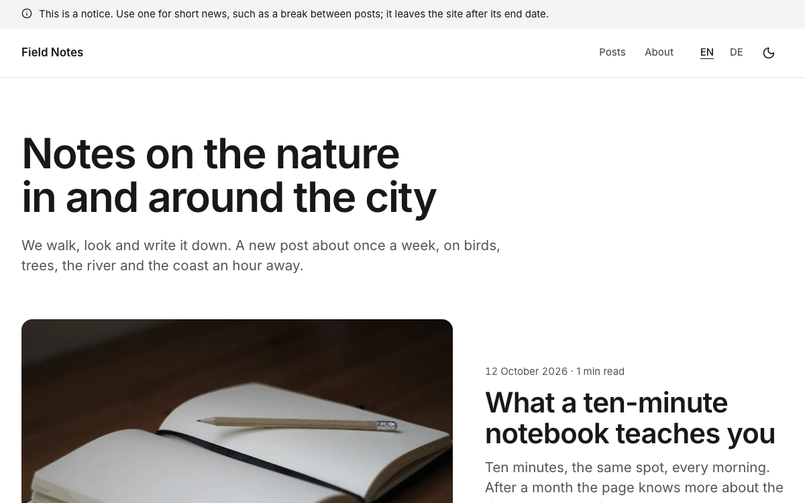
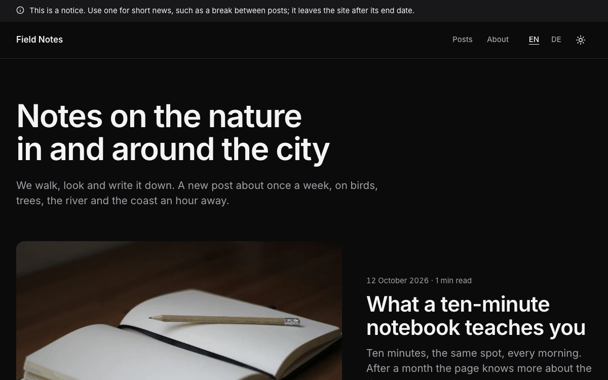

# Blog

A personal blog to start from: "Field Notes", two friends writing about the nature in and around their city. Posts
with a cover photo or none, topics with their own pages, an author page per writer, older and newer post links, a
feed per language, drafts and scheduled posts, in English and German, with light and dark mode. Built with
[Nuxt](https://nuxt.com) and [Ginko](https://github.com/lupinum-dev/ginko). All content is Markdown in `content/`;
the blog needs no account and no database.

| Light | Dark |
|---|---|
|  |  |

## Quick start

```bash
npm create ginko@latest my-blog -- --template blog
```

This copies the template into `my-blog`, keeps the languages you choose (`--locales en` for English only,
`--locales de,en` for German first), sets the site id and writes a `.env` with a new `NUXT_APP_SECRET`. Then:

```bash
cd my-blog
npm install
npm run dev
```

Or copy the folder as it is, with both languages, through Nuxt's own command:

```bash
npm create nuxt@latest my-blog -- -t github:lupinum-dev/ginko/templates/blog#release
```

Copy `.env.example` to `.env` and fill in `NUXT_APP_SECRET` (see below). The `#release` branch follows the latest
Ginko release, so both commands give you the same files.

## Deploy

[](https://vercel.com/new/clone?repository-url=https%3A%2F%2Fgithub.com%2Flupinum-dev%2Fginko%2Ftree%2Frelease%2Ftemplates%2Fblog&env=NUXT_APP_SECRET&envDescription=Signs%20the%20share%20card%20URLs.%20Any%2032%20or%20more%20random%20characters.)

Any host that runs Node works: `npm run build` writes a server to `.output/`, started with
`node .output/server/index.mjs`. Set these variables where the site runs:

| Variable | What |
|---|---|
| `NUXT_APP_SECRET` | Signs the URLs of the share cards. 32 or more random characters (`openssl rand -hex 32`). |
| `NUXT_PUBLIC_SITE_URL` | The address of the live site, for example `https://www.my-blog.com`. On Vercel the production address is used when this is not set. |

A build on Vercel stops with a message while the address is still `example.com`, so search engines never see wrong
links. Other builds (CI, your computer) only print a warning.

### Static files

The blog can also be built as static files: `npm run generate` writes every page, the feeds, the sitemap and
`llms.txt` to `.output/public/`, for any static host. Two things then wait for the next build: a scheduled post (see
"Write a post") and the end of a notice. Add the daily rebuild below.

### A daily rebuild

A post dated in the future goes online with the first build on or after its date, with a server and with static
files alike, because the content is part of the build. To publish it on its day without doing anything, rebuild the
site every morning. On Vercel: create a Deploy Hook (Project → Settings → Git → Deploy Hooks), save its URL as the
repository secret `DEPLOY_HOOK` on GitHub, and add `.github/workflows/daily-build.yml`:

```yaml
name: daily-build
on:
  schedule:
    - cron: '5 4 * * *' # every day at 04:05 UTC
  workflow_dispatch:
permissions: {}
jobs:
  build:
    runs-on: ubuntu-latest
    steps:
      - run: curl --fail --silent --show-error --request POST "$DEPLOY_HOOK"
        env:
          DEPLOY_HOOK: ${{ secrets.DEPLOY_HOOK }}
```

Other hosts have the same kind of build hook. GitHub pauses scheduled workflows in a repository without activity for
60 days; a new post is activity.

## Develop, build, preview

| Command | What |
|---|---|
| `npm run dev` | the site with live reload on http://localhost:3000; it also shows drafts and scheduled posts |
| `npm run build` | the production build in `.output/` |
| `npm run preview` | runs that build locally |
| `npm run generate` | static files instead of a server |
| `npm run lint` | ESLint |
| `npm run typecheck` | TypeScript and Vue types |

`.github/workflows/ci.yml` runs lint, typecheck and build on every push. It needs no settings.

## Write a post

A post is one Markdown file in `content/posts/`; its name is its address (`swifts-over-the-car-park.md` is
`/posts/swifts-over-the-car-park`).

```markdown
---
title: "Swifts over the car park"
description: "One or two sentences: the summary in lists, feeds and search results."
date: 2026-06-21
authors: [people/ida-wren]
tags: ["Birds"]
image:
  src: /media/swifts.jpg
  alt: "What the photo shows, for people who cannot see it"
---

The text, in Markdown. Headings start at `##`.
```

- **Draft:** add `draft: true`. The post is on no page, in no list, feed, sitemap or search, until you remove the
  line. `npm run dev` shows it, so you can read it first.
- **Schedule:** give it a `date` in the future. It stays off the site like a draft until the first build on or after
  that day (see "A daily rebuild"). `npm run dev` shows it.
- **Publish:** a `date` of today or earlier and no `draft` line. Commit and push; the next build puts it online.
- **Translation:** `swifts-over-the-car-park.de.md` with `title`, `slug` (its German address), `description`, `tags`
  and `image.alt` in German, and the text. Date, authors and the photo come from the main file. A post without a
  translation is not shown in that language.
- **Cover photo:** optional. Without one, lists and the post show text only. Put the file in `public/media/`; cover
  photos are shown at 3:2.
- **Photo with a caption in the text:** the image, and on the next line an emphasised caption:

  ```markdown
  
  *The pools below the old lookout, two hours after high water.*
  ```

- **Topics:** `tags` are free text, at most ten per post. Each tag gets a page under the posts
  (`/posts/topics/birds`) with every post that carries it; the home page and the list of posts link all of them.
  Write a tag the same way in every post. Tags are per language, so the German tag pages are the German tags'; the
  language switch on a tag page leads to the other language's list of posts.
- **Code and quotes:** fenced code blocks (with a language, such as ```` ```text ````) and `>` quotes are styled.

The reading time is counted from the text (200 words a minute). The older and the newer post are linked below each
post.

## Edit content

Every text is a Markdown file. The main language has no suffix (`home.md`); a translation adds the language code
(`home.de.md`) and repeats only what it translates.

| On the site | File |
|---|---|
| Home page: title and lead | `content/home.md`, `content/home.de.md` |
| Posts | `content/posts/<name>.md` (see "Write a post") |
| Authors (the About page and one page each) | `content/people/<n>.<name>.md`: `name`, `role`, `bio`; no photo needed, the site shows initials. A post names them in `authors` (`people/ida-wren`) |
| Notices above the header | `content/notices/<n>.<name>.md`: `text` (at most 140 characters), `until` (the last day it shows) |
| Email (footer, imprint) | `content/site.md`; add `legalName`, `street`, `postalCode` and `city` if your imprint needs them |
| Privacy policy, terms of use, imprint | `content/legal/` (placeholders: replace them before you go live) |
| Site name, description for search engines | `ginko.config.ts` (`name`, `seo.description`) |
| Menu, the line under the name in the footer, profiles elsewhere, newsletter | `app/app.config.ts` |
| Section titles, the About page's title and lead, the posts page's title and lead | `i18n/<language>.json`; the features' own texts are in `i18n/<feature>/<language>.json`, and a key set in `i18n/<language>.json` wins |

Notices show newest first: put the newest one at the top (the smallest number). At most two show at once.

## Follow: feed and newsletter

Each language has a feed at `<posts page>/rss.xml` (`/posts/rss.xml`, `/de/beitraege/rss.xml`) with the title,
summary, date and authors of every post that is online. It is linked in the footer of every page and below the list
of posts.

The blog has no form (it sends no data to other companies). For a newsletter, use a newsletter service and set its
sign-up page as `blog.newsletter` in `app/app.config.ts`; the footer then links it. Name the service in your privacy
policy.

## Make it yours

- **Name and menu.** `name` in `ginko.config.ts`; `nav` in `app/app.config.ts`, at most six links.
- **Logo.** Put the file in `public/` and set `logo: { src: '/logo.svg', width: 120, height: 32 }` in
  `app/app.config.ts`. Without it, the header shows the name.
- **Colour.** `--brand` and `--brand-foreground` in `app/assets/css/main.css`, once for light and once for dark
  (`.dark`), and the light value as `seo.color` in `ginko.config.ts` (the background of the share cards). Keep text
  on the colour at 4.5:1 or more; `DESIGN.md` has the rules and the colours of the other templates.
- **Fonts.** `--font-body` (and optionally `--font-heading`) in `main.css`. `@nuxt/fonts` downloads the font at build
  time and serves it from your site.
- **Addresses.** The words of the addresses per language are `segments` in `app/routes.ts`: `posts` (`/posts`,
  `/de/beitraege`), `tags` (the word of a topic page: `topics`, `themen`) and `about` (`/about`, `/de/ueber-uns`,
  also the authors' pages). Change a word there; pages and links follow.

`DESIGN.md` explains the tokens and components. The parts in `app/components/ui/` are
[shadcn-vue](https://www.shadcn-vue.com) components.

## Add a page

Add a Vue file in `app/pages/`, for example `app/pages/now.vue` for a "What we are doing now" page. Start it with
`<BlockPageHeader>` and call `usePageSeo()`, like `app/pages/about/[slug].vue`. Register it in `ginko.config.ts`
under `pages` (`now: localized('/now')`), so `useGinkoPath()('now')` links to it and the sitemap lists it, and add
its German word to `segments` in `app/routes.ts` (`now: { en: 'now', de: 'jetzt' }`). Put it in the menu with
`{ page: 'now', label: { en: 'Now', de: 'Jetzt' } }` in `nav`.

For pages written in Markdown, take the `pages` brick from Ginko's starter template (`app/bricks/pages.ts` and
`app/pages/[...slug].vue`, with `pages: pages({ route: localized('/[slug]'), source: 'files' })` in `bricks`); then
`content/pages/<n>.<name>.md` becomes a page.

## Add or remove a language

The languages are the `locales` list in `app/routes.ts`; the first is the main language, whose addresses have no
prefix.

- **Remove one:** delete it from `locales` and its words from `segments`, then delete its files (`*.de.md`,
  `i18n/de.json`, `i18n/*/de.json`), its line in `languages` in `ginko.config.ts`, and its `tagline` and `nav`
  labels in `app/app.config.ts`. Or start fresh with `npm create ginko@latest my-blog -- --template blog --locales en`.
- **Add one** (for example French): add `'fr'` to `locales` and to `languages`, give each word in `segments` its
  French form, add the `.fr.md` translations (a post without one is not shown in French), `i18n/fr.json`, and the
  features' texts in French (`i18n/site/fr.json`, `i18n/blog/fr.json`, `i18n/people/fr.json`: Ginko's other
  templates have them).

## Remove a feature

| Feature | Delete |
|---|---|
| Topic pages | `app/pages/news/tags/`, and the tag links in `app/pages/news/[slug].vue`, `app/pages/news/index.vue` and `app/pages/index.vue` (the "Topics" section); keep `tags` in the posts as keywords for search engines |
| Author pages | `route` of the `people` brick in `ginko.config.ts` and `app/pages/about/[slug].vue`; names are then plain text |
| The About page | `pages.team`, its `nav` item, `app/pages/team.vue`, `app/components/people/`, `i18n/people/`, `"people"` in `package.json` → `ginko.features`; keep the `people` brick while posts name authors |
| Feed | `server/middleware/news-feed.ts`, the feed link in `app/pages/news/index.vue` and `app/components/site/FooterStatus.vue` |
| Notices | `content/notices/`, the `notices` brick, `<SiteNotice />` in `app/layouts/default.vue`, `app/components/site/Notice.vue` |
| A legal text | its files in `content/legal/` |
| German | see "Add or remove a language" |
| Dark mode | `<SiteThemeToggle />` in `app/components/site/Header.vue`, `app/components/site/ThemeToggle.vue`, and `@nuxtjs/color-mode` with its `colorMode` options in `nuxt.config.ts` and `package.json` |
| Share cards | `nuxt-og-image` and `@takumi-rs/core` in `nuxt.config.ts` and `package.json`; then `NUXT_APP_SECRET` is not needed |

## Before you deploy

- [ ] `NUXT_PUBLIC_SITE_URL` (or `url` in `ginko.config.ts`) is your real address.
- [ ] `NUXT_APP_SECRET` is set where the site runs.
- [ ] The sample posts and authors are replaced by your own, and the draft `lichen-on-the-old-bridge` is deleted.
- [ ] The placeholders in `content/legal/` are replaced by your own texts, and the ones you do not need are deleted.
- [ ] `content/site.md` has your real email (and your name and address, if your country requires an imprint).
- [ ] Every photo you added has alt text in each language and a source in `MEDIA.md`.
- [ ] If you schedule posts: the daily rebuild runs.

## Move to the Studio

Ginko Studio is Lupinum's hosted editor: authors write, save drafts and set a time for a post to go live on their
phone, without Git; Today lists the drafts and the scheduled posts. It is open by invitation, and Lupinum moves your
content with you. The site stays the same code: each brick in `ginko.config.ts` loses its `source: 'files'`, and its
content then comes from the Studio. Until then, everything here works without it. Ask at
[lupinum.com](https://lupinum.com).

## Updating

Move all Ginko packages to the same version in one step:

```bash
npm install @lupinum/ginko@latest @lupinum/ginko-content@latest @lupinum/ginko-i18n@latest
```

The release notes list "Template files changed": compare those files with yours if you want the changes.

## License

Code: MIT (see `LICENSE`). Media: see `MEDIA.md`.
