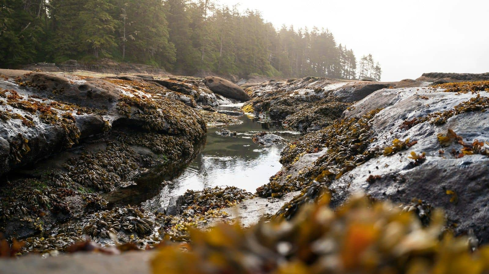

The coast is an hour from the city by train, and the best time to arrive is two hours after high water. By then the sea has pulled back from the flat rocks below the old lookout and left a row of pools behind.

*The pools below the old lookout, two hours after high water.*

## What we found

In one pool the size of a bathtub: three beadlet anemones, closed into dark red blobs; a shore crab that backed under a stone the moment my shadow fell on it; periwinkles on every surface; and a small fish, probably a blenny, that held so still I only saw it when it moved.

The seaweed matters as much as the animals. Bladder wrack hangs on the higher rocks, where the pools dry out; the lower ones keep water all day, and they hold the most life.

## How to look

- Check the tide table before you go, and start back while the water is still falling.
- Turn a stone only if you can put it back the same way up, and put it back gently.
- Look first, then touch. Most of what lives here is only visible to someone who waits.

We stayed until the first waves reached the outer pools. On the train home I drew the bathtub pool from memory. It was wrong in most details, which is a good reason to go back.
