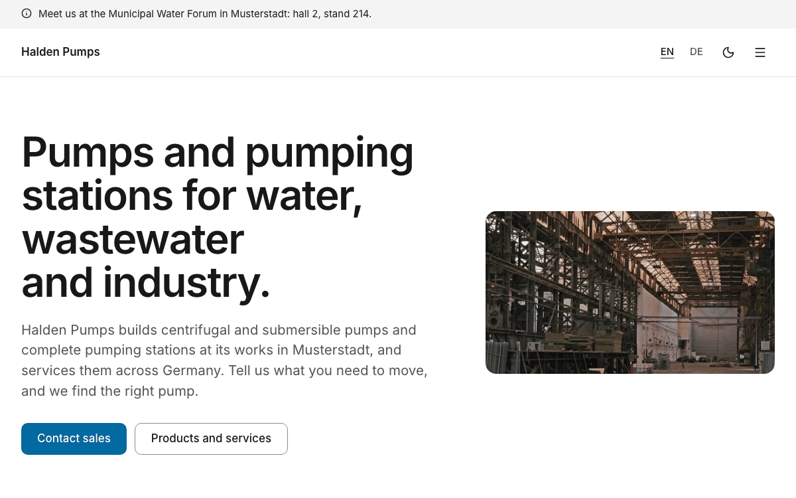
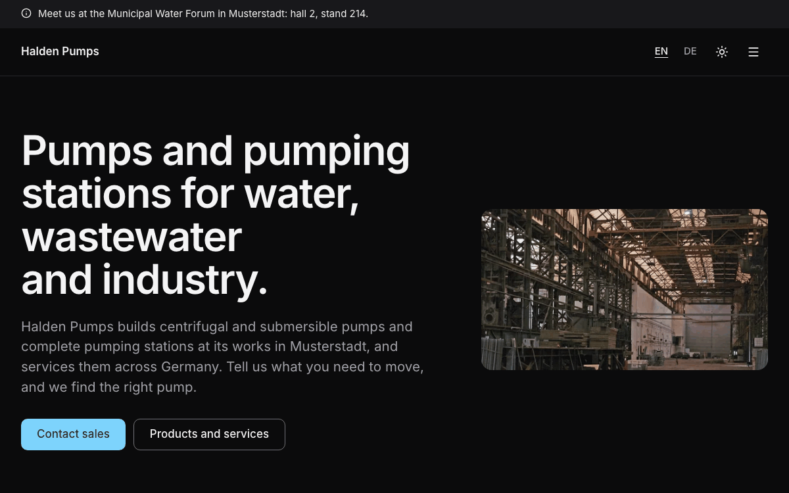

# Company

A complete website for a manufacturer or a technical business: what you make in one sentence on the home page,
products and services with key facts, a price or "on request" and a product sheet, open jobs that leave the site after
their last day, news with an RSS feed, sales and service contacts, customer logos and a quote, the trade fairs where
you show, documents to download, and legal texts. In English and German, with light and dark mode. Built with
[Nuxt](https://nuxt.com) and [Ginko](https://github.com/lupinum-dev/ginko). All content is Markdown in `content/`; the
site needs no account and no database. The sample is "Halden Pumps", a fictional German maker of industrial pumps and
pumping stations.

| Light | Dark |
|---|---|
|  |  |

## Quick start

```bash
npm create ginko@latest my-site -- --template company
```

This copies the template into `my-site`, keeps the languages you choose (`--locales en` for English only,
`--locales de,en` for German first), moves the sample dates (jobs, trade fairs, notices) to this week, sets the site
id and writes a `.env` with a new `NUXT_APP_SECRET`. Then:

```bash
cd my-site
npm install
npm run dev
```

Or copy the folder as it is, with both languages, through Nuxt's own command:

```bash
npm create nuxt@latest my-site -- -t github:lupinum-dev/ginko/templates/company#release
```

Copy `.env.example` to `.env` and fill in `NUXT_APP_SECRET` (see below). The `#release` branch follows the latest
Ginko release, so both commands give you the same files. With this route the sample dates stay as they are: a sample
job or trade fair whose day has passed is simply not shown.

## Deploy

[](https://vercel.com/new/clone?repository-url=https%3A%2F%2Fgithub.com%2Flupinum-dev%2Fginko%2Ftree%2Frelease%2Ftemplates%2Fcompany&env=NUXT_APP_SECRET&envDescription=Signs%20the%20share%20card%20URLs.%20Any%2032%20or%20more%20random%20characters.)

Any host that runs Node works: `npm run build` writes a server to `.output/`, started with
`node .output/server/index.mjs`. Set these variables where the site runs:

| Variable | What |
|---|---|
| `NUXT_APP_SECRET` | Signs the URLs of the share cards. 32 or more random characters (`openssl rand -hex 32`). |
| `NUXT_PUBLIC_SITE_URL` | The address of the live site, for example `https://www.halden-pumps.com`. On Vercel the production address is used when this is not set. |

A build on Vercel stops with a message while the address is still `example.com`, so search engines never see wrong
links. Other builds (CI, your computer) only print a warning.

The site runs as a server, not as static files: a job leaves the list, its page, the sitemap and search engines the
day after its `validUntil`, a trade fair the day after it ends and a notice the day after its last day, with no new
build. Static files (`npm run generate`) would keep them until the next build, so an expired job ad would stay online.

## Develop, build, preview

| Command | What |
|---|---|
| `npm run dev` | the site with live reload on http://localhost:3000; drafts show here |
| `npm run build` | the production build in `.output/`; drafts are left out |
| `npm run preview` | runs that build locally |
| `npm run check` | Checks the content files in a few seconds: missing or wrong fields, dates, prices, links between pages and files in `public/`. Each problem names the file and the field. |
| `npm run lint` | ESLint |
| `npm run typecheck` | TypeScript and Vue types |

`.github/workflows/ci.yml` runs lint, typecheck and build on every push. It needs no settings.

## Edit content

Every text is a Markdown file. After each change, run `npm run check`. The main language has no suffix (`about.md`); a
translation adds the language code (`about.de.md`) and repeats only what it translates: dates, prices, files and images
come from the main file. A page (a product, job, post, trade fair, legal text or free page) shows in a language only
when its translation has every required text (for a job: `title`, `slug`, `description`, `location` and the text). The
number at the start of a file name sets the order.

Files point to other entries by id: the folder and the file name without number and language, so
`content/people/1.katrin-albers.md` is `people/katrin-albers`. The `slug` is only the address on the site: renaming a
file breaks the references to it, changing the `slug` does not. A translation lists the `specs` rows of a product in
the same order as the main file: when you add, remove or move a row in the main file, do the same at the same place in
each translation (write `- {}` for a row with nothing to translate). `npm run check` reports a translation with a
different number of rows. Write dates as `2026-10-24`, times as `'09:30'`, prices as a plain number in euros (`95` or
`12.50`).

| On the site | File |
|---|---|
| Home page: what you make, lead, photo (optional) | `content/home.md` (and `home.de.md`) |
| Service line: who answers it (an entry of `content/people/`, with phone and email) and when | `content/serviceLine.md` (`contact`, `hours`; `serviceLine.de.md` translates `hours`) |
| Products and services | `content/services/<n>.<name>.md`: `title`, `summary`, `pricing` (`price` or `onRequest`, always one of the two), `price` (in euros, `390` or `12.50`, required with `pricing: price`), `duration` (minutes), `specs` (rows of `label` and `value`), `image` (3:2; give every entry one, or none), `contact` (who gets the enquiries, an entry of `content/people/`: `people/<name>`; else the email and phone of `content/site.md`), `sheet` (the product sheet, an entry of `content/downloads/`: `downloads/<name>`), the text |
| Jobs | `content/jobs/<name>.md`: `title`, `description` (the short text in the list), `location`, `employmentType` (`fullTime`, `partTime`, `freelance`, `internship`, `apprenticeship`), `remote` (`onsite`, `hybrid`, `remote`), `applyEmail` (else the email of `content/site.md`) or `applyUrl` (an application page elsewhere), `validUntil` (required: the last day to apply), the text |
| News | `content/posts/<name>.md`: `title`, `description` (the summary), `date`, `authors` (people by id, `[people/katrin-albers]`), `tags`, `image` (the cover, 3:2); `draft: true` keeps a post off the site |
| Contacts (sales, service, human resources) | `content/people/<n>.<name>.md`: `name`, `role`, `bio`, `email`, `phone`; no photo needed, the site shows initials |
| Trade fairs | `content/events/<n>.<name>.md`: `title`, `when` (`from`, `to`), `start`, `end`, `location` (venue, hall and stand), `booking` (optional: a ticket link), the text |
| Product sheets and other documents | `content/downloads/<name>.md`: `title`, `summary`, `date`, `file` (a PDF in `public/sheets/`; when you replace a sheet, delete the old PDF, or it stays online at its old address), `language` (`en`, when the file is not in the page's language) |
| Customer logos | `content/logos/<n>.<name>.md`: `name`, `image` (an SVG or PNG in `public/logos/`), `url` |
| Quotes on the home page | `content/quotes/<n>.<name>.md`: `text`, `name`, `role`; the home page shows the first |
| About us and other pages | `content/pages/<n>.<name>.md`; each translation sets its own address with `slug:` |
| Notices above the header | `content/notices/<n>.<name>.md`: `text` (at most 140 characters; in quotes when it contains a colon), `until` (the last day it shows, like `2026-12-31`; without it the notice stays until you delete the file); a translation has only `text` |
| Name, address, register entry, VAT number, email, phone | `content/site.md` (footer, imprint, enquiry and application emails, search engines) |
| Privacy policy, terms of sale, imprint | `content/legal/` (placeholders for Germany: replace them before you go live) |
| Site name, description for search engines, currency | `ginko.config.ts` (`name`, `seo.description`, `currency`) |
| Menu, footer links, the line under the name in the footer | `app/app.config.ts` |
| The home page's title in search results and tabs, section titles, the texts of the lists | `i18n/<language>.json` (`home.title` is "Industrial pumps and pumping stations"); the features' own texts are in `i18n/<feature>/<language>.json`, and a key set in `i18n/<language>.json` wins (this template renames "Team" to "Contact" and "Events" to "Trade fairs" that way) |

**Prices.** Every product or service says how it is priced: `pricing: price` with a `price`, or `pricing: onRequest`.
The page shows the price in the visitor's language with tabular numbers ("€390", "390 €"), and search engines get the
same price; an entry on request shows "On request" and gives search engines no price. A fixed price without an amount
is a mistake: the build stops on it and names the entry, and the Studio does not save it. An entry with a fixed price
offers "Ask for a date"; one on request "Request a quote". The labels say "plus VAT" (`vat: 'excluded'` in
`app/app.config.ts`, which also tells search engines); set `vat: 'included'` if your prices include it, and change
`services.lead` in `i18n/<language>.json`.

**Jobs.** Each job needs `validUntil`. The day after it, the job leaves the list, its page answers "not found", and it
is gone from the sitemap and the JobPosting data for search engines. `content/jobs/summer-internship-assembly.md`
shows this: its last day has passed, so it is nowhere on the site. Delete it for your site. With no open job, the jobs
page invites an open application by email. Applications are emails with the job title in the subject; the site has no
form.

**Contacts.** The contact page shows the service line (`content/serviceLine.md`) and the office (address, main number
and email from `content/site.md`) first, then `content/people/` in their order. The home page shows the service line
under its actions, for a visitor whose pump has stopped; the office's number is in the footer of every page and in
the home page's closing band.

Each language has a news feed at `<news page>/rss.xml` (`/news/rss.xml`, `/de/aktuelles/rss.xml`).

Notices show newest first: give a new notice a smaller number than the others (`0.` works and numbers may have gaps, so
older notices keep theirs). At most two show at once.

## Make it yours

- **Name.** `name` in `ginko.config.ts` (header, footer, page titles, the jobs card of the home page, share cards, search
  engines). The sample name also appears as text in `seo.description` there, `legalName` in `content/site.md`, the
  `lead` in `content/home*.md` and the `summary` in `content/pages/1.about*.md`. Search `content/` and `i18n/` for it
  and replace what is left. On phones the header shows `shortName` in `app/app.config.ts` instead, when you set one.
- **Menu.** `nav` in `app/app.config.ts` holds at most six items: a page of `ginko.config.ts` (`{ page: 'news', label: {
  … } }`, label per language, the same words as the page's title) or a page of `content/pages/` by id (`{ entry:
  'pages/about' }` is `content/pages/1.about.md`).
- **Logo.** Put the file in `public/` and set `logo: { src: '/logo.svg', width: 140, height: 32 }` in
  `app/app.config.ts`. Without it, the header shows the name. Search engines get it as the employer's logo of your
  jobs too.
- **Country, time zone and languages.** `country` in `ginko.config.ts` (ISO code: the public holidays, and the
  country search engines get for your address and every job), `timeZone` (dates and times of fairs and posts) and
  `languages` (the language and region of each locale, for example `de: 'de-AT'` for Austria); `currency` for prices.
  In `content/site.md`, write your own register entry and VAT number in the form of your country, or leave them out.
- **Colour.** `--brand` and `--brand-foreground` in `app/assets/css/main.css`, once for light and once for dark
  (`.dark`), and the light value as `seo.color` in `ginko.config.ts` (the background of the share cards). In dark mode,
  `--brand-surface` and `--brand-surface-foreground` colour the home page's closing band. This template uses sky blue
  (`#0369a1`, dark `#7dd3fc`, and a deep blue `#0c4a6e` for the closing band in dark mode). Text on the colour needs a
  contrast of at least 4.5:1 in both modes; check each pair with a contrast checker (for example
  webaim.org/resources/contrastchecker). `DESIGN.md` has the rules.
- **Fonts.** `--font-body` in `main.css`. `@nuxt/fonts` downloads the fonts at build time and serves them from your
  site.
- **Organisation type.** `organization: 'Organization'` in `app/app.config.ts` tells search engines what you are;
  address and contact come from `content/site.md`, the country from `country` in `ginko.config.ts`.
- **Addresses.** The words of the addresses per language (`services` → `products`, `produkte`; `jobs` → `karriere`)
  are in `app/routes.ts`. Change a word there; the pages, the menu and the links follow.

`DESIGN.md` explains the tokens and components. The parts in `app/components/ui/` are
[shadcn-vue](https://www.shadcn-vue.com) components.

## Add a page

**A text page:** add `content/pages/2.quality.md` with a `title`, an optional `summary` and the text below the
frontmatter. It appears at `/quality`; each translation sets its own address with `slug:` (`slug: qualitaet` in
`2.quality.de.md` gives `/de/qualitaet`). Add `{ entry: 'pages/quality' }` to `nav` or `footer` in `app/app.config.ts`
to link it.

**A page with its own layout:** add a Vue file in `app/pages/`, for example `app/pages/references.vue`. Start it with
`<BlockPageHeader>` and call `usePageSeo()`, like `app/pages/downloads.vue`. Register it in `ginko.config.ts` under
`pages` (`references: localized('/references')`) and add the words of its address per language to `segments` in
`app/routes.ts` (`references: { en: 'references', de: 'referenzen' }`). It then answers at `/references` and
`/de/referenzen`, and `useGinkoPath()('references')` links to it.

## Add or remove a language

The languages are the `locales` list in `app/routes.ts`; the first is the main language, whose addresses have no
prefix.

- **Remove one:** start fresh with `npm create ginko@latest my-site -- --template company --locales en`, or delete it
  from `locales` and from the maps in `app/routes.ts` and `languages` in `ginko.config.ts`, then delete its files
  (`*.de.md`, `i18n/de.json`, `i18n/*/de.json`).
- **Add one** (for example French): add `'fr'` to `locales` and a word per address in `app/routes.ts`, its tag to
  `languages` in `ginko.config.ts` (`fr: 'fr-FR'`), and the French labels of `nav`, `footer` and `tagline` in
  `app/app.config.ts` (without them they show in the main language). Add `i18n/fr.json` and the texts of every
  `i18n/<feature>/en.json` translated as `i18n/<feature>/fr.json`.
- **Translate the content** as `content/**/*.fr.md`. A page shows in the new language only once it has its
  translation file: without one it is not on the French site, the menu leaves it out, and links to it lead to its page
  in the main language. Translate at least the legal texts (`content/legal/`) before the language goes live.

## Add an enquiry or application form

The site sends no data to other companies, so it has no forms: "Request a quote" and "Apply by email" open an email
with the product or job in the subject. To use an application portal instead, give a job an `applyUrl`; for an
enquiry form, link to a form service of your choice. Name the service in your privacy policy.

## Remove a feature

Links in the content name pages by their key (`[contact]($page.team)`). After you remove a page, search `content/` for
`$page.<key>` and remove or change those links: the build stops on a link that leads nowhere.

| Feature | Delete |
|---|---|
| Products and services | `content/services/`, the `services` brick and `pages.services` in `ginko.config.ts`, its `nav` item, the "Products and services" section and the hero's second button in `app/pages/index.vue`, `app/pages/services/`, `app/bricks/services.ts`, `app/composables/useServices.ts`, `i18n/services/`, the `services` keys in `i18n/<language>.json`, and `"services"` in `package.json` → `ginko.features` |
| Jobs | `content/jobs/`, the `jobs` brick and `pages.jobs`, its `nav` item, the jobs card in `app/pages/index.vue` (`next`), `app/pages/jobs/`, `app/components/jobs/`, `app/composables/useJobs.ts`, `i18n/jobs/`, `"jobs"` in `ginko.features`, the `jobs` and `home.jobs` keys in `i18n/<language>.json`, and rename `home.next` ("Jobs and trade fairs") to "Trade fairs" (the section leaves the home page by itself when no fair is coming up); the links to `$page.jobs` in `content/posts/apprentices-start*.md` and `content/pages/1.about*.md` |
| News | `content/posts/`, the `posts` brick and `pages.news`, its `nav` item, the "News" section on the home page, `app/pages/news/`, `app/components/blog/`, `app/composables/useBlog.ts`, `server/middleware/news-feed.ts`, `i18n/blog/`, `"blog"` in `ginko.features` |
| Contact page | `pages.team`, its `nav` item, the hero's "Contact sales" button and the closing `<BlockCta>` band (its `action` is required, so delete the whole band, then the unused `site` and `contact` lines of its script) in `app/pages/index.vue`, `app/pages/team.vue`, `app/components/people/`, `i18n/people/`, `"people"` in `ginko.features`; the `$page.team` links in `content/posts/saturday-service*.md` and `content/pages/1.about*.md` (drop the link or the sentence around it); keep the `people` brick while posts, products or the service line name people |
| Trade fairs | `content/events/`, the `events` brick and `pages.events`, its `nav` item, the fair card in `app/pages/index.vue` (`next`, `useEventText`), `app/pages/events/`, `app/components/event/`, `app/composables/useEvents.ts`, `i18n/events/`, `"events"` in `ginko.features`, the notice about the fair in `content/notices/` |
| Downloads | `content/downloads/`, `public/sheets/`, the `downloads` brick and `pages.downloads`, its `footer` item, `downloads: 'downloads'` of the `services` brick and the `sheet` lines in `content/services/`, `app/pages/downloads.vue`, `app/components/downloads/`, `i18n/downloads/`, `"downloads"` in `ginko.features`; the links to `$page.downloads` in `content/posts/ts-pumps-atex*.md` |
| Logos and quotes | `content/logos/`, `content/quotes/`, `public/logos/`, the `logos` and `quotes` bricks, the "References" section on the home page, `app/bricks/logos-quotes.ts`, `app/components/block/Logos.vue`, `Quote.vue`, `"logos-quotes"` in `ginko.features` |
| Notices | `content/notices/`, the `notices` brick, `<SiteNotice />` in `app/layouts/default.vue`, `app/components/site/Notice.vue` |
| A language | see "Add or remove a language" |
| Dark mode | `<SiteThemeToggle />` in `app/components/site/Header.vue`, `app/components/site/ThemeToggle.vue`, and `@nuxtjs/color-mode` with its `colorMode` options in `nuxt.config.ts` and `package.json` |
| Share cards | `nuxt-og-image` and `@takumi-rs/core` in `nuxt.config.ts` and `package.json`; then `NUXT_APP_SECRET` is not needed |

## Before you deploy

- [ ] `NUXT_PUBLIC_SITE_URL` (or `url` in `ginko.config.ts`) is your real address.
- [ ] `NUXT_APP_SECRET` is set where the site runs.
- [ ] `content/site.md` shows your real legal name, address, register entry, VAT number and contact details.
- [ ] Every product and service has your price or `pricing: onRequest`, and the "plus VAT" labels fit your prices.
- [ ] Every job has the right `validUntil` and application address; the sample jobs and the ended sample
      (`content/jobs/summer-internship-assembly.md`) are deleted or replaced.
- [ ] The sample phone numbers and emails are replaced: they reach nobody (the numbers start their local part
      with 0, the emails end in .example), so a forgotten one fails quietly.
- [ ] The placeholders in `content/legal/` are replaced by your own texts, and the ones you do not need are deleted.
- [ ] The sample quotes, customer logos, product sheets (`public/sheets/`) and photos are replaced or deleted; quotes
      and logos only with the customer's permission.
- [ ] Every photo you added has alt text in each language file that shows it and a source in `MEDIA.md`.

## Move to the Studio

Ginko Studio is Lupinum's hosted editor: your team posts a job ad or a news post from the browser, changes a price or
uploads a new product sheet, and the Today page lists the jobs that end within 7 days (also by email on Sundays) and
how old the newest post is. It is open by invitation, and Lupinum moves your content with you. The site stays the same
code: each brick in `ginko.config.ts` loses its `source: 'files'`, and its content then comes from the Studio. Until
then, everything here works without it. Ask at [lupinum.com](https://lupinum.com).

## Updating

Move all Ginko packages to the same version in one step:

```bash
npm install @lupinum/ginko@latest @lupinum/ginko-content@latest @lupinum/ginko-i18n@latest
```

The release notes list "Template files changed": compare those files with yours if you want the changes.

## License

Code: MIT (see `LICENSE`). Media: see `MEDIA.md`.
