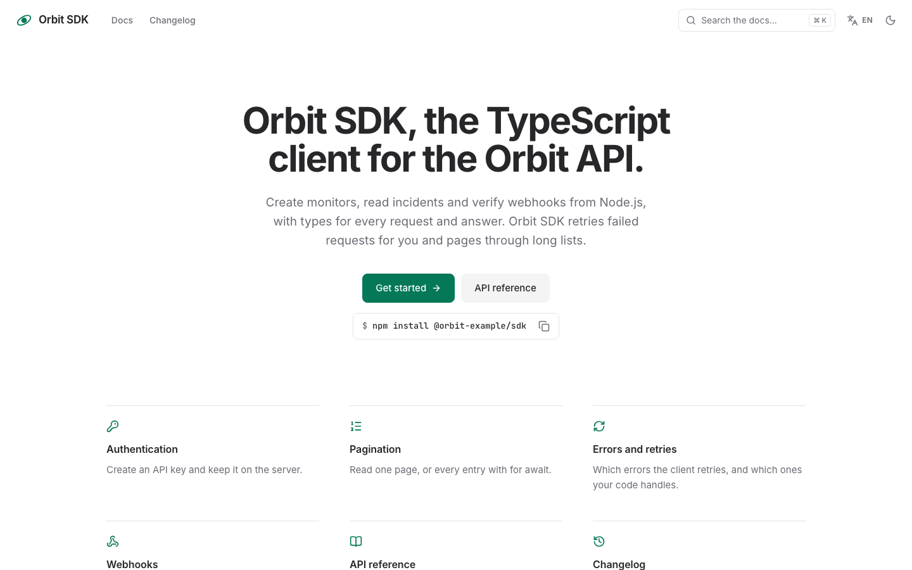
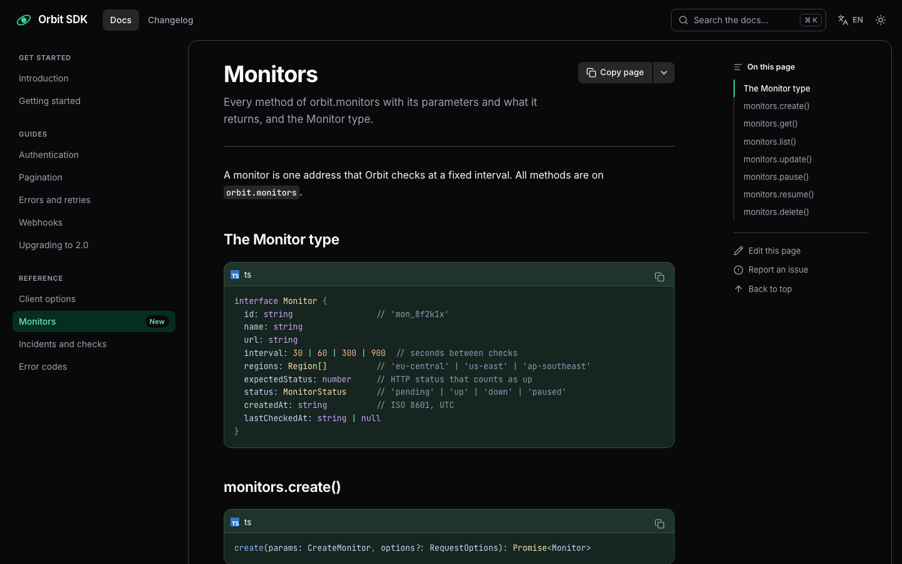

# Docs

A documentation site to start from: a start page, guides and a reference in three sections, a changelog, search,
and the same pages in English and German, with light and dark mode. The sample documents "Orbit SDK", a made-up
TypeScript client for a made-up monitoring API. Built with [Nuxt](https://nuxt.com),
[Ginko](https://github.com/lupinum-dev/ginko) and its docs layer
[`@lupinum/ginko-docs`](https://www.npmjs.com/package/@lupinum/ginko-docs). All content is Markdown in `content/`;
the site needs no account and no database.

| Light | Dark |
|---|---|
|  |  |

## Quick start

```bash
npm create ginko@latest my-docs -- --template docs
```

This copies the template into `my-docs`, keeps the languages you choose (`--locales en` for English only,
`--locales de,en` for German first), sets the site id and writes a `.env` with a new `NUXT_APP_SECRET`. Then:

```bash
cd my-docs
npm install
npm run dev
```

Or copy the folder as it is, with both languages, through Nuxt's own command:

```bash
npm create nuxt@latest my-docs -- -t github:lupinum-dev/ginko/templates/docs#release
```

Copy `.env.example` to `.env` and fill in `NUXT_APP_SECRET` (see below). The `#release` branch follows the latest
Ginko release, so both commands give you the same files.

## Deploy

[](https://vercel.com/new/clone?repository-url=https%3A%2F%2Fgithub.com%2Flupinum-dev%2Fginko%2Ftree%2Frelease%2Ftemplates%2Fdocs&env=NUXT_APP_SECRET&envDescription=Signs%20the%20share%20card%20URLs.%20Any%2032%20or%20more%20random%20characters.)

Any host that runs Node works: `npm run build` writes a server to `.output/`, started with
`node .output/server/index.mjs`. Set these variables where the site runs:

| Variable | What |
|---|---|
| `NUXT_APP_SECRET` | Signs the URLs of the share cards. 32 or more random characters (`openssl rand -hex 32`). |
| `NUXT_PUBLIC_SITE_URL` | The address of the live site, for example `https://docs.my-library.dev`. On Vercel the production address is used when this is not set. |

A build on Vercel stops with a message while the address is still `example.com`, so search engines never see wrong
links. Other builds (CI, your computer) only print a warning.

### Static files

Docs change only when you change a file, so they can also be plain files on any static host (GitHub Pages,
Netlify, an S3 bucket):

```bash
NUXT_PUBLIC_SITE_URL=https://docs.my-library.dev npm run generate
```

The pages, their Markdown versions (`/docs/<page>.md`), the search index, the sitemap, `llms.txt` and the share
cards are written to `.output/public/`; upload that folder. A static site needs no `NUXT_APP_SECRET`. What changes:

- Every change goes live with the next build, so let your host build on every push (Vercel, Netlify and Cloudflare
  Pages do this by default).
- This template has no scheduled posts and no notices with an end date, so nothing goes stale between builds. If you
  add a banner (`docs.banner` in `app/app.config.ts`), it changes with the next build as well.
- The MCP endpoint for AI agents (`POST /__ginko/docs-mcp`) needs the server; a static site has none. Agents can
  still read `llms.txt` and the `.md` version of every page.

## Develop, build, preview

| Command | What |
|---|---|
| `npm run dev` | the site with live reload on http://localhost:3000 |
| `npm run build` | the production build in `.output/` |
| `npm run preview` | runs that build locally |
| `npm run generate` | static files instead of a server (see above) |
| `npm run lint` | ESLint |
| `npm run typecheck` | TypeScript and Vue types |

`.github/workflows/ci.yml` runs lint, typecheck and build on every push. It needs no settings. The build also checks
every link inside the pages: a link to a page or a heading that does not exist stops it, with the file and the link.

## Edit content

Every text is a Markdown file. The main language has no suffix (`webhooks.md`); a translation adds the language code
(`webhooks.de.md`). The number at the start of a file name sets the order in the navigation.

| On the site | File |
|---|---|
| Start page: title, text, install command, the two buttons, the cards, the text below | `content/home.md`, `content/home.de.md` |
| Docs pages | `content/docs/<n>.<name>.md`; the German file sets its own address with `slug:` |
| Changelog | `content/changelog/v<x>-<y>-<z>.md` with `version` and `date`; the translation holds only the text |
| Site name, description for search engines | `ginko.config.ts` (`name`, `seo.description`) |
| Logo, footer links, "Edit this page" | `app/app.config.ts` |
| Texts of your own links | `i18n/en.json`, `i18n/de.json` |

**A docs page** has `title` and `description` (the lead under the title, and the text search engines show) in its
frontmatter. `section: Guides` starts a group in the navigation; the pages after it belong to it until the next
`section`. `badge: New` puts a label next to the title. The address is the file name without the number
(`3.authentication.md` → `/docs/authentication`) or the `slug`.

**Links between pages** are written as `[Webhooks]($docs.webhooks)`: the name of the file, not its address. The link
then goes to the page in the reader's language and keeps working when a translation has another address. Add
`#heading` for a section. `[Changelog]($page.changelog)` links to the changelog. The start page's buttons and cards
take the same form (`href: $docs.getting-started`).

**A new release** is one new file in `content/changelog/`, for example `v2-2-0.md`:

```md
---
version: 2.2.0
date: 2026-11-20
---

### Added

- `incidents.list()` takes `since`.
```

Add `v2-2-0.de.md` with the German text (no frontmatter needed). The changelog orders releases by `date`, newest
first. Use dashes in the file name: a dot would read as a language code.

**An outdated translation.** When you change an English page, change its `.de.md` file in the same commit, or note
it in the pull request. In the files there is no marker for "outdated"; in Ginko Studio (below), an English change
marks the German page as outdated under **Inhalte > Übersetzungen**.

**A page without a translation** stays out of the German navigation and search. Links to it from German pages go to
the English page, and on that page the language menu says "Not translated: opens the start page" next to Deutsch, so
no reader lands on a missing page. `content/docs/7.upgrading-to-v2.md` is such a page.

## Make it yours

- **Name and logo.** `name` in `ginko.config.ts` is the name in the header and in page titles. The logo is
  `public/logo.svg` (and `public/logo-dark.svg` for dark mode), set in `app/app.config.ts` (`docs.logo`); remove
  `logo` to show only the name. Replace `public/favicon.svg` too.
- **Colour.** The five tokens in `app/assets/css/main.css`, and the light `--primary` as `seo.color` in
  `ginko.config.ts` (the background of the share cards). `DESIGN.md` has the rules and the contrast of each pair.
- **Fonts.** `--font-sans` and `--font-mono` in `main.css`. The layer serves Inter and JetBrains Mono itself; another
  face needs its files and an `@font-face` rule. The layer always preloads Inter, so a site with another face still
  loads it.
- **Repository.** `docs.repository` in `app/app.config.ts` adds "Edit this page" and "Report an issue" under every
  page. Set your own Git host; for GitHub, `{ url: 'https://github.com/<you>/<repo>' }` is enough. If your docs live in
  a subfolder of a larger repository, set `editUrl: '{url}/edit/{branch}/docs/{source}'`.
- **Header and footer links.** `docs.nav` (after Docs and Changelog) and `docs.footer.links` in `app/app.config.ts`;
  the text of each is `docs.nav.<id>` or `docs.footer.<id>` in `i18n/<language>.json`. `docs.social` adds icon links
  such as GitHub. `docs.banner` shows a notice above the header that readers can close.

Every option of the layer is in the [`@lupinum/ginko-docs` README](https://www.npmjs.com/package/@lupinum/ginko-docs).

## Add a page

Add a Markdown file to `content/docs/`, for example `content/docs/12.testing.md`:

```md
---
title: Testing
description: Run your tests against a mock of the Orbit API.
---

## Use a test key
…
```

It answers at `/docs/testing`, comes last in the navigation (the number sets the place) and is in the search. Add
`content/docs/12.testing.de.md` with a German `title`, `description`, `slug` and text for `/de/docs/<slug>`.

The Markdown components work in every page: `::callout`, `::steps`, `::code-group`, `::tabs`, `::card` and more
(see the [components](https://github.com/lupinum-dev/ginko/tree/main/packages/ginko-components)). The build checks
every component and its props.

A page with its own Vue code goes into `app/pages/` (for example `app/pages/playground.vue`); a page you define there
wins over the layer's page at the same address.

## Add or remove a language

The languages are the `locales` list in `ginko.config.ts`; the first is the main language, whose addresses have no
prefix.

- **Remove one:** delete it from `locales`, then delete its files (`*.de.md`, `i18n/de.json`).
  Or start fresh with `npm create ginko@latest my-docs -- --template docs --locales en`.
- **Add one** (for example French): add `'fr'` to `locales` (`pages.home` follows the list), add
  `content/**/*.fr.md` translations (pages without one stay in English, see "A page without a translation") and
  `i18n/fr.json` with the texts of `i18n/en.json` translated. The layer's own texts (search, navigation, "On this
  page") exist in English and German; for another language, add them under `docs` in `i18n/fr.json` (the keys are in
  the layer's `i18n/en.json`).

## Remove a feature

| Feature | Delete |
|---|---|
| Start page | `content/home*.md` and `home: docsHome()` in `ginko.config.ts`; `/` then opens the first docs page |
| Changelog | `content/changelog/`, `changelog: changelogCollection()` and `changelog: changelogPages(…)` in `ginko.config.ts` |
| German | see "Add or remove a language" |
| "Edit this page" | `repository` in `app/app.config.ts` |
| "Copy page" and its menu | set `markdownActions: { copy: false, openIn: [] }` in `app/app.config.ts` |
| Share cards | `nuxt-og-image` and `@takumi-rs/core` in `nuxt.config.ts` and `package.json`; then `NUXT_APP_SECRET` is not needed |

## Before you deploy

- [ ] `NUXT_PUBLIC_SITE_URL` (or `url` in `ginko.config.ts`) is your real address.
- [ ] `NUXT_APP_SECRET` is set where the site runs (not needed for a static build).
- [ ] `docs.repository` and the footer links in `app/app.config.ts` point at your project, not at `example.com`.
- [ ] The Orbit sample pages are replaced by your own, and `public/logo.svg`, `logo-dark.svg` and `favicon.svg` by
  your logo.
- [ ] `npm run build` passes: it stops on a broken link inside a page.

## Move to the Studio

Ginko Studio is Lupinum's hosted editor: people who do not use Git change pages and changelog entries in the
browser, and see which translations are behind under **Inhalte > Übersetzungen**. It is open by invitation, and
Lupinum moves your content with you and switches the bricks of `ginko.config.ts` from files to the Studio; the pages
and their code stay the same. Until then, everything here works without it. Ask at [lupinum.com](https://lupinum.com).

## Updating

Move all Ginko packages to the same version in one step:

```bash
npm install @lupinum/ginko@latest @lupinum/ginko-content@latest @lupinum/ginko-i18n@latest @lupinum/ginko-docs@latest
```

The release notes list "Template files changed": compare those files with yours if you want the changes.

## License

Code: MIT (see `LICENSE`). Media: see `MEDIA.md`.
