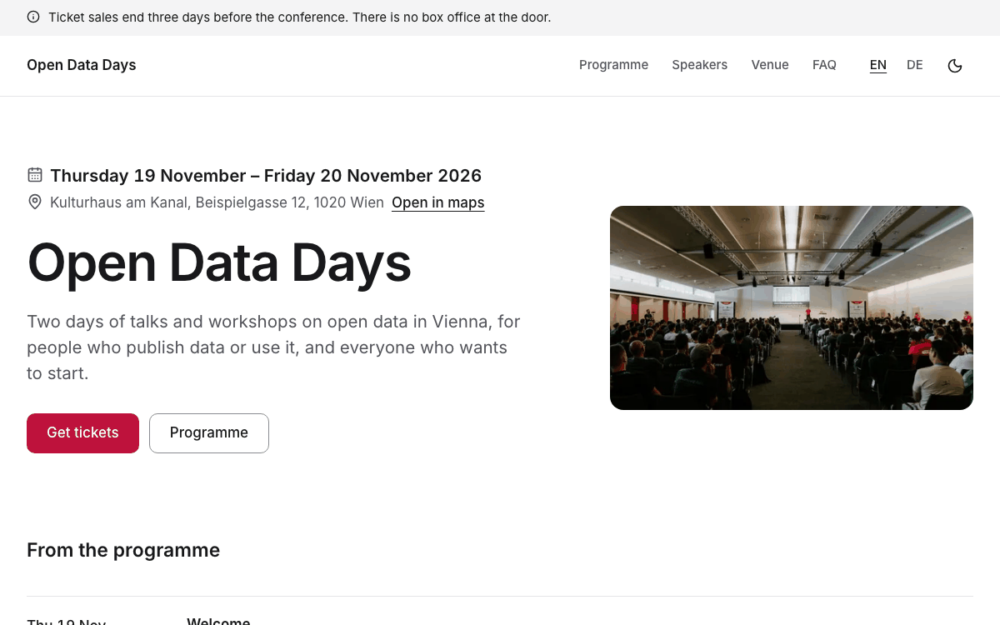
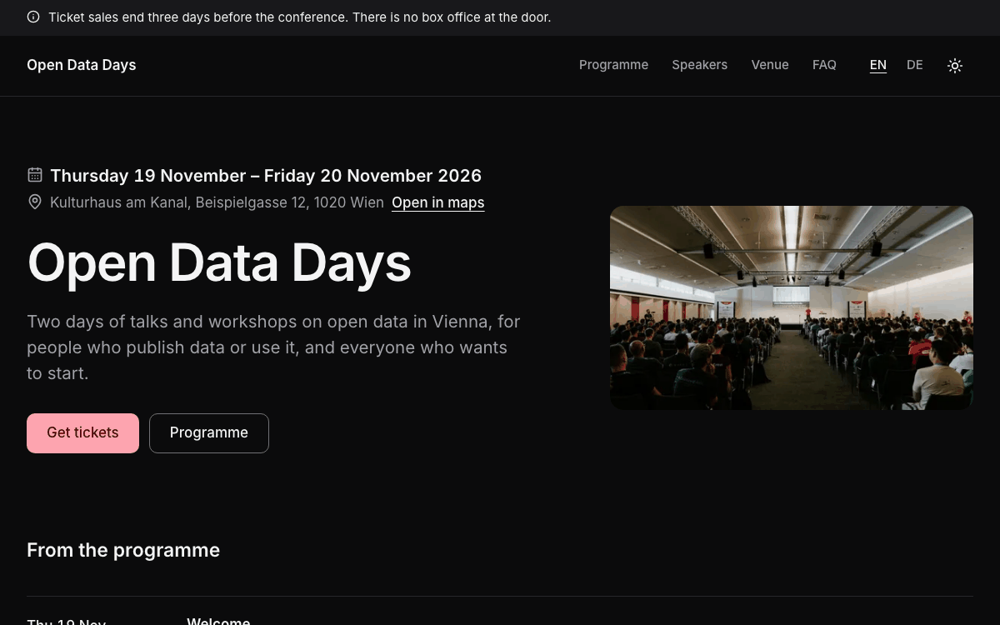

# Events

A complete website for a conference, a festival or a community event over one or more days: the dates, the place
with a link to the map and the ticket link on the first screen, the programme by day with time, room, speakers and
"sold out" or "cancelled", a page per speaker, "now and next" on the home page during the event, questions and
answers, sponsor logos, photos of last year, and legal texts. In English and German, with light and dark mode. Built
with [Nuxt](https://nuxt.com) and [Ginko](https://github.com/lupinum-dev/ginko). All content is Markdown in
`content/`; the site needs no account and no database. The sample is "Open Data Days", a two-day community
conference about open data in Vienna.

| Light | Dark |
|---|---|
|  |  |

## Quick start

```bash
npm create ginko@latest my-site -- --template events
```

This copies the template into `my-site`, keeps the languages you choose (`--locales en,de` for English and German,
`--locales de,en` for German first, `--locales en` for English only), moves the sample dates to this week (the
conference stays a few weeks ahead), sets the site id and writes a `.env` with a new `NUXT_APP_SECRET`. Then:

```bash
cd my-site
npm install
npm run dev
```

Or copy the folder as it is, with both languages, through Nuxt's own command:

```bash
npm create nuxt@latest my-site -- -t github:lupinum-dev/ginko/templates/events#release
```

Copy `.env.example` to `.env` and fill in `NUXT_APP_SECRET` (see below). The `#release` branch follows the latest
Ginko release, so both commands give you the same files. With this route the sample dates stay as they are: move
them yourself (see "Dates and times").

## Deploy

[](https://vercel.com/new/clone?repository-url=https%3A%2F%2Fgithub.com%2Flupinum-dev%2Fginko%2Ftree%2Frelease%2Ftemplates%2Fevents&env=NUXT_APP_SECRET&envDescription=Signs%20the%20share%20card%20URLs.%20Any%2032%20or%20more%20random%20characters.)

Any host that runs Node works: `npm run build` writes a server to `.output/`, started with
`node .output/server/index.mjs`. Set these variables where the site runs:

| Variable | What |
|---|---|
| `NUXT_APP_SECRET` | Signs the URLs of the share cards. 32 or more random characters (`openssl rand -hex 32`). |
| `NUXT_PUBLIC_SITE_URL` | The address of the live site, for example `https://www.open-data-days.org`. On Vercel the production address is used when this is not set. |

A build on Vercel stops with a message while the address is still `example.com`, so search engines never see wrong
links. Other builds (CI, your computer) only print a warning.

The site runs as a server, not as static files: a session leaves the programme the day after it took place, an event
the day after its last day, a notice the day after its `until`, and "now and next" follows the clock, all with no new
build. Static files (`npm run generate`) would keep the old state until the next build.

## Develop, build, preview

| Command | What |
|---|---|
| `npm run dev` | the site with live reload on http://localhost:3000 |
| `npm run build` | the production build in `.output/` |
| `npm run preview` | runs that build locally |
| `npm run lint` | ESLint |
| `npm run typecheck` | TypeScript and Vue types |

`.github/workflows/ci.yml` runs lint, typecheck and build on every push. It needs no settings.

## Edit content

Every text is a Markdown file. The main language has no suffix (`welcome.md`); a translation adds the language code
(`welcome.de.md`) and repeats only the texts: dates, times, rooms, speakers, prices and photos come from the main
file. The number at the start of a file name sets the order.

| On the site | File |
|---|---|
| Home page: title, lead, photo | `content/home.md` (and `home.de.md`) |
| The conference and other dates: title, days (`when`), `start` (first day), `end` (last day), `location`, `price`, `booking` (the ticket shop), `soldOut`, the text | `content/events/<n>.<name>.md`; the home page shows the first coming event that has sessions, and an event leaves the site after its last day |
| The programme: one file per session with `event` (`events/open-data-days`), `date`, `from`, `to`, `title`, `room`, `speakers` (`[people/lena-hofer]`), `status` (`open`, `soldOut` or `cancelled`) | `content/sessions/<name>.md`; the translation holds only the `title` |
| Speakers: `name`, `slug` (the address), `role`, `bio`, `photo` (optional; without one the site shows initials) | `content/people/<n>.<name>.md`; the number sets the order on the speakers page and the home page (the first four) |
| Questions and answers | `content/faq/<n>.<name>.md`: `question`, `answer`; the home page shows the first three |
| Sponsor and partner logos | `content/logos/<n>.<name>.md`: `name`, `image` (an SVG or PNG in `public/logos/`), `url` |
| Photos of last year | `content/gallery.md` (and the alt texts in each translation, same order) |
| Venue, code of conduct, sponsoring and other pages | `content/pages/<n>.<name>.md`; each translation sets its own address with `slug:` |
| Notices above the header ("Ticket sales end three days before the conference") | `content/notices/<n>.<name>.md`: `text` (at most 140 characters), `until` (the last day it shows) |
| Name, address, register number, email, phone of the organiser (footer, imprint, search engines) | `content/site.md` |
| Privacy policy, terms, imprint | `content/legal/` (placeholders for Austria: replace them before you go live) |
| Site name, description for search engines, time zone, country | `ginko.config.ts` (`name`, `seo.description`, `timeZone`, `country`) |
| Menu, footer links, the line under the name in the footer | `app/app.config.ts` |
| Texts of the home page sections and the FAQ page; the page titles and leads of the programme, speakers and dates | `i18n/<language>.json`; the features' own texts are in `i18n/<feature>/<language>.json`, and a key set in `i18n/<language>.json` wins (as `events.book` = "Get tickets" there does) |

**A session moves or changes.** Change `from`, `to`, `room` or `status` in its main file (`content/sessions/<name>.md`),
nothing else. The programme, the speaker pages, "now and next", the event page and the data for search engines all
read that one file, so they cannot disagree. Write a room's name only in the main file, never in a translation: a
room is a name on a sign (Festsaal, Studio), and a second copy in another language would stay behind when the room
changes. `status: soldOut` shows "Sold out", `status: cancelled` shows "Cancelled"; a cancelled session stays in the
programme, so people who planned to go see it.

**Dates and times.** All times are in the site's time zone (`timeZone: 'Europe/Vienna'` in `ginko.config.ts`), as
they are on the printed programme; search engines get them with the right offset for summer or winter time. A
session leaves the programme the day after its `date`. "Now and next" shows on the home page on days that have
sessions: the sessions running now and the ones that start next, as of the minute the page was loaded, and it moves
on every minute while the page is open.

**Tickets.** The site sells nothing: `booking` in the event's file is the address of your ticket shop, and "Get
tickets" leads there. When the event is full, set `soldOut: true`: the button gives way to "Fully booked". An event
without `booking` shows the organiser's phone and email instead.

Notices show newest first: put the newest one at the top (the smallest number). At most two show at once.

## Make it yours

- **Name and menu.** `name` in `ginko.config.ts`; `nav` in `app/app.config.ts` holds at most six items: a page of
  `ginko.config.ts` (`{ page: 'programme', label: { … } }`, label per language, the same words as the page's title) or
  a page of `content/pages/` by id (`{ entry: 'pages/venue' }` is `content/pages/1.venue.md`).
- **Logo.** Put the file in `public/` and set `logo: { src: '/logo.svg', width: 120, height: 32 }` in
  `app/app.config.ts`. Without it, the header shows the name.
- **Colour.** `--brand` and `--brand-foreground` in `app/assets/css/main.css`, once for light and once for dark
  (`.dark`), and the light value as `seo.color` in `ginko.config.ts` (the background of the share cards). This
  template uses rose (`#be123c`, dark `#fda4af`). Keep text on the colour at 4.5:1 or more; `DESIGN.md` has the rules.
- **Fonts.** `--font-body` in `main.css`. `@nuxt/fonts` downloads the fonts at build time and serves them from your
  site.
- **Organisation type.** `organization: 'Organization'` in `app/app.config.ts` tells search engines what you are;
  address and contact come from `content/site.md`, the country from `country` in `ginko.config.ts`.
- **Addresses.** The words of the addresses per language (`programme` → `programm`, `speakers` → `vortragende`) are in
  `app/routes.ts`. Change a word there; the pages, the menu and the links follow.

`DESIGN.md` explains the tokens and components. The parts in `app/components/ui/` are
[shadcn-vue](https://www.shadcn-vue.com) components.

## Add a page

**A text page:** add `content/pages/4.travel-grants.md` with a `title`, an optional `summary` and the text below the
frontmatter. It appears at `/travel-grants`; each translation sets its own address with `slug:` (`slug: reisekosten`
in `4.travel-grants.de.md` gives `/de/reisekosten`). Add `{ entry: 'pages/travel-grants' }` to `nav` or `footer` in
`app/app.config.ts` to link it.

**A page with its own layout:** add a Vue file in `app/pages/`, for example `app/pages/workshops.vue`. Start it with
`<BlockPageHeader>` and call `usePageSeo()`, like `app/pages/faq.vue`. Register it in `ginko.config.ts` under `pages`
(`workshops: localized('/workshops')`) and add the words of its address per language to `segments` in
`app/routes.ts` (`workshops: { en: 'workshops', de: 'workshops' }`). It then answers at `/workshops` and
`/de/workshops`, and `useGinkoPath()('workshops')` links to it.

## Add or remove a language

The languages are the `locales` list in `app/routes.ts`; the first is the main language, whose addresses have no
prefix.

- **Remove one:** start fresh with `npm create ginko@latest my-site -- --template events --locales en`, or delete it
  from `locales` and from the maps in `app/routes.ts` and `languages` in `ginko.config.ts`, then delete its files
  (`*.de.md`, `i18n/de.json`, `i18n/*/de.json`).
- **Add one** (for example Italian): add `'it'` to `locales` and a word per address in `app/routes.ts`, its tag to
  `languages` in `ginko.config.ts` (`it: 'it-IT'`), and the Italian labels of `nav`, `footer` and `tagline` in
  `app/app.config.ts` (without them they show in the main language). Add `i18n/it.json` and the texts of every
  `i18n/<feature>/en.json` translated as `i18n/<feature>/it.json`.
- **Translate the content** as `content/**/*.it.md`. A session needs only its `title`; a speaker their `role` and
  `bio`. A page, legal text or event shows in the new language only once it has its translation file: without one
  it is not on the Italian site, the menu leaves it out, and links to it lead to its page in the main language.
  Translate at least the legal texts (`content/legal/`) before the language goes live.

## Tickets, registration and contact forms

The site sends no data to other companies, so it has no forms and takes no payments. "Get tickets" leads to your
ticket shop (`booking` in the event's file); a registration or call for proposals works the same way: link to a form
service of your choice from a page. Name these services in your privacy policy. The venue page links to OpenStreetMap
instead of embedding a map, so no map loads from another company.

## Remove a feature

Links in the content name pages by their key (`[questions page]($page.faq)`). After you remove a page, search
`content/` for `$page.<key>` and remove or change those links: the build stops on a link that leads nowhere.

| Feature | Delete |
|---|---|
| Programme and speakers | `content/sessions/`, `content/people/`, the `sessions` and `people` bricks and `pages.programme` and `pages.speakers` in `ginko.config.ts`, their `nav` items, "Now and next", "From the programme" and "Speakers" on the home page and `useSessions` there, `app/pages/programme.vue`, `app/pages/speakers/`, `app/components/session/`, `app/components/event/Programme.vue`, `app/composables/useSessions.ts`, `app/utils/sessions.ts`, `i18n/sessions/`, and `"sessions"` in `package.json` → `ginko.features`; the home page then shows the next event |
| Questions and answers | `content/faq/`, the `faq` brick and `pages.faq`, its `nav` item, "Questions" on the home page, `app/pages/faq.vue`, `app/components/block/Faq.vue`, `app/components/ui/accordion/`, `"faq"` in `ginko.features`; the link to `$page.faq` in `content/pages/1.venue*.md` |
| Sponsor logos | `content/logos/`, `public/logos/`, the `logos` brick, "Sponsors and partners" on the home page, `app/bricks/logos-quotes.ts`, `app/components/block/Logos.vue`, `Quote.vue`, `"logos-quotes"` in `ginko.features`; and the Sponsoring page (`content/pages/3.sponsoring*.md`, its `footer` item) if you want none |
| Last year's photos | `content/gallery.md`, `public/media/talk.jpg`, `workshop-tables.jpg`, `coffee-break.jpg`, the `gallery` brick, "Last year" on the home page, `app/components/block/Gallery.vue`, `app/components/site/Lightbox.vue`, `i18n/gallery/`, `"gallery"` in `ginko.features` |
| Notices | `content/notices/`, the `notices` brick, `<SiteNotice />` in `app/layouts/default.vue`, `app/components/site/Notice.vue` |
| A language | see "Add or remove a language" |
| Dark mode | `<SiteThemeToggle />` in `app/components/site/Header.vue`, `app/components/site/ThemeToggle.vue`, and `@nuxtjs/color-mode` with its `colorMode` options in `nuxt.config.ts` and `package.json` |
| Share cards | `nuxt-og-image` and `@takumi-rs/core` in `nuxt.config.ts` and `package.json`; then `NUXT_APP_SECRET` is not needed |

The dates (`content/events/`, the events list and the event pages) are the core of this template: keep them.

## Before you deploy

- [ ] `NUXT_PUBLIC_SITE_URL` (or `url` in `ginko.config.ts`) is your real address.
- [ ] `NUXT_APP_SECRET` is set where the site runs.
- [ ] `content/site.md` shows the organiser's real name, address, register number and contact details.
- [ ] The event in `content/events/` has your dates, place and the address of your ticket shop in `booking`.
- [ ] The sample sessions, speakers, questions, sponsor logos and photos are replaced or deleted; speakers' names,
      roles and photos only with their permission.
- [ ] The placeholders in `content/legal/` are replaced by your own texts, and the ones you do not need are deleted.
- [ ] Every photo you added has alt text in each language and a source in `MEDIA.md`.

## Move to the Studio

Ginko Studio is Lupinum's hosted editor: during the event, someone on the team moves a session, changes its room or
marks it sold out or cancelled from their phone in a few taps, and it is right on every page at once; notices end by
themselves, and the Today page shows the next event and how many speakers have no bio yet. It is
open by invitation, and Lupinum moves your content with you. The site stays the same code: each brick in
`ginko.config.ts` loses its `source: 'files'`, and its content then comes from the Studio. Until then, everything here
works without it. Ask at [lupinum.com](https://lupinum.com).

## Updating

Move all Ginko packages to the same version in one step:

```bash
npm install @lupinum/ginko@latest @lupinum/ginko-content@latest @lupinum/ginko-i18n@latest
```

The release notes list "Template files changed": compare those files with yours if you want the changes.

## License

Code: MIT (see `LICENSE`). Media: see `MEDIA.md`.
