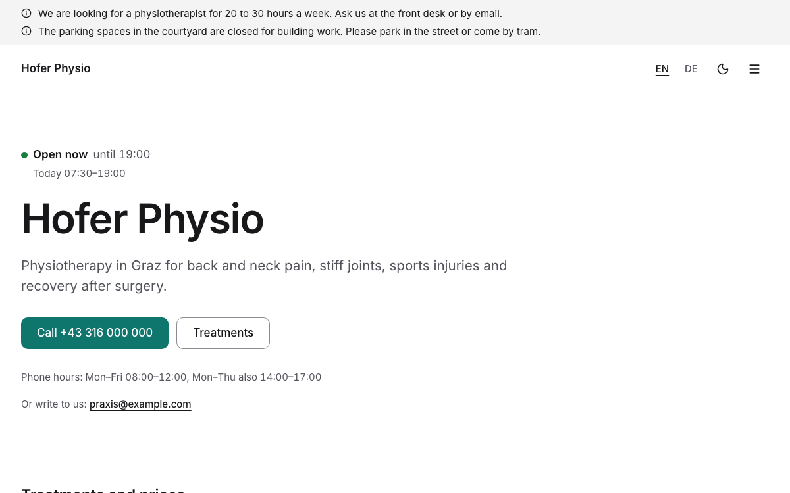
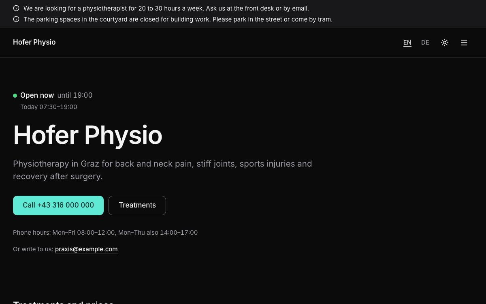

# Local business

A complete website for a practice, studio or shop that people visit by appointment: whether you are open today and
until when, your treatments or services with price and duration, how to book (call during your phone hours, email, or
your online booking page), where you are and how to get in (address, "Open in maps", step-free access, parking, public
transport), the people who look after your customers, questions and answers, photos, and legal texts. In English and
German, with light and dark mode. Built with [Nuxt](https://nuxt.com) and [Ginko](https://github.com/lupinum-dev/ginko).
All content is Markdown in `content/`; the site needs no account and no database. The sample is "Hofer Physio", a
fictional physiotherapy practice in Graz, Austria.

| Light | Dark |
|---|---|
|  |  |

## Quick start

```bash
npm create ginko@latest my-site -- --template local-business
```

This copies the template into `my-site`, keeps the languages you choose (`--locales en` for English only,
`--locales de,en` for German first), moves the sample dates (the notices) to this week, sets the site id and writes a
`.env` with a new `NUXT_APP_SECRET`. Then:

```bash
cd my-site
npm install
npm run dev
```

Or copy the folder as it is, with both languages, through Nuxt's own command:

```bash
npm create nuxt@latest my-site -- -t github:lupinum-dev/ginko/templates/local-business#release
```

Copy `.env.example` to `.env` and fill in `NUXT_APP_SECRET` (see below). The `#release` branch follows the latest
Ginko release, so both commands give you the same files. With this route the sample dates stay as they are: a sample
notice whose last day has passed is simply not shown.

## Deploy

[](https://vercel.com/new/clone?repository-url=https%3A%2F%2Fgithub.com%2Flupinum-dev%2Fginko%2Ftree%2Frelease%2Ftemplates%2Flocal-business&env=NUXT_APP_SECRET&envDescription=Signs%20the%20share%20card%20URLs.%20Any%2032%20or%20more%20random%20characters.)

Any host that runs Node works: `npm run build` writes a server to `.output/`, started with
`node .output/server/index.mjs`. Set these variables where the site runs:

| Variable | What |
|---|---|
| `NUXT_APP_SECRET` | Signs the URLs of the share cards. 32 or more random characters (`openssl rand -hex 32`). |
| `NUXT_PUBLIC_SITE_URL` | The address of the live site, for example `https://www.hofer-physio.at`. On Vercel the production address is used when this is not set. |

A build on Vercel stops with a message while the address is still `example.com`, so search engines never see wrong
links. Other builds (CI, your computer) only print a warning.

The site runs as a server, not as static files: "Open now", today's hours and the closures follow the clock and the
calendar, and a notice leaves the site the day after its last day, with no new build. Static files
(`npm run generate`) would keep showing the hours and notices of the day they were built.

## Develop, build, preview

| Command | What |
|---|---|
| `npm run dev` | the site with live reload on http://localhost:3000 |
| `npm run check` | Checks the content files in a few seconds: missing or wrong fields, dates, prices, links between pages and files in `public/`. Each problem names the file and the field. |
| `npm run build` | the production build in `.output/` |
| `npm run preview` | runs that build locally |
| `npm run lint` | ESLint |
| `npm run typecheck` | TypeScript and Vue types |

`.github/workflows/ci.yml` runs lint, typecheck and build on every push. It needs no settings.

## Edit content

Every text is a Markdown file. The main language has no suffix (`about.md`); a translation adds the language code
(`about.de.md`) and repeats only what it translates: times, dates, prices and images come from the main file. A page
(a treatment, a legal text or a free page) shows in a language only when its translation has every required text. The
number at the start of a file name sets the order. After each change, run `npm run check`.

Write dates as `2026-10-24`, times as `'09:30'`, prices as a plain number in euros (`95` or `12.50`). Files point to other entries by id: the folder and the file name without number and language, so `content/people/1.anna-hofer.md` is `people/anna-hofer`. The `slug` is only the address on the site: renaming a file breaks the references to it, changing the `slug` does not. A translation lists the rows in the same order as the main file: when you add, remove or move a row in the main file (an exception, a photo, a spec), do the same at the same place in each translation (write `- {}` for a row with nothing to translate). `npm run check` reports a translation with a different number of rows.

| On the site | File |
|---|---|
| Home page: name, one line about you, photo (optional, 16:9; without one the text takes the full width) | `content/home.md` (and `home.de.md`, which translates the alt text) |
| Opening hours: the week, closures, public holidays | `content/hours.md`: `week` (each day `closed: true`, or `from1` and `to1`, and `from2` and `to2` for a break), `exceptions` (`when` with `from` and `to`, `reason`, `closed: true`; or `closed: false` with other times for those days), `holidays` (`closed`, `sunday` or `normal`); `hours.de.md` translates the reasons, row by row: when you add, remove or move an exception in `hours.md`, do the same at the same place in `hours.de.md` |
| Other hours for a time of year or from a date | `content/hourPlans/<n>.<name>.md`: `label`, `from`, `to` (optional; without it the plan runs on with no end), `yearly` (`true`: the same dates every year; `false`: once), `week` (all seven days, like `week` in `hours.md`) |
| Phone hours, online booking, access, parking, public transport | `content/visit.md`: `phoneHours` (short, as people read it; parts separated by commas, `Mon–Fri 08:00–12:00, Mon–Thu also 14:00–17:00`), `bookingUrl` (optional: your booking page elsewhere), `access`, `parking`, `transit` |
| Treatments or services | `content/services/<n>.<name>.md`: `title`, `summary`, `pricing` (`price` or `onRequest`, always one of the two), `price` (in euros, `65` or `12.50`, required with `pricing: price`), `duration` (minutes), `specs` (rows of `label` and `value`; `<name>.de.md` translates them row by row), `contact` (optional: the person of `content/people/` who gives the treatment, `people/anna-hofer`; the page says "Treated by Anna Hofer"), `image` (3:2; give every entry one, or none), the text |
| The team | `content/people/<n>.<name>.md`: `name`, `role` (with the qualification), `bio`, `photo` (optional, 4:5; without one the site shows initials), `email` and `phone` (optional, only a person's own) |
| Questions and answers | `content/faq/<n>.<name>.md`: `question`, `answer`; the home page shows the first three |
| Photos of the practice (contact page) | `content/gallery.md`: `images`, each with `src` and `alt`; `gallery.de.md` translates the alt texts, row by row: add, remove or move a photo in both files |
| About us and other pages | `content/pages/<n>.<name>.md`; each translation sets its own address with `slug:` |
| Notices above the header | `content/notices/<n>.<name>.md`: `text` (at most 140 characters; in quotes when it contains a colon) and `until` (the last day it shows, like `2026-12-31`; without it the notice stays until you delete the file); a translation has only `text` |
| Name, address, register entry, email, phone | `content/site.md` (the call and email buttons on the home, contact and treatment pages, footer, imprint, search engines) |
| Privacy policy, payment and cancellation, imprint | `content/legal/` (privacy policy and imprint are placeholders for Austria; the payment and cancellation terms are a sample that matches the FAQ: replace all three before you go live) |
| Site name, description for search engines, currency, country | `ginko.config.ts` (`name`, `seo.description`, `currency`, `country`) |
| Menu, footer links, the line under the name in the footer | `app/app.config.ts` |
| The home page's title in search results and tabs, section titles, the texts of the pages | `i18n/<language>.json` (`home.title` is "Physiotherapy in Graz"); the features' own texts are in `i18n/<feature>/<language>.json`, and a key set in `i18n/<language>.json` wins (this template renames "Services" to "Treatments" that way) |

**Opening hours.** One rule shows everywhere: the line at the top of the home page ("Open now until 19:00", "Opens
today at 07:30", "Closed today" with the reason), the week with today marked, the footer of every page and the
opening hours search engines read. Public holidays come from `country` in `ginko.config.ts` (`AT`: the Austrian
holidays); with `holidays: closed` they show as closures, like your own. The list of closures shows the next 90 days,
and leaves out a public holiday on a day you are closed anyway. To close on a single day, add it to `exceptions` with
the same `from` and `to`. Times use 24 hours (`'07:30'`).

A plan from `content/hourPlans/` replaces the whole week for its dates, so it lists all seven days; to add Saturday hours, copy the week of `hours.md` and change Saturday. When two plans cover the same day, the one with the later `from` date wins. For a yearly plan that is the date in its file, not this year's, so new hours from a date after a yearly plan's `from` replace that plan from then on. Give the yearly plan a later `from`, or end the new plan before it.

**Prices.** Every treatment says how it is priced: `pricing: price` with a `price`, or `pricing: onRequest` (the home
visits). The page shows the price in the visitor's language ("€65", "€ 65"), and search engines get the same price; an
entry on request shows "On request" and gives search engines no price. A fixed price without an amount is a mistake:
the build stops on it and names the entry, and the Studio does not save it. Physiotherapy is exempt from VAT in
Austria, so the labels say "Price" with no VAT note. If your prices include VAT, set `vat: 'included'` in
`app/app.config.ts`: the labels then say "incl. VAT", and so does the data for search engines.

**Booking.** The home page, the contact page and every treatment page show the same buttons
(`app/components/visit/Book.vue`): "Call" with your number, your phone hours right under it, "Send an email" (on a
treatment page with the treatment in the subject) and "Book online" when `content/visit.md` has a `bookingUrl`.
The order is fixed: call, then email, then online booking (each only when it exists), and the first one is the main
button. A treatment page shows these buttons through
`app/components/services/Actions.vue`, which the services feature shows in place of its own. The site has no booking
form (see "Add a booking or contact form").

**Notices** show newest first: give the newest one a smaller number than the others: `0.` works and numbers may have gaps, so older notices keep theirs. At most two show at once, at the
top of every page, so keep them for news a visitor needs before they come (a closure, building work), not for news
about you (a job opening belongs on the About page). When a notice changes access or parking, check
`content/visit.md` too, so the directions say the same. The sample has one about the courtyard parking; delete it for
your site.

## Make it yours

- **Name.** `name` in `ginko.config.ts` (header, footer, share cards, search engines). The sample name also appears as text in `seo.description` of `ginko.config.ts`, `title` of `content/home.md`, `legalName` of `content/site.md` (with the legal form) and `summary` of `content/pages/1.about.md` and `1.about.de.md`. Search `content/` for it and replace what is left.
- **Menu.** `nav` in `app/app.config.ts` holds at most six items: a page of
  `ginko.config.ts` (`{ page: 'faq', label: { … } }`, label per language, the same words as the page's title) or a
  page of `content/pages/` by id (`{ entry: 'pages/about' }` is `content/pages/1.about.md`).
- **Logo.** Put the file in `public/` and set `logo: { src: '/logo.svg', width: 140, height: 32 }` in
  `app/app.config.ts`. Without it, the header shows the name.
- **Colour.** `--brand` and `--brand-foreground` in `app/assets/css/main.css`, once for light and once for dark
  (`.dark`), and the light value as `seo.color` in `ginko.config.ts` (the background of the share cards). This
  template uses teal (`#0f766e`, dark `#5eead4`). Text on the colour needs a contrast of at least 4.5:1 in both modes; check each pair with a contrast checker (for example webaim.org/resources/contrastchecker). `DESIGN.md` has the rules.
- **Fonts.** `--font-body` in `main.css`. `@nuxt/fonts` downloads the fonts at build time and serves them from your
  site.
- **Kind of business.** The home page tells search engines that you are a `Physiotherapy` (a kind of LocalBusiness)
  with your opening hours: change `'@type'` in `app/pages/index.vue` for another kind (`Dentist`,
  `HealthAndBeautyBusiness`, `Store` …). Address and contact come from `content/site.md`, the country from `country`
  in `ginko.config.ts`.
- **Addresses.** The words of the addresses per language (`services` → `treatments`, `behandlungen`; `faq` →
  `faq`, `fragen`) are in `app/routes.ts`. Change a word there; the pages, the menu and the links follow.

`DESIGN.md` explains the tokens and components. The parts in `app/components/ui/` are
[shadcn-vue](https://www.shadcn-vue.com) components.

## Add a page

**A text page:** add `content/pages/2.first-visit.md` with a `title`, an optional `summary` and the text below the
frontmatter. It appears at `/first-visit`; each translation sets its own address with `slug:` (`slug: erster-besuch`
in `2.first-visit.de.md` gives `/de/erster-besuch`). Add `{ entry: 'pages/first-visit' }` to `nav` or `footer` in
`app/app.config.ts` to link it.

**A page with its own layout:** add a Vue file in `app/pages/`, for example `app/pages/prices.vue`. Start it with
`<BlockPageHeader>` and call `usePageSeo()`, like `app/pages/faq.vue`. Register it in `ginko.config.ts` under `pages`
(`prices: localized('/prices')`) and add the words of its address per language to `segments` in `app/routes.ts`
(`prices: { en: 'prices', de: 'preise' }`). It then answers at `/prices` and `/de/preise`, and
`useGinkoPath()('prices')` links to it.

## Add or remove a language

The languages are the `locales` list in `app/routes.ts`; the first is the main language, whose addresses have no
prefix.

- **Remove one:** start fresh with `npm create ginko@latest my-site -- --template local-business --locales en`, or
  delete it from `locales` and from the maps in `app/routes.ts` and `languages` in `ginko.config.ts`, then delete its
  files (`*.de.md`, `i18n/de.json`, `i18n/*/de.json`).
- **Add one** (for example Italian): add `'it'` to `locales` and a word per address in `app/routes.ts`, its tag to
  `languages` in `ginko.config.ts` (`it: 'it-IT'`), and the Italian labels of `nav`, `footer` and `tagline` in
  `app/app.config.ts` (without them they show in the main language). Add `i18n/it.json` and the texts of every
  `i18n/<feature>/en.json` translated as `i18n/<feature>/it.json`.
- **Translate the content** as `content/**/*.it.md`. A page shows in the new language only once it has its
  translation file: without one it is not on the Italian site, the menu leaves it out, and links to it lead to its
  page in the main language. Translate at least the legal texts (`content/legal/`) before the language goes live.

## Add a booking or contact form

The site sends no data to other companies, so it has no forms: "Call" and "Send an email" use the visitor's phone and
email program, and "Open in maps" opens OpenStreetMap only when they choose it. To take
bookings online, set `bookingUrl` in `content/visit.md` to the page of your booking service: the home and contact pages
then link to it. Name the service in your privacy policy.

## Remove a feature

Links in the content name pages by their key (`[how to find us]($page.contact)`). After you remove a page, search
`content/` for `$page.<key>` and remove or change those links: the build stops on a link that leads nowhere.

| Feature | Delete |
|---|---|
| Treatments | `content/services/`, the `services` brick and `pages.services` in `ginko.config.ts`, `services` in `segments` of `app/routes.ts`, its `nav` item, in `app/pages/index.vue` the "Treatments and prices" section and its script lines (`useGinko('services')` and `useServiceCards`), `app/pages/services/`, `app/components/services/`, `app/bricks/services.ts`, `app/composables/useServices.ts`, `i18n/services/`, the `services` keys in `i18n/<language>.json`, the link to `$page.services` in `content/legal/2.terms*.md`, and `"services"` in `package.json` → `ginko.features` |
| Team page | `pages.team`, `team` in `segments` of `app/routes.ts`, its `nav` item, in `app/pages/index.vue` the "Our team" section and its `useGinko('people')` line, `app/pages/team.vue`, `app/components/people/`, `i18n/people/`, `"people"` in `ginko.features`, the link to `$page.team` in `content/pages/1.about*.md`, the "Treated by" link in `app/components/services/Actions.vue` (keep the name without the link); keep the `people` brick in `ginko.config.ts` (a treatment's optional `contact` names a person); `content/people/` may be empty |
| Questions and answers | `content/faq/`, the `faq` brick and `pages.faq`, `faq` in `segments` of `app/routes.ts`, its `nav` item, in `app/pages/index.vue` the "Questions" section and its script lines (`useGinko('faq')` and `faqItems`), `app/pages/faq.vue`, `app/components/block/Faq.vue`, `app/components/ui/accordion/`, the `faq` keys in `i18n/<language>.json`, `"faq"` in `ginko.features` |
| Photos | `content/gallery.md` and `content/gallery.*.md`; in `ginko.config.ts` the `gallery` brick and `gallery` in the `@lupinum/ginko/basics` import; in `app/pages/contact.vue` "The practice" section and its script lines (`useGinko('gallery')` and `images`); `app/components/block/Gallery.vue`, `app/components/site/Lightbox.vue`, `i18n/gallery/`, the `contact.practice` key in `i18n/<language>.json`, `"gallery"` in `package.json` → `ginko.features` |
| Opening hours | not on its own: the home page, the contact page and the footer are built around them. Without fixed hours ("by appointment only"), keep the feature and mark every day `closed: true`, then remove `<HoursToday />` and the hours sections from `app/pages/index.vue` and `app/pages/contact.vue`, the `openingHoursJsonLd` part of the home page's `usePageSeo`, and `app/components/site/FooterStatus.vue` (else every footer says "Closed today") |
| Hours from a date | `content/hourPlans/`, the `hourPlans` brick and `plans: 'hourPlans'` of the `hours` brick in `ginko.config.ts` |
| Notices | `content/notices/`, the `notices` brick, `<SiteNotice />` in `app/layouts/default.vue`, `app/components/site/Notice.vue` |
| A language | see "Add or remove a language" |
| Dark mode | `<SiteThemeToggle />` in `app/components/site/Header.vue`, `app/components/site/ThemeToggle.vue`, and `@nuxtjs/color-mode` with its `colorMode` options in `nuxt.config.ts` and `package.json` |
| Share cards | `nuxt-og-image` and `@takumi-rs/core` in `nuxt.config.ts` and `package.json`; then `NUXT_APP_SECRET` is not needed |

## Before you deploy

- [ ] `NUXT_PUBLIC_SITE_URL` (or `url` in `ginko.config.ts`) is your real address.
- [ ] `NUXT_APP_SECRET` is set where the site runs.
- [ ] `content/site.md` shows your real legal name, address, register entry and contact details.
- [ ] `content/hours.md` has your week, your closures for the coming months and your rule for public holidays;
      `content/hourPlans/` only holds hours you really use.
- [ ] Every treatment has your price or `pricing: onRequest`, and the price labels fit your VAT (`vat` in
      `app/app.config.ts`).
- [ ] `content/visit.md` has your phone hours and your directions; the FAQ states your real cancellation rule.
- [ ] The sample people, notices and photos are replaced or deleted; people only with their permission.
- [ ] The placeholders in `content/legal/` are replaced by your own texts, and the ones you do not need are deleted.
- [ ] Every photo you added has alt text in each language file that shows it and a source in `MEDIA.md`.

## Move to the Studio

Ginko Studio is Lupinum's hosted editor: from a phone, you close today ("Closed today" with a reason), add your
holidays, post a notice until a date or change a price, and the Today page starts with today's hours, the notices,
the treatments and the team. It is open by invitation, and Lupinum moves your content with you. The site stays the
same code: each brick in `ginko.config.ts` loses its `source: 'files'`, and its content then comes from the Studio.
Until then, everything here works without it. Ask at [lupinum.com](https://lupinum.com).

## Updating

Move all Ginko packages to the same version in one step:

```bash
npm install @lupinum/ginko@latest @lupinum/ginko-content@latest @lupinum/ginko-i18n@latest
```

The release notes list "Template files changed": compare those files with yours if you want the changes.

## License

Code: MIT (see `LICENSE`). Media: see `MEDIA.md`.
