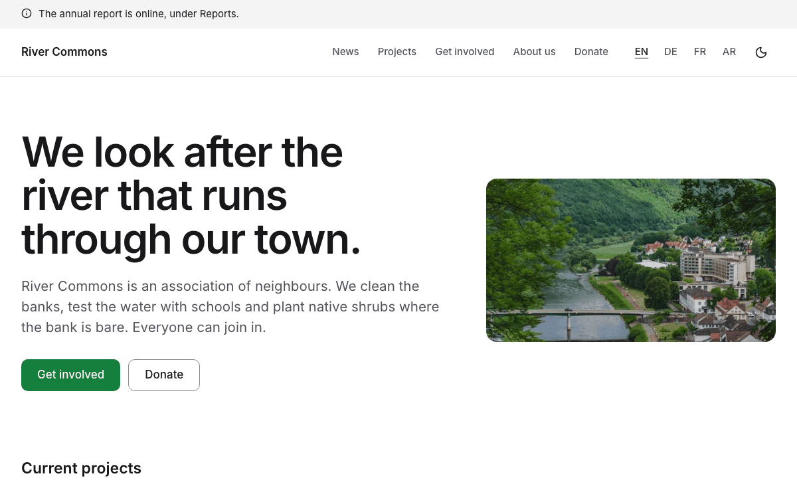
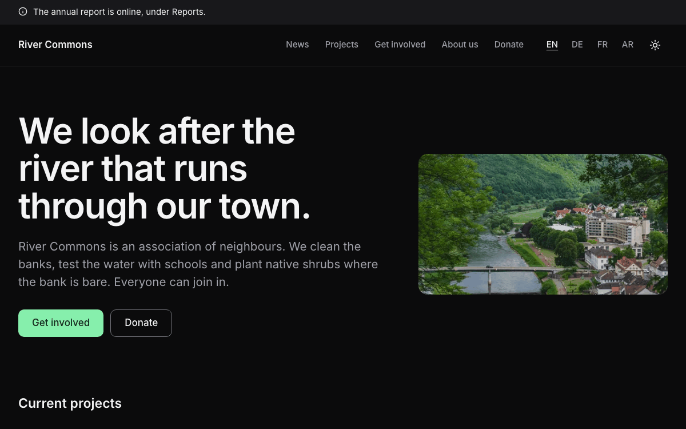

# Nonprofit

A complete website for an association, a club or a small NGO: a mission statement on the home page, news with an RSS
feed, projects and campaigns that end on a date, the team, reports to download, partner logos and quotes, a donate
page that links to your donation service, and legal texts. In English, German, French and Arabic (right to left), with
light and dark mode. Built with [Nuxt](https://nuxt.com) and [Ginko](https://github.com/lupinum-dev/ginko). All
content is Markdown in `content/`; the site needs no account and no database. The sample is "River Commons", a river
clean-up association in a German town.

| Light | Dark |
|---|---|
|  |  |

## Quick start

```bash
npm create ginko@latest my-site -- --template nonprofit
```

This copies the template into `my-site`, keeps the languages you choose (`--locales en,de` for English and German,
`--locales de,en` for German first, `--locales en` for English only), moves the sample dates to this week, sets the
site id and writes a `.env` with a new `NUXT_APP_SECRET`. Then:

```bash
cd my-site
npm install
npm run dev
```

Or copy the folder as it is, with all four languages, through Nuxt's own command:

```bash
npm create nuxt@latest my-site -- -t github:lupinum-dev/ginko/templates/nonprofit#release
```

Copy `.env.example` to `.env` and fill in `NUXT_APP_SECRET` (see below). The `#release` branch follows the latest
Ginko release, so both commands give you the same files.

## Deploy

[](https://vercel.com/new/clone?repository-url=https%3A%2F%2Fgithub.com%2Flupinum-dev%2Fginko%2Ftree%2Frelease%2Ftemplates%2Fnonprofit&env=NUXT_APP_SECRET&envDescription=Signs%20the%20share%20card%20URLs.%20Any%2032%20or%20more%20random%20characters.)

Any host that runs Node works: `npm run build` writes a server to `.output/`, started with
`node .output/server/index.mjs`. Set these variables where the site runs:

| Variable | What |
|---|---|
| `NUXT_APP_SECRET` | Signs the URLs of the share cards. 32 or more random characters (`openssl rand -hex 32`). |
| `NUXT_PUBLIC_SITE_URL` | The address of the live site, for example `https://www.river-commons.org`. On Vercel the production address is used when this is not set. |

A build on Vercel stops with a message while the address is still `example.com`, so search engines never see wrong
links. Other builds (CI, your computer) only print a warning.

The site runs as a server, not as static files: a campaign leaves the site the day after it ends and a notice the day
after its last day, with no new build. Static files (`npm run generate`) would keep them until the next build.

## Develop, build, preview

| Command | What |
|---|---|
| `npm run dev` | the site with live reload on http://localhost:3000; drafts show here |
| `npm run build` | the production build in `.output/`; drafts are left out |
| `npm run preview` | runs that build locally |
| `npm run lint` | ESLint |
| `npm run typecheck` | TypeScript and Vue types |

`.github/workflows/ci.yml` runs lint, typecheck and build on every push. It needs no settings.

## Edit content

Every text is a Markdown file. The main language has no suffix (`about.md`); a translation adds the language code
(`about.de.md`) and repeats only what it translates: dates, files and images come from the main file. The number at
the start of a file name sets the order.

| On the site | File |
|---|---|
| Home page: mission, lead, photo | `content/home.md` (and `home.de.md`, `home.fr.md`, `home.ar.md`) |
| News | `content/posts/<name>.md`: `title`, `description` (the summary), `date`, `authors` (people by id, `[people/jana-becker]`), `tags`, `image` (the cover, 3:2); `draft: true` keeps a post off the site |
| Projects and campaigns | `content/projects/<n>.<name>.md`: `title`, `summary`, `image`, the text; `ends` for a campaign (the last day it shows) |
| Team and board | `content/people/<n>.<name>.md`: `name`, `role`, `bio`, `email`, `phone`; no photo needed, the site shows initials |
| Reports to download | `content/downloads/<name>.md`: `title`, `summary`, `date`, `file` (a PDF in `public/reports/`), `language` (`en`, when the file is not in your main language) |
| Partner logos | `content/logos/<n>.<name>.md`: `name`, `image` (an SVG or PNG in `public/logos/`), `url` |
| Quotes on the home page | `content/quotes/<n>.<name>.md`: `text`, `name`, `role`; the home page shows the first |
| About, Get involved, Donate and other pages | `content/pages/<n>.<name>.md`; each translation sets its own address with `slug:` |
| Notices above the header | `content/notices/<n>.<name>.md`: `text` (at most 140 characters), `until` (the last day it shows) |
| Events | `content/events/` (no page yet: see "Events" below) |
| Name, address, register entry, email, phone | `content/site.md` (footer, imprint, search engines) |
| Privacy policy, terms, imprint | `content/legal/` (placeholders for Germany: replace them before you go live) |
| Site name, description for search engines | `ginko.config.ts` (`name`, `seo.description`) |
| Menu, footer links, the line under the name in the footer | `app/app.config.ts` |
| Section titles and texts of the home page and the lists | `i18n/<language>.json`; the features' own texts are in `i18n/<feature>/<language>.json`, and a key set in `i18n/<language>.json` wins |

Each language has a news feed at `<news page>/rss.xml` (`/news/rss.xml`, `/de/aktuelles/rss.xml`, …) with the title,
summary, date and authors of every post that is online.

Notices show newest first: put the newest one at the top (the smallest number). At most two show at once.

**Events.** The clean-ups and meetings in `content/events/` are kept, and the Studio's Today page shows the next one,
but this version of the template has no events page yet. A later version adds the list and the event pages.

## Make it yours

- **Name and menu.** `name` in `ginko.config.ts`; `nav` in `app/app.config.ts` holds at most six items: a page of
  `ginko.config.ts` (`{ page: 'news', label: { … } }`, label per language, the same words as the page's title) or a
  page of `content/pages/` by id (`{ entry: 'pages/about' }` is `content/pages/1.about.md`).
- **Logo.** Put the file in `public/` and set `logo: { src: '/logo.svg', width: 120, height: 32 }` in
  `app/app.config.ts`. Without it, the header shows the name.
- **Colour.** `--brand` and `--brand-foreground` in `app/assets/css/main.css`, once for light and once for dark
  (`.dark`), and the light value as `seo.color` in `ginko.config.ts` (the background of the share cards). This
  template uses green (`#15803d`, dark `#86efac`). Keep text on the colour at 4.5:1 or more; `DESIGN.md` has the rules.
- **Fonts.** `--font-body` in `main.css`; Arabic pages use Noto Sans Arabic (`:lang(ar)` in `main.css`, the family in
  `nuxt.config.ts`). `@nuxt/fonts` downloads the fonts at build time and serves them from your site.
- **Organisation type.** `organization: 'NGO'` in `app/app.config.ts` tells search engines what you are; address and
  contact come from `content/site.md`, the country from `country` in `ginko.config.ts`.
- **Addresses.** The words of the addresses per language (`news` → `aktuelles`, `actualites`, `akhbar`) are in
  `app/routes.ts`. Change a word there; the pages, the menu and the links follow.

`DESIGN.md` explains the tokens and components. The parts in `app/components/ui/` are
[shadcn-vue](https://www.shadcn-vue.com) components.

## Add a page

**A text page:** add `content/pages/4.volunteering.md` with a `title`, an optional `summary` and the text below the
frontmatter. It appears at `/volunteering`; each translation sets its own address with `slug:` (`slug: ehrenamt` in
`4.volunteering.de.md` gives `/de/ehrenamt`). Add `{ entry: 'pages/volunteering' }` to `nav` or `footer` in
`app/app.config.ts` to link it.

**A page with its own layout:** add a Vue file in `app/pages/`, for example `app/pages/partners.vue`. Start it with
`<BlockPageHeader>` and call `usePageSeo()`, like `app/pages/team.vue`. Register it in `ginko.config.ts` under `pages`
(`partners: localized('/partners')`) and add the words of its address per language to `segments` in `app/routes.ts`
(`partners: { en: 'partners', de: 'partner', fr: 'partenaires', ar: 'shuraka' }`). It then answers at `/partners`,
`/de/partner`, … and `useGinkoPath()('partners')` links to it.

## Add or remove a language

The languages are the `locales` list in `app/routes.ts`; the first is the main language, whose addresses have no
prefix. Arabic is written right to left: the layout turns around by itself (the page sets `dir="rtl"`).

- **Remove one:** start fresh with `npm create ginko@latest my-site -- --template nonprofit --locales en,de`, or
  delete it from `locales` and from the maps in `app/routes.ts` and `languages` in `ginko.config.ts`, then delete its
  files (`*.fr.md`, `i18n/fr.json`, `i18n/*/fr.json`).
- **Add one** (for example Spanish): add `'es'` to `locales` and a word per address in `app/routes.ts`, add
  `content/**/*.es.md` translations (pages without one stay in the main language), `i18n/es.json` and the texts of
  every `i18n/<feature>/en.json` translated as `i18n/<feature>/es.json`.

## Add a donation form or a contact form

The site sends no data to other companies, so it has no forms. The Donate page links to your donation service (a
Markdown link in `content/pages/3.donate.md`); a contact form works the same way: link to a form service of your
choice. Name the service in your privacy policy.

## Remove a feature

| Feature | Delete |
|---|---|
| Projects | `content/projects/`, the `projects` brick and `pages.projects` in `ginko.config.ts`, its `nav` item, the "Current projects" section in `app/pages/index.vue`, `app/pages/projects/`, `app/bricks/projects.ts`, `app/composables/useProjects.ts`, `i18n/projects/`, and `"projects"` in `package.json` → `ginko.features` |
| News | `content/posts/`, the `posts` brick and `pages.news`, its `nav` item, the "Latest news" section on the home page, `app/pages/news/`, `app/components/blog/`, `app/composables/useBlog.ts`, `server/middleware/news-feed.ts`, `i18n/blog/`, `"blog"` in `ginko.features` |
| Team | `content/people/`, `pages.team`, its `footer` item, `app/pages/team.vue`, `app/components/people/`, `i18n/people/`, `"people"` in `ginko.features`; keep the `people` brick while posts name authors |
| Reports | `content/downloads/`, `public/reports/`, the `downloads` brick and `pages.downloads`, its `footer` item, `app/pages/downloads.vue`, `app/components/downloads/`, `i18n/downloads/`, `"downloads"` in `ginko.features` |
| Logos and quotes | `content/logos/`, `content/quotes/`, `public/logos/`, the `logos` and `quotes` bricks, their sections on the home page, `app/bricks/logos-quotes.ts`, `app/components/block/Logos.vue`, `Quote.vue`, `"logos-quotes"` in `ginko.features` |
| Notices | `content/notices/`, the `notices` brick, `<SiteNotice />` in `app/layouts/default.vue`, `app/components/site/Notice.vue` |
| A language | see "Add or remove a language" |
| Dark mode | `<SiteThemeToggle />` in `app/components/site/Header.vue`, `app/components/site/ThemeToggle.vue`, and `@nuxtjs/color-mode` with its `colorMode` options in `nuxt.config.ts` and `package.json` |
| Share cards | `nuxt-og-image` and `@takumi-rs/core` in `nuxt.config.ts` and `package.json`; then `NUXT_APP_SECRET` is not needed |

## Before you deploy

- [ ] `NUXT_PUBLIC_SITE_URL` (or `url` in `ginko.config.ts`) is your real address.
- [ ] `NUXT_APP_SECRET` is set where the site runs.
- [ ] `content/site.md` shows your real name, address, register entry and contact details.
- [ ] The Donate page has your donation link and bank details, and the note on donation receipts fits you.
- [ ] The placeholders in `content/legal/` are replaced by your own texts, and the ones you do not need are deleted.
- [ ] The sample quotes, partner logos, report PDF and photos are replaced or deleted; quotes only with the person's
      permission.
- [ ] Every photo you added has alt text in each language and a source in `MEDIA.md`.

## Move to the Studio

Ginko Studio is Lupinum's hosted editor: volunteers write news on their phone and a board member checks it before it
goes online, campaigns end by themselves, and the Today page shows how old the newest post is and the next event. It
is open by invitation, and Lupinum moves your content with you. The site stays the same code: each brick in
`ginko.config.ts` loses its `source: 'files'`, and its content then comes from the Studio. Until then, everything here
works without it. Ask at [lupinum.com](https://lupinum.com).

## Updating

Move all Ginko packages to the same version in one step:

```bash
npm install @lupinum/ginko@latest @lupinum/ginko-content@latest @lupinum/ginko-i18n@latest
```

The release notes list "Template files changed": compare those files with yours if you want the changes.

## License

Code: MIT (see `LICENSE`). Media: see `MEDIA.md`.
