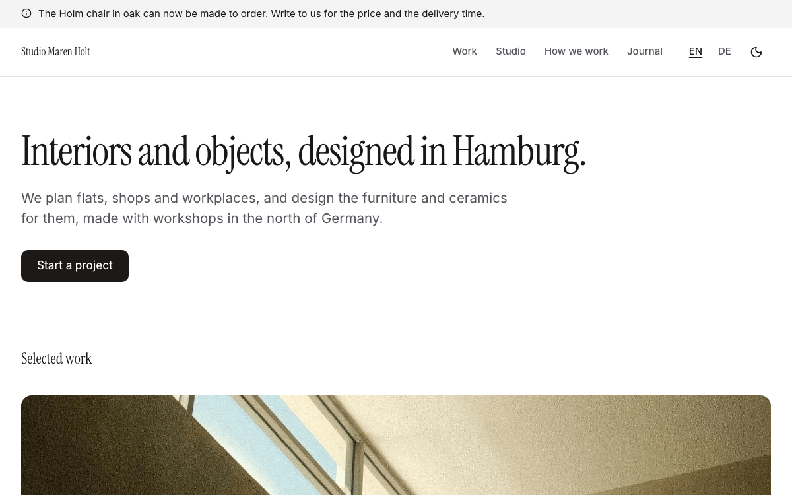
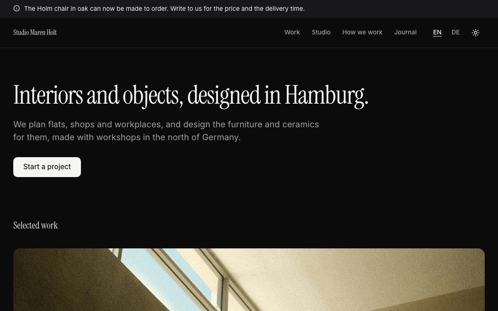

# Portfolio

A complete website for a design studio, an architect, a maker or a photographer: the work as large photos on the home
page, a page per project with its facts (client, year, place, scope), all its photos with their descriptions and a
lightbox, the people of the studio, a page on how a project runs, a journal with an RSS feed, and legal texts. One
main action on every page: "Start a project", an email with the subject filled in, next to the phone and the
address. In English and German, with light and dark mode. Built with [Nuxt](https://nuxt.com) and
[Ginko](https://github.com/lupinum-dev/ginko). All content is Markdown in `content/`; the site needs no account and no
database. The sample is "Studio Maren Holt", a fictional interior and object design studio in Hamburg.

| Light | Dark |
|---|---|
|  |  |

## Quick start

```bash
npm create ginko@latest my-site -- --template portfolio
```

This copies the template into `my-site`, keeps the languages you choose (`--locales en` for English only,
`--locales de,en` for German first), moves the sample notice's end date by the weeks since the sample was made, sets
the site id and writes a `.env` with a new `NUXT_APP_SECRET`. Then:

```bash
cd my-site
npm install
npm run dev
```

Or copy the folder as it is, with both languages, through Nuxt's own command:

```bash
npm create nuxt@latest my-site -- -t github:lupinum-dev/ginko/templates/portfolio#release
```

Copy `.env.example` to `.env` and fill in `NUXT_APP_SECRET` (see below). The `#release` branch follows the latest
Ginko release, so both commands give you the same files. With this route the sample dates stay as they are: a notice
whose last day has passed is simply not shown.

## Deploy

[](https://vercel.com/new/clone?repository-url=https%3A%2F%2Fgithub.com%2Flupinum-dev%2Fginko%2Ftree%2Frelease%2Ftemplates%2Fportfolio&env=NUXT_APP_SECRET&envDescription=Signs%20the%20share%20card%20URLs.%20Any%2032%20or%20more%20random%20characters.)

Any host that runs Node works: `npm run build` writes a server to `.output/`, started with
`node .output/server/index.mjs`. Set these variables where the site runs:

| Variable | What |
|---|---|
| `NUXT_APP_SECRET` | Signs the URLs of the share cards. 32 or more random characters (`openssl rand -hex 32`). |
| `NUXT_PUBLIC_SITE_URL` | The address of the live site, for example `https://www.studio-maren-holt.de`. On Vercel the production address is used when this is not set. |

A build on Vercel stops with a message while the address is still `example.com`, so search engines never see wrong
links. Other builds (CI, your computer) only print a warning.

### Static files

A portfolio changes when you add a project or a journal entry, so it can also be built as static files and served by
any web host, without Node:

```bash
npm run generate
```

The files are in `.output/public/`; upload that folder. Every page, the sitemap, `llms.txt` and the journal feeds are
written at build time. What that means:

- **Everything changes with a build.** A new project, photo or journal entry goes online when you build and upload
  again (on Vercel or Netlify: with the next push).
- **Notices** (`content/notices/`) leave the site only with the next build after their `until` day. If you use them,
  add a daily rebuild (for example a Vercel cron job that calls a deploy hook, or a scheduled GitHub Action).
- **Scheduled journal entries.** An entry whose `date` is after the build day stays off the site; it goes online with
  the first build on or after that day (in files mode and in the Studio). A file with `draft: true` never does. If you
  schedule entries, add a daily rebuild too.
- **Share cards** are generated by the server (`nuxt-og-image`). With static files, each page's card is rendered once
  at build time.

Run as a server (`npm run build`), notices end on their day by themselves; scheduled journal entries still need a
build on their day.

## Develop, build, preview

| Command | What |
|---|---|
| `npm run dev` | the site with live reload on http://localhost:3000; drafts show here |
| `npm run check` | Checks the content files in a few seconds: missing or wrong fields, dates, links between pages and files in `public/`. Each problem names the file and the field. |
| `npm run build` | the production build in `.output/`; drafts are left out |
| `npm run generate` | static files in `.output/public/` instead of a server (see "Static files") |
| `npm run preview` | runs that build locally |
| `npm run lint` | ESLint |
| `npm run typecheck` | TypeScript and Vue types |

`.github/workflows/ci.yml` runs lint, typecheck and build on every push. It needs no settings.

## Edit content

Every text is a Markdown file. The main language has no suffix (`holm-chair.md`); a translation adds the language
code (`holm-chair.de.md`) and repeats only what it translates: the year, files and images come from the main file,
and each photo's description is written per language. A page (a project, journal entry, legal text or free page)
shows in a language only when its translation has every required text (for a project: `title`, `slug`, `summary` and
the text). The number at the start of a file name sets the order. Write dates as `2026-10-24`. After each change, run
`npm run check`.

Files point to other entries by id: the folder and the file name without number and language, so
`content/people/1.maren-holt.md` is `people/maren-holt`. The `slug` is only the address on the site: renaming a file
breaks the references to it, changing the `slug` does not.

| On the site | File |
|---|---|
| Home page: what the studio does in one sentence, and a lead | `content/home.md` (and `home.de.md`) |
| Projects | `content/projects/<n>.<name>.md`: `title`, `slug` (the address; without it, the file name), `summary` (below the title and in search results), `client` (a name, or "Private client"; leave it out for your own pieces), `year`, `place`, `scope` (what you did, in a few words), `image` (the main photo, 3:2 on the cards: put the file in `public/media/` and write `src: /media/name.jpg`), `photos` (more photos, each `image` with `src` and `alt`), the text; `draft: true` keeps a project off the site while you work on it |
| Journal | `content/posts/<name>.md`: `title`, `description` (the summary), `date` (`YYYY-MM-DD`; a later day keeps it off the built site until then), `authors` (people by id, `[people/maren-holt]`), `image` (optional, 3:2), the text; `draft: true` keeps an entry off the site |
| People of the studio | `content/people/<n>.<name>.md`: `name`, `role`, `bio`, `email`, `phone`; no photo needed, the site shows initials |
| How we work, and other pages | `content/pages/<n>.<name>.md`; each translation sets its own address with `slug:` |
| Notices above the header | `content/notices/<n>.<name>.md`: `text` (at most 140 characters; in quotes when it contains a colon), `until` (the last day it shows, like `2026-12-31`; without it the notice stays until you delete the file); a translation has only `text` |
| Name, address, VAT number, email, phone | `content/site.md` (footer, imprint, "Start a project", search engines) |
| Privacy policy, imprint | `content/legal/` (placeholders for Germany: replace them before you go live) |
| Site name, description for search engines | `ginko.config.ts` (`name`, `seo.description`) |
| Menu, the line under the name in the footer | `app/app.config.ts` |
| The home page's title in tabs and search results, section titles, the subject of the "Start a project" email, the leads of the work, studio and journal pages | `i18n/<language>.json` (`home.title`, `start.subject`, `projects.lead`, `people.lead`, `blog.lead`); the features' own texts are in `i18n/<feature>/<language>.json`, and a key set in `i18n/<language>.json` wins (this template renames "Projects" to "Work", "Team" to "Studio" and "News" to "Journal" that way) |

**Projects.** The home page shows the first three projects (the smallest numbers), the first one wide; the work page
shows all of them. To change the selection, change the numbers. Only the main file's number counts; rename the
translation too if you want the files to stay side by side. A project's page shows the main photo and every photo of
`photos`, large and one below the other, each with its description below it; a click opens the lightbox, which shows
the whole photo. Then its facts, the text and the next project (after the last, the first).

**Photo descriptions.** Every photo needs `alt`: what the photo shows, in a short sentence. It is shown below the
photo, read out by screen readers and given to search engines. The build stops on a photo without one in the main
language and names the file; a translation without its own description shows the main language's. Write one per
language. In a translation, `photos` has one row per photo of the main file, in the same order, with only its `alt`:
rows are matched by position, not by `src`. When you add, remove or move a photo in the main file, do the same at the
same place in each translation (write `- {}` for a row with nothing to translate). `npm run check` reports a
translation with a different number of rows.

**Start a project.** The button opens an email to the address of `content/site.md` with the subject of
`start.subject` ("Project enquiry"). It is on the home page, on every project page, on the studio page and on the "How we work" page, next
to the phone number and the address. If you rename `content/pages/1.how-we-work.md`, change the id in
`app/components/pages/Top.vue` too; it shows the block on that page only. To change where it leads, change the email in `content/site.md`.

Each language has a journal feed at `<journal page>/rss.xml` (`/journal/rss.xml`, `/de/journal/rss.xml`).

Notices show newest first: give a new notice a smaller number than the others (`0.` works, and numbers may have gaps,
so older notices keep theirs). At most two show at once.

## Make it yours

- **Name.** `name` in `ginko.config.ts` (header, footer, share cards, search engines). The sample name also appears as
  text in `seo.description` in `ginko.config.ts` and the person Maren Holt in `content/site.md` (`legalName`) and
  `content/people/1.maren-holt.md` with its translation. Search `content/` and `i18n/` for it and replace what is
  left. `legalName` (a person or a company) is shown in the imprint, the address and after © in the footer; without it
  the footer shows `name`. For a long name, add `shortName` in `app/app.config.ts` (`site: { shortName: '…' }`):
  phones show it instead.
- **Menu.** `nav` in `app/app.config.ts` holds at most six items: a page of `ginko.config.ts`
  (`{ page: 'news', label: { … } }`, label per language, the same words as the page's title) or a page of
  `content/pages/` by id (`{ entry: 'pages/how-we-work' }` is `content/pages/1.how-we-work.md`).
- **Logo.** Put the file in `public/` and set `logo: { src: '/logo.svg', width: 160, height: 32 }` in
  `app/app.config.ts`. Without it, the header shows the name in the heading font.
- **Colour.** `--brand` and `--brand-foreground` in `app/assets/css/main.css`, once for light and once for dark
  (`.dark`), `--brand-surface` and `--brand-surface-foreground` (the closing band, in `.dark` only), and the light
  value as `seo.color` in `ginko.config.ts` (the background of the share cards). This template uses stone, almost
  black (`#1c1917`) and almost white in dark mode (`#f5f5f4`), so the photos carry the colour; the closing band uses
  the zinc of the neutrals (`#27272a`) in dark mode. Text on the colour needs a contrast of at least 4.5:1 in both
  modes; check each pair with a contrast checker (for example webaim.org/resources/contrastchecker). `DESIGN.md` has
  the rules.
- **Fonts.** `--font-body` (Inter) and `--font-heading` (Instrument Serif, headings from the size of a section title
  up) in `main.css`. `@nuxt/fonts` downloads the fonts at build time and serves them from your site; a font with only
  some weights is listed in `fonts.families` in `nuxt.config.ts` (Instrument Serif has one, 400). To use one face for
  everything, delete `--font-heading` and the `@layer base` block of `main.css`.
- **Organisation type.** `organization: 'LocalBusiness'` in `app/app.config.ts`, and the home page tells search
  engines the studio is a `ProfessionalService` (`app/pages/index.vue`); address and contact come from
  `content/site.md`, the country from `country` in `ginko.config.ts`.
- **Addresses.** The words of the addresses per language (`projects` → `work`, `projekte`; `team` → `studio`;
  `news` → `journal`) are in `app/routes.ts`. Change a word there; the pages, the menu and the links follow.

`DESIGN.md` explains the tokens and components. The parts in `app/components/ui/` are
[shadcn-vue](https://www.shadcn-vue.com) components.

## Add a page

**A text page:** add `content/pages/2.press.md` with a `title`, an optional `summary` and the text below the
frontmatter. It appears at `/press`; each translation sets its own address with `slug:` (`slug: presse` in
`2.press.de.md` gives `/de/presse`). Add `{ entry: 'pages/press' }` to `nav` or `footer` in `app/app.config.ts` to
link it.

**A page with its own layout:** add a Vue file in `app/pages/`, for example `app/pages/exhibitions.vue`. Start it with
`<BlockPageHeader>` and call `usePageSeo()`, like `app/pages/team.vue`. Register it in `ginko.config.ts` under `pages`
(`exhibitions: localized('/exhibitions')`) and add the words of its address per language to `segments` in
`app/routes.ts` (`exhibitions: { en: 'exhibitions', de: 'ausstellungen' }`). It then answers at `/exhibitions` and
`/de/ausstellungen`, and `useGinkoPath()('exhibitions')` links to it.

## Add or remove a language

The languages are the `locales` list in `app/routes.ts`; the first is the main language, whose addresses have no
prefix.

- **Remove one:** start fresh with `npm create ginko@latest my-site -- --template portfolio --locales en`, or delete
  it from `locales` and from the maps in `app/routes.ts` and `languages` in `ginko.config.ts`, then delete its files
  (`*.de.md`, `i18n/de.json`, `i18n/*/de.json`).
- **Add one** (for example French): add `'fr'` to `locales` and a word per address in `app/routes.ts`, its tag to
  `languages` in `ginko.config.ts` (`fr: 'fr-FR'`), and the French labels of `nav` and `tagline` in
  `app/app.config.ts` (without them they show in the main language). Add `i18n/fr.json` and the texts of every
  `i18n/<feature>/en.json` translated as `i18n/<feature>/fr.json`.
- **Translate the content** as `content/**/*.fr.md`, with a description (`alt`) for every photo. A page shows in the
  new language only once it has its translation file: without one it is not on the French site, the menu leaves it
  out, and links to it lead to its page in the main language. Translate at least the legal texts (`content/legal/`)
  before the language goes live.

## Add an enquiry form

The site sends no data to other companies, so it has no forms: "Start a project" opens an email with the subject
filled in. To use a form instead, link to a form service of your choice from a page of `content/pages/` (`actionLabel`
and `actionUrl` give the page a button) and name the service in your privacy policy.

## Remove a feature

Links in the content name pages by their key (`[projects]($page.projects)`). After you remove a page, search
`content/` for `$page.<key>` and remove or change those links: the build stops on a link that leads nowhere.

| Feature | Delete |
|---|---|
| Journal | `content/posts/`, the `posts` brick and `pages.news` in `ginko.config.ts`, its `nav` item, the "From the journal" section of `app/pages/index.vue`, `app/pages/news/`, `app/components/blog/`, `app/composables/useBlog.ts`, `server/middleware/news-feed.ts`, `i18n/blog/`, the `blog` keys in `i18n/<language>.json`, `"blog"` in `package.json` → `ginko.features` |
| Studio page (people) | `content/people/`, `pages.team` and its `nav` item, `app/pages/team.vue`, `app/components/people/`, `i18n/people/`, the `people` keys in `i18n/<language>.json`, `"people"` in `ginko.features`; the `people` brick only after the journal, whose `authors` name people |
| Free pages ("How we work") | `content/pages/`, the `pages` brick, its `nav` item, `app/pages/[...slug].vue`, `app/bricks/pages.ts`, `app/components/pages/Top.vue`, `"pages"` in `ginko.features`; the "Start a project" button stays on the home and project pages |
| Notices | `content/notices/`, the `notices` brick, `<SiteNotice />` in `app/layouts/default.vue`, `app/components/site/Notice.vue` |
| A language | see "Add or remove a language" |
| Dark mode | `<SiteThemeToggle />` in `app/components/site/Header.vue`, `app/components/site/ThemeToggle.vue`, and `@nuxtjs/color-mode` with its `colorMode` options in `nuxt.config.ts` and `package.json` |
| Share cards | `nuxt-og-image` and `@takumi-rs/core` in `nuxt.config.ts` and `package.json`; then `NUXT_APP_SECRET` is not needed |

The projects are the centre of this template; to remove them, start from the starter template instead. The photo
viewer (`"gallery"` in `ginko.features`) is what the project pages show their photos with.

## Before you deploy

- [ ] `NUXT_PUBLIC_SITE_URL` (or `url` in `ginko.config.ts`) is your real address.
- [ ] `NUXT_APP_SECRET` is set where the site runs.
- [ ] `content/site.md` shows your real name, address, VAT number and contact details.
- [ ] The sample phone numbers and emails are replaced: they reach nobody (the numbers start their local part
      with 0, the emails end in .example), so a forgotten one fails quietly.
- [ ] The sample projects, people and journal entries are replaced by your own, and the sample photos
      (`public/media/`, see `MEDIA.md`) by photos of your work.
- [ ] Every photo has a description (`alt`) in each language file that shows it, and a source in `MEDIA.md`.
- [ ] The placeholders in `content/legal/` are replaced by your own texts.
- [ ] If you build static files: a daily rebuild runs while you use notices (see "Static files").

## Move to the Studio

Ginko Studio is Lupinum's hosted editor: you add a project as a draft from the browser, add photos to it from your
phone (the Studio does not save a photo without its description), write a journal entry and publish it now or later,
and the Today page shows your drafts and how old the newest journal entry is. It is open by invitation, and Lupinum
moves your content with you. The site stays the same code: each brick in `ginko.config.ts` loses its
`source: 'files'`, and its content then comes from the Studio. Until then, everything here works without it. Ask at
[lupinum.com](https://lupinum.com).

## Updating

Move all Ginko packages to the same version in one step:

```bash
npm install @lupinum/ginko@latest @lupinum/ginko-content@latest @lupinum/ginko-i18n@latest
```

The release notes list "Template files changed": compare those files with yours if you want the changes.

## License

Code: MIT (see `LICENSE`). Media: see `MEDIA.md`.
