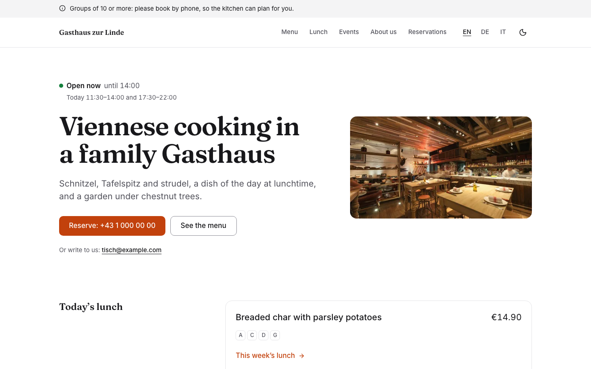
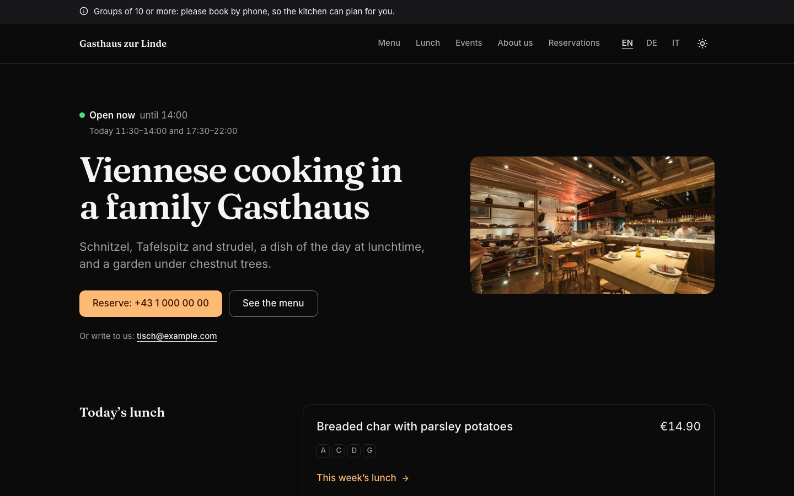

# Restaurant

A complete website for a restaurant, café or inn: the first screen says whether you are open right now and how to
reserve; then the menu with allergens, the lunch of the week, events, photos, opening hours with closures and
holidays, and the address. In English, German and Italian, with light and dark mode. The sample is "Gasthaus zur
Linde", a family inn in Vienna. Built with [Nuxt](https://nuxt.com) and [Ginko](https://github.com/lupinum-dev/ginko).
All content is Markdown in `content/`; the site needs no account and no database.

| Light | Dark |
|---|---|
|  |  |

What guests get:

- **Open now?** "Open now · until 14:00", "Opens today at 17:30" or "Closed today · Summer holiday", computed for the
  restaurant's time zone and Austrian public holidays, and moving on by itself while the page is open.
- **Menu** by category with today's prices, vegetarian and vegan dishes, the 14 EU allergen letters with their key,
  "sold out today", a planned price change, and a print version for the door.
- **Lunch of the week**, only while it is current, with days you are closed marked as closed.
- **Events** with weekday, date, time, price and "fully booked"; past events leave the site by themselves.
- **Reserving** by phone or email, no form and nothing sent to other companies. "Open in maps" is a link, not an
  embedded map.
- **Search engines** get a Restaurant with opening hours and menu, and each event with its time zone.

## Quick start

```bash
npm create ginko@latest my-restaurant -- --template restaurant
```

This copies the template into `my-restaurant`, keeps the languages you choose (`--locales en` for English only,
`--locales de,en` for German first), moves the sample dates (events, notices, the lunch week) to this week, sets the
site id and writes a `.env` with a new `NUXT_APP_SECRET`. Then:

```bash
cd my-restaurant
npm install
npm run dev
```

Or copy the folder as it is, with all three languages, through Nuxt's own command:

```bash
npm create nuxt@latest my-restaurant -- -t github:lupinum-dev/ginko/templates/restaurant#release
```

Copy `.env.example` to `.env` and fill in `NUXT_APP_SECRET` (see below). The `#release` branch follows the latest
Ginko release, so both commands give you the same files. With this route the sample dates stay as they are.

## Deploy

[](https://vercel.com/new/clone?repository-url=https%3A%2F%2Fgithub.com%2Flupinum-dev%2Fginko%2Ftree%2Frelease%2Ftemplates%2Frestaurant&env=NUXT_APP_SECRET&envDescription=Signs%20the%20share%20card%20URLs.%20Any%2032%20or%20more%20random%20characters.)

Any host that runs Node works: `npm run build` writes a server to `.output/`, started with
`node .output/server/index.mjs`. Set these variables where the site runs:

| Variable | What |
|---|---|
| `NUXT_APP_SECRET` | Signs the URLs of the share cards. 32 or more random characters (`openssl rand -hex 32`). |
| `NUXT_PUBLIC_SITE_URL` | The address of the live site, for example `https://www.my-restaurant.at`. On Vercel the production address is used when this is not set. |

A build on Vercel stops with a message while the address is still `example.com`, so search engines never see wrong
links. Other builds (CI, your computer) only print a warning.

This template renders on the server and has no static mode: "open now", today's lunch, notices and events depend on
the day and the hour, so every request shows the current state.

## Develop, build, preview

| Command | What |
|---|---|
| `npm run dev` | the site with live reload on http://localhost:3000 |
| `npm run check` | Checks the content files in a few seconds: missing or wrong fields, dates, prices, links between pages and files in `public/`. Each problem names the file and the field. |
| `npm run build` | the production build in `.output/` |
| `npm run preview` | runs that build locally |
| `npm run lint` | ESLint |
| `npm run typecheck` | TypeScript and Vue types |

`npm run dev` shows the site as of today: a notice, a closure for today or this week's lunch show at once. Next week's
lunch appears on its Monday, and a closure appears `holidayNoticeDays` days (in `content/hours.md`, 14 in the
sample) before it starts.

`.github/workflows/ci.yml` runs lint, typecheck and build on every push. It needs no settings.

## Edit content

Every text is a Markdown file. The main language has no suffix (`about.md`); a translation adds the language code
(`about.de.md`) and repeats only the texts, not dates, prices or photos. The number at the start of a file name sets
the order. After each change, run `npm run check`.

Write dates as `2026-10-24`, times as `'09:30'`, prices as a plain number in euros (`95` or `12.50`).

A translation lists the rows of a list (closures, lunch days, gallery photos) in the same order as the main file: when
you add, remove or move a row in the main file, do the same at the same place in each translation (write `- {}` for a
row with nothing to translate). When you change the lunch week, change the dishes in `lunch.de.md` and `lunch.it.md`
too. `npm run check` reports a translation with a different number of rows.

| On the site | File |
|---|---|
| Home page: title, lead, photo | `content/home.md` (+ `.de.md`, `.it.md`) |
| Opening hours: the week (two periods a day), public holidays (`holidays`), closures: one day with `closedOn: 2026-10-20` and `closedNote`, several days as an `exceptions` row with `when: { from, to }` (from = to for one day), `reason`, `closed: true` (or `closed: false` with times for special hours) | `content/hours.md` |
| Other hours for a season or from a date (winter hours) | `content/hourPlans/<n>.<name>.md` |
| Menu: one file per dish (category, name, description, price, allergens, vegetarian or vegan) | `content/menu/<n>.<name>.md` |
| A dish sold out today | `soldOutOn: 2026-10-15` in its file (only that day) |
| A dish off the menu for now | `onMenu: false` in its file |
| A price change from a date | `nextPrice` and `priceFrom` in its file; the menu announces it two weeks ahead |
| Lunch of the week: five rows, `day: mo` to `day: fr`, each with one `dish`, an optional `price` and `allergens`; `weekOf` = its Monday. For two dishes a day, write both in `dish` | `content/lunch.md` |
| Events (date, start time, price, photo, text) | `content/events/<n>.<name>.md`; it leaves the site after its last day |
| Notices above the header ("Fully booked tonight") | `content/notices/<n>.<name>.md`: `text` (at most 140 characters; in quotes when it contains a colon) and `until` (the last day it shows, like `2026-12-31`; leave it out to keep the notice until you delete the file). A notice shows from the day you add the file; there is no start date. Something that is always true (groups book by phone) belongs on a page, not in a notice |
| Photos of the gallery | `content/gallery.md` (and the alt texts in each translation) |
| Reservations page: title, lead and text (the call and email buttons and the opening hours come from `content/site.md` and `content/hours.md`) | `content/reservations.md` |
| Pages (About, …) | `content/pages/<n>.<name>.md`; a translation sets its own address with `slug:` |
| Legal name of the company (imprint, footer; for example "Gasthaus zur Linde GmbH"), address, email, phone (footer, reservation buttons, search engines) | `content/site.md` |
| Privacy policy, terms, imprint | `content/legal/` (placeholders: replace them before you go live) |
| Site name, description for search engines, country | `ginko.config.ts` (`name`, `seo.description`, `country`) |
| Navigation, the line under the name in the footer, footer links, profiles elsewhere | `app/app.config.ts` |
| Texts of the home page sections and the reservation buttons | `i18n/<language>.json` |
| Texts of buttons, labels, allergen names | `i18n/<feature>/<language>.json`; to change one, set it under the feature's key in `i18n/<language>.json` (as `events.lead` there does) |

`allergens`: the letters of the 14 EU allergens (`[A, G]`), or `none` for a dish without any. Leaving the line out or
writing `[]` is an error, so a dish never says "no allergens" by mistake.

Allergens use the EU letters as Austrian menus write them: A gluten, B crustaceans, C egg, D fish, E peanuts, F soy,
G milk, H tree nuts, L celery, M mustard, N sesame, O sulphites, P lupin, R molluscs. Check each dish with your
kitchen: a wrong allergen is the one mistake this site must never make.

The Studio asks whether the allergens are still right when a dish changes; in the files nothing asks, so check the
allergens whenever you change a dish.

Notices show newest first (the smallest number first), and at most two show at once. Give a new notice a smaller
number than the others: `0.` works and numbers may have gaps, so older notices keep theirs.

## Make it yours

- **Name.** `name` in `ginko.config.ts` (header, footer, share cards, search engines). The sample name also appears as
  text in `shortName` (`Zur Linde`) in `app/app.config.ts`, which replaces the name in the header on phones (delete it
  to use `name` there), and in `legalName` (`Gasthaus zur Linde GmbH`) in `content/site.md`, the company name for the
  imprint and footer. Search `content/` and `app/app.config.ts` for it and replace what is left.
- **Navigation.** `nav` in `app/app.config.ts` (at most six: a page of `ginko.config.ts` with its label per language,
  or a page of `content/pages/` by id, such as `pages/about`).
- **Logo.** Put the file in `public/` and set `logo: { src: '/logo.svg', width: 120, height: 32 }` in
  `app/app.config.ts`. Without it, the header shows the name.
- **Colour.** `--brand` and `--brand-foreground` in `app/assets/css/main.css`, once for light and once for dark
  (`.dark`), and the light value of `--brand` as `seo.color` in `ginko.config.ts` (the background of the share
  cards). Text on the colour needs a contrast of at least 4.5:1 in both modes; check each pair with a contrast checker
  (for example webaim.org/resources/contrastchecker). `DESIGN.md` has the rules.
- **Fonts.** `--font-body` (Inter) and `--font-heading` (Fraunces) in `main.css`. `@nuxt/fonts` downloads the fonts at
  build time and serves them from your site.
- **Country and time zone.** `country` (public holidays, the address for search engines) and `timeZone` in
  `ginko.config.ts`. Holiday calendars exist for `AT`, `DE` and `SG`; another country counts no public holidays, so
  enter yours as closures in `content/hours.md`.
- **Currency.** `currency` in `ginko.config.ts`; prices in the files are plain numbers (`24.9`).

`DESIGN.md` explains the tokens and components. The parts in `app/components/ui/` are
[shadcn-vue](https://www.shadcn-vue.com) components.

## Add a page

**A text page:** add `content/pages/3.groups.md` with a `title`, an optional `summary` and the text below the
frontmatter. It appears at `/groups` (`/de/<slug>` for the German file). Add `{ entry: 'pages/groups' }` to `nav` in
`app/app.config.ts` to put it in the navigation.

**A page with its own layout:** add a Vue file in `app/pages/`, for example `app/pages/wine.vue`. It answers at
`/wine`, `/de/wine` and `/it/wine`. Start it with `<BlockPageHeader>` and call `usePageSeo()`, like
`app/pages/gallery.vue`, and register it in `ginko.config.ts` under `pages` (`wine: localized('/wine')`), so
`useGinkoPath()('wine')` links to it. For a word of its own per language, add it to `segments` in `app/routes.ts`:
`wine: { en: 'wine', de: 'weine', it: 'vini' }`. `localized()` in `ginko.config.ts` and `modules/page-paths/`
(which gives the page file its addresses) both read that table, so each word is written once.

## Add or remove a language

The languages are the `locales` list in `app/routes.ts`; the first is the main language, whose addresses have no
prefix.

- **Remove one:** start fresh with `npm create ginko@latest my-restaurant -- --template restaurant --locales en,de`.
  By hand: delete it from `locales` and from the maps in `app/routes.ts` and `languages` in `ginko.config.ts`, then
  delete its files (`*.it.md`, `i18n/it.json`, `i18n/*/it.json`).
- **Add one** (for example French): add `'fr'` to `locales` and `languages`, its words to `segments`, `i18n/fr.json`
  and `i18n/<feature>/fr.json` for each feature folder in `i18n/`, and the content in French. An entry with its own
  address (a page, an event, a legal text) without its `.fr.md` is left out of the French site: no page, no link, not
  in the sitemap. So translate at least `content/legal/*.fr.md` (without them the French site has no imprint, which
  Austria and Germany require), `content/pages/*.fr.md` and `content/events/*.fr.md`. Everything else (dishes,
  notices, hour plans and the single files `site`, `home`, `reservations`, `gallery`, `hours`, `lunch`) shows the main
  language's text until it has a `.fr.md`. Add `fr` labels to `nav`, `footer` and `tagline` in `app/app.config.ts`:
  a link without one shows the main language's label, and the footer shows no tagline.

## Add a booking or contact form

The site sends no data to other companies, so it has no form: guests reserve by phone or email. To add online
booking, link to a booking service of your choice from the reservations page (a Markdown link in
`content/reservations.md`) or set `booking` on an
event (its page then shows "Book a place" instead of phone and email). Name the service in your privacy policy.

## Remove a feature

| Feature | Delete |
|---|---|
| Lunch of the week | `content/lunch*.md`, the `lunch` brick and the `lunch` page in `ginko.config.ts`, `app/pages/lunch.vue`, `app/components/menu/LunchDays.vue`, `useLunch` in `app/composables/useMenu.ts`, the "Today's lunch" section in `app/pages/index.vue`, the `lunch` entry of `nav` and `segments` |
| Events | `content/events/`, the `events` brick and page in `ginko.config.ts`, `app/pages/events/`, `app/components/event/`, `app/composables/useEvents.ts`, `i18n/events/`, the `events` key in each `i18n/<language>.json`, `<EventUpcoming />` in `app/pages/index.vue`, the `events` entry of `nav` and `segments` |
| Gallery | `content/gallery*.md`, the `gallery` brick and page in `ginko.config.ts`, `app/pages/gallery.vue`, `app/components/block/Gallery.vue`, `app/components/site/Lightbox.vue`, `i18n/gallery/`, the gallery section in `app/pages/index.vue`, the `gallery` entry of `footer` and `segments` |
| Winter hours | `content/hourPlans/` (keep the `hourPlans` brick: without entries it shows nothing) |
| Notices | `content/notices/` (keep the brick: without entries nothing shows) |
| Print version of the menu | `app/pages/menu/print.vue`, `app/layouts/print.vue`, the print link in `app/pages/menu/index.vue`, the word `print` in `segments` |
| A legal text | its files in `content/legal/` |
| A language | see "Add or remove a language" |
| Dark mode | `<SiteThemeToggle />` in `app/components/site/Header.vue`, `app/components/site/ThemeToggle.vue`, and `@nuxtjs/color-mode` with its `colorMode` options in `nuxt.config.ts` and `package.json` |
| Share cards | `nuxt-og-image` and `@takumi-rs/core` in `nuxt.config.ts` and `package.json`; then `NUXT_APP_SECRET` is not needed |

The menu and the opening hours are the core of this template; the home page and the lunch week read them.

## Before you deploy

- [ ] `NUXT_PUBLIC_SITE_URL` (or `url` in `ginko.config.ts`) is your real address.
- [ ] `NUXT_APP_SECRET` is set where the site runs.
- [ ] `content/hours.md` has your real week, closures and the public holiday rule; `country` and `timeZone` are yours.
- [ ] Every dish has its real price and allergens, checked with the kitchen.
- [ ] `content/site.md` has your real name, address, phone and email: the reservation buttons use them.
- [ ] The sample phone numbers and emails are replaced: they reach nobody (the numbers start their local part
      with 0, the emails end in .example), so a forgotten one fails quietly.
- [ ] The placeholders in `content/legal/` are replaced by your own texts (in Austria and Germany an imprint is
      required), and the ones you do not need are deleted.
- [ ] The sample photos are replaced by your own, each with alt text in every language and a source in `MEDIA.md`.
- [ ] The sample events and notices are replaced or deleted.

## Move to the Studio

Ginko Studio is Lupinum's hosted editor: the owner marks "closed today", "fully booked tonight" or a dish as sold out
from the phone at the pass, the cook enters the lunch week and the owner approves it, all without Git. It is open by
invitation, and Lupinum moves your content with you. The site stays the same code: each brick in `ginko.config.ts`
loses its `source: 'files'`, and its content then comes from the Studio. Until then, everything here works without
it. Ask at [lupinum.com](https://lupinum.com).

## Updating

Move all Ginko packages to the same version in one step:

```bash
npm install @lupinum/ginko@latest @lupinum/ginko-content@latest @lupinum/ginko-i18n@latest @lupinum/ginko-preset-gastro@latest
```

The release notes list "Template files changed": compare those files with yours if you want the changes.

## License

Code: MIT (see `LICENSE`). Media: see `MEDIA.md`.
