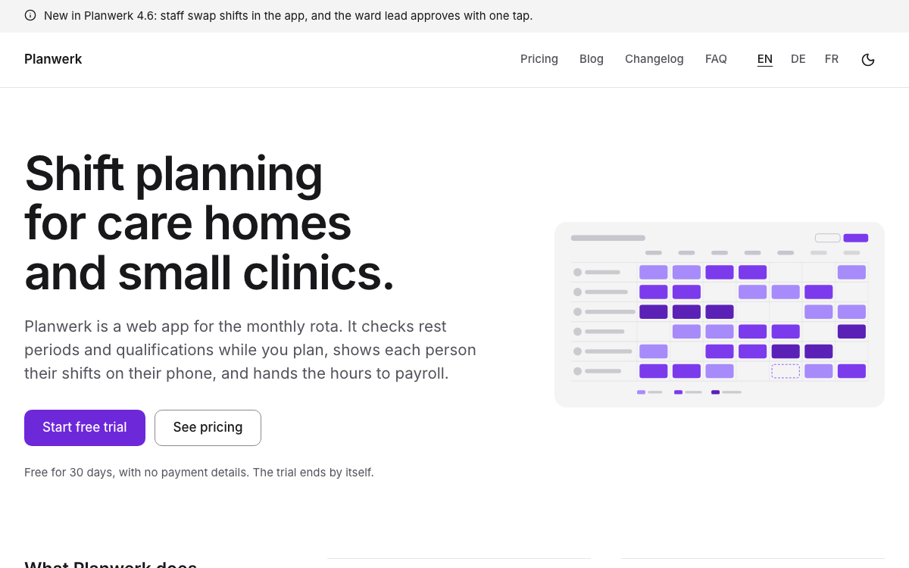
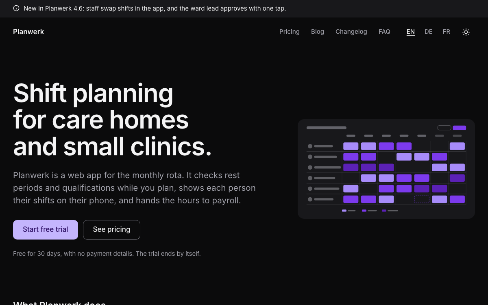

# SaaS

A complete website for a software product: what it does and for whom in one sentence on the home page, the plans
with their prices per month and per year, a free trial that leads to your app, the changelog with an RSS feed,
questions and answers, a blog, customer logos and a quote, the facts about security and data, and legal texts. In
English, German and French, with light and dark mode. Built with [Nuxt](https://nuxt.com) and
[Ginko](https://github.com/lupinum-dev/ginko). All content is Markdown in `content/`; the site needs no account and no
database. The sample is "Planwerk", a fictional German company with a web app for planning shifts in care homes and
small clinics.

| Light | Dark |
|---|---|
|  |  |

## Quick start

```bash
npm create ginko@latest my-site -- --template saas
```

This copies the template into `my-site`, keeps the languages you choose (`--locales en` for English only,
`--locales de,en` for German first), moves the sample notice to this week, sets the site id and writes a `.env` with a
new `NUXT_APP_SECRET`. Then:

```bash
cd my-site
npm install
npm run dev
```

Or copy the folder as it is, with all three languages, through Nuxt's own command:

```bash
npm create nuxt@latest my-site -- -t github:lupinum-dev/ginko/templates/saas#release
```

Copy `.env.example` to `.env` and fill in `NUXT_APP_SECRET` (see below). The `#release` branch follows the latest
Ginko release, so both commands give you the same files. With this route the sample notice keeps its date: once that
day has passed, it is simply not shown.

## Deploy

[](https://vercel.com/new/clone?repository-url=https%3A%2F%2Fgithub.com%2Flupinum-dev%2Fginko%2Ftree%2Frelease%2Ftemplates%2Fsaas&env=NUXT_APP_SECRET&envDescription=Signs%20the%20share%20card%20URLs.%20Any%2032%20or%20more%20random%20characters.)

Any host that runs Node works: `npm run build` writes a server to `.output/`, started with
`node .output/server/index.mjs`. Set these variables where the site runs:

| Variable | What |
|---|---|
| `NUXT_APP_SECRET` | Signs the URLs of the share cards. 32 or more random characters (`openssl rand -hex 32`). |
| `NUXT_PUBLIC_SITE_URL` | The address of the live site, for example `https://www.planwerk.example`. On Vercel the production address is used when this is not set. |

A build on Vercel stops with a message while the address is still `example.com`, so search engines never see wrong
links. Other builds (CI, your computer) only print a warning.

**Static files.** This site can also be built as static files for any web host (`npm run generate`, output in
`.output/public/`). Nothing on it depends on today's date except the notices: with static files, a notice leaves the
site with the next build after its last day, not at midnight. Rebuild when you change a notice, and add a daily
rebuild (for example a Vercel cron job or a scheduled GitHub Action).

## Develop, build, preview

| Command | What |
|---|---|
| `npm run dev` | the site with live reload on http://localhost:3000; drafts show here |
| `npm run build` | the production build in `.output/`; drafts are left out |
| `npm run generate` | static files instead of a server |
| `npm run preview` | runs the build locally |
| `npm run lint` | ESLint |
| `npm run typecheck` | TypeScript and Vue types |

`.github/workflows/ci.yml` runs lint, typecheck and build on every push. It needs no settings.

## Edit content

Every text is a Markdown file. The main language has no suffix (`about.md`); a translation adds the language code
(`about.de.md`, `about.fr.md`) and repeats only what it translates: prices, dates, versions, links and images come
from the main file. A page (a post, a free page or a legal text) shows in a language only when its translation has
every required text. Plans, releases and questions without a translation show in the main language. The number at the
start of a file name sets the order.

| On the site | File |
|---|---|
| Home page: what the product does and for whom, lead, picture of the product, the link to the free trial, the features, the security and data facts | `content/home.md` (`title`, `lead`, `image`, `trialUrl`, `features` and `facts` as rows of `title` and `text`; and `home.de.md`, `home.fr.md`) |
| Plans and prices | `content/pricing/<n>.<name>.md`: `name`, `summary` (for whom), `pricing` (`price` or `onRequest`, always one of the two), `monthly` and `yearly` (in euros, `89` or `89.50`; both required with `pricing: price`), `included` (rows of `item`), `recommended: true` on one plan, `actionLabel`, `actionUrl` (the sign-up page of your app; empty: the contact page, or without one an email to the address of `content/site.md` with the plan's name in the subject) |
| Changelog | `content/changelog/v<version>.md` (`v4-6-0.md`: a dot in a file name reads as a language): `version`, `date`, then the text: one sentence (the summary on the home page and in the feed), a line `<!-- more -->`, and the changes under `### New`, `### Improved` and `### Fixed` |
| FAQ | `content/faq/<n>.<name>.md`: `question`, `answer`; the pricing page shows the first three, so keep billing, cancellation and data export at the top |
| Blog | `content/posts/<name>.md`: `title`, `description` (the summary), `date`, `authors` (people by id, `[people/lena-hartmann]`), `tags`, `image` (the cover, 3:2); `draft: true` keeps a post off the site |
| Authors of the blog | `content/people/<n>.<name>.md`: `name`, `role`, `bio`; no photo needed, the site shows initials |
| Customer logos | `content/logos/<n>.<name>.md`: `name`, `image` (an SVG or PNG in `public/logos/`), `url` |
| Quote on the home page | `content/quotes/<n>.<name>.md`: `text`, `name`, `role`; the home page shows the first |
| Security, about us, contact and other pages | `content/pages/<n>.<name>.md`; each translation sets its own address with `slug:`. The contact page shows the address, email and phone of `content/site.md` under its title (`app/components/pages/Top.vue`) |
| Notices above the header | `content/notices/<n>.<name>.md`: `text` (at most 140 characters), `until` (the last day it shows) |
| Name, address, register entry, VAT number, email, phone | `content/site.md` (footer, imprint, the contact page, search engines) |
| Privacy policy, terms of service, imprint | `content/legal/` (placeholders for Germany: replace them before you go live) |
| Site name, description for search engines, currency | `ginko.config.ts` (`name`, `seo.description`, `currency`) |
| Menu, footer links, the line under the name in the footer, VAT | `app/app.config.ts` |
| The home page's title in search results and tabs, section titles, the texts of the pages | `i18n/<language>.json` (`home.title` is "Shift planning for care homes and small clinics"); the features' own texts are in `i18n/<feature>/<language>.json`, and a key set in `i18n/<language>.json` wins (this template renames "News" to "Blog" that way) |

**Prices.** Every plan says how it is priced: `pricing: price` with `monthly` and `yearly`, or `pricing: onRequest`.
The pricing page shows both prices of each plan in the visitor's language with tabular numbers ("€219 per month",
"or €2,190 per year"), so it needs no switch; search engines get the same prices (a Product with one Offer per month
and one per year). A plan on request shows "On request" and gives search engines no price. A priced plan without one
of its amounts is a mistake: the build stops on it and names the file, and the Studio does not save it. The page says
"All prices plus VAT" (`vat: 'excluded'` in `app/app.config.ts`, which also tells search engines); set
`vat: 'included'` if your prices include it.

**Changelog.** The newest release comes first, by `date`. Each release has its own address on the changelog page
(`/changelog#v4-6-0`), so a notice or a post can link to it. Each language has a feed at `<changelog page>/rss.xml`
(`/changelog/rss.xml`, `/de/neuerungen/rss.xml`, `/fr/nouveautes/rss.xml`) with the version, the summary and the
date of each release; the blog has its own at `<blog page>/rss.xml`.

**Free trial.** "Start free trial" is a link to your app (`trialUrl` in `content/home.md`, and `actionUrl` of each
plan). The site itself has no sign-up form and sends no data anywhere.

Notices show newest first: put the newest one at the top (the smallest number). At most two show at once.

## Make it yours

- **Name and menu.** `name` in `ginko.config.ts`; `nav` in `app/app.config.ts` holds at most six items: a page of
  `ginko.config.ts` (`{ page: 'pricing', label: { … } }`, label per language, the same words as the page's title) or
  a page of `content/pages/` by id (`{ entry: 'pages/security' }` is `content/pages/1.security.md`). `footer` takes the
  same items and an address on another site: `{ url: 'https://app.example.com/login', label: { … } }` is the
  "Sign in" link to your app, in the footer and in the phone menu.
- **Logo.** Put the file in `public/` and set `logo: { src: '/logo.svg', width: 140, height: 32 }` in
  `app/app.config.ts`. Without it, the header shows the name.
- **Picture of the product.** `content/home.md` shows `public/media/rota.svg`, a neutral drawing of a shift plan.
  Replace it with a screenshot of your product (16:9, PNG or WebP, about 1600 × 900 pixels) and describe it in `alt`
  in each language file.
- **Colour.** `--brand` and `--brand-foreground` in `app/assets/css/main.css`, once for light and once for dark
  (`.dark`), and the light value as `seo.color` in `ginko.config.ts` (the background of the share cards). This
  template uses violet (`#6d28d9`, dark `#c4b5fd`, and a deep violet `#4c1d95` for the closing band in dark mode).
  Keep text on the colour at 4.5:1 or more; `DESIGN.md` has the rules.
- **Fonts.** `--font-body` in `main.css`. `@nuxt/fonts` downloads the fonts at build time and serves them from your
  site.
- **Organisation type.** `organization: 'Organization'` in `app/app.config.ts` tells search engines what you are;
  address and contact come from `content/site.md`, the country from `country` in `ginko.config.ts`.
- **Addresses.** The words of the addresses per language (`pricing` → `preise`, `tarifs`; `changelog` →
  `neuerungen`, `nouveautes`) are in `app/routes.ts`. Change a word there; the pages, the menu and the links follow.

`DESIGN.md` explains the tokens and components. The parts in `app/components/ui/` are
[shadcn-vue](https://www.shadcn-vue.com) components.

## Add a page

**A text page:** add `content/pages/4.integrations.md` with a `title`, an optional `summary` and the text below the
frontmatter. It appears at `/integrations`; each translation sets its own address with `slug:` (`slug: schnittstellen`
in `4.integrations.de.md` gives `/de/schnittstellen`). Add `{ entry: 'pages/integrations' }` to `nav` or `footer` in
`app/app.config.ts` to link it.

**A page with its own layout:** add a Vue file in `app/pages/`, for example `app/pages/customers.vue`. Start it with
`<BlockPageHeader>` and call `usePageSeo()`, like `app/pages/faq.vue`. Register it in `ginko.config.ts` under `pages`
(`customers: localized('/customers')`) and add the words of its address per language to `segments` in
`app/routes.ts` (`customers: { en: 'customers', de: 'kunden', fr: 'clients' }`). It then answers at `/customers`,
`/de/kunden` and `/fr/clients`, and `useGinkoPath()('customers')` links to it.

## Add or remove a language

The languages are the `locales` list in `app/routes.ts`; the first is the main language, whose addresses have no
prefix.

- **Remove one:** start fresh with `npm create ginko@latest my-site -- --template saas --locales en,de`, or delete it
  from `locales` and from the maps in `app/routes.ts` and `languages` in `ginko.config.ts`, then delete its files
  (`*.fr.md`, `i18n/fr.json`, `i18n/*/fr.json`) and its labels in `app/app.config.ts`.
- **Add one** (for example Italian): add `'it'` to `locales` and a word per address in `app/routes.ts`, its tag to
  `languages` in `ginko.config.ts` (`it: 'it-IT'`), and the Italian labels of `nav` and `tagline` in
  `app/app.config.ts` (without them they show in the main language). Add `i18n/it.json` and the texts of every
  `i18n/<feature>/en.json` translated as `i18n/<feature>/it.json`.
- **Translate the content** as `content/**/*.it.md`. A page shows in the new language only once it has its
  translation file: without one it is not on the Italian site, the menu leaves it out, and links to it lead to its page
  in the main language. Plans, releases and questions show in the main language until they are translated. Translate
  at least the legal texts (`content/legal/`) before the language goes live.

## Add a sign-up or contact form

The site sends no data to other companies, so it has no forms: "Start free trial" opens your app, and "Ask for a quote"
leads to the contact page, which says what to send. For a contact form, link to a form service of your choice and name
it in your privacy policy.

## Remove a feature

Links in the content name pages by their key (`[changelog]($page.changelog)`). After you remove a page, search
`content/` for `$page.<key>` and remove or change those links: the build stops on a link that leads nowhere.

| Feature | Delete |
|---|---|
| Pricing | `content/pricing/`, the `pricing` brick and `pages.pricing` in `ginko.config.ts`, its `nav` item, the hero's second button in `app/pages/index.vue`, `app/pages/pricing.vue`, `app/components/pricing/`, `app/bricks/pricing.ts`, `app/composables/usePricing.ts`, `i18n/pricing/`, the `pricing` keys in `i18n/<language>.json`, and `"pricing"` in `package.json` → `ginko.features` |
| Changelog | `content/changelog/`, the `changelog` brick and `pages.changelog`, its `nav` item, the "Latest changes" section and `useLatestReleases` in `app/pages/index.vue`, `app/pages/changelog.vue`, `app/components/changelog/`, `app/composables/useChangelog.ts`, `app/utils/changelog.ts`, `server/middleware/changelog-feed.ts`, `i18n/changelog/`, the `changelog` keys in `i18n/<language>.json`, `"changelog"` in `ginko.features`; the links to `$page.changelog` in `content/posts/swap-requests*.md` and `content/pages/2.about*.md` |
| FAQ | `content/faq/`, the `faq` brick and `pages.faq`, its `nav` item, `app/pages/faq.vue`, `app/components/pricing/More.vue` (the questions below the plans), `app/components/block/Faq.vue`, `app/components/ui/accordion/`, `i18n/faq/`, the `faq` and `pricing.questions` keys in `i18n/<language>.json`, `"faq"` in `ginko.features`; the links to `$page.faq` in `content/pages/3.contact*.md` |
| Blog | `content/posts/`, `content/people/`, the `posts` and `people` bricks and `pages.news`, its `nav` item, `app/pages/news/`, `app/components/blog/`, `app/composables/useBlog.ts`, `server/middleware/news-feed.ts`, the team on the About page in `app/components/pages/Top.vue` (and its `about` keys in `i18n/<language>.json`), `i18n/blog/`, the `blog` keys in `i18n/<language>.json`, `"blog"` in `ginko.features` |
| Logos and quotes | `content/logos/`, `content/quotes/`, `public/logos/`, the `logos` and `quotes` bricks, the "Customers" section on the home page, `app/bricks/logos-quotes.ts`, `app/components/block/Logos.vue`, `Quote.vue`, `"logos-quotes"` in `ginko.features` |
| Notices | `content/notices/`, the `notices` brick, `<SiteNotice />` in `app/layouts/default.vue`, `app/components/site/Notice.vue` |
| A language | see "Add or remove a language" |
| Dark mode | `<SiteThemeToggle />` in `app/components/site/Header.vue`, `app/components/site/ThemeToggle.vue`, and `@nuxtjs/color-mode` with its `colorMode` options in `nuxt.config.ts` and `package.json` |
| Share cards | `nuxt-og-image` and `@takumi-rs/core` in `nuxt.config.ts` and `package.json`; then `NUXT_APP_SECRET` is not needed |

## Before you deploy

- [ ] `NUXT_PUBLIC_SITE_URL` (or `url` in `ginko.config.ts`) is your real address.
- [ ] `NUXT_APP_SECRET` is set where the site runs.
- [ ] `content/site.md` shows your real legal name, address, register entry, VAT number and contact details.
- [ ] Every plan has your prices or `pricing: onRequest`, the "plus VAT" note fits your prices, and the answers in
      `content/faq/` say the same as your terms.
- [ ] `trialUrl` in `content/home.md`, each plan's `actionUrl`, the sign-in link (`footer` in `app/app.config.ts`) and the
      link on the contact page lead to your app, not to `app.example.com`.
- [ ] The facts about security and data (`facts` in `content/home.md`, `content/pages/1.security.md`) describe your
      real hosting, backups and contracts.
- [ ] The placeholders in `content/legal/` are replaced by your own texts, and the ones you do not need are deleted.
- [ ] The sample changelog, posts, quote, customer logos and the drawing of the product are replaced or deleted;
      quotes and logos only with the customer's permission.
- [ ] Every image you added has alt text in each language file that shows it and a source in `MEDIA.md`.

## Move to the Studio

Ginko Studio is Lupinum's hosted editor: your team adds a changelog entry or a notice from the browser, changes a
price or answers a new question, and the Today page shows how old the newest changelog entry is. It is open by
invitation, and Lupinum moves your content with you. The site stays the same code: each brick in `ginko.config.ts`
loses its `source: 'files'`, and its content then comes from the Studio. Until then, everything here works without
it. Ask at [lupinum.com](https://lupinum.com).

## Updating

Move all Ginko packages to the same version in one step:

```bash
npm install @lupinum/ginko@latest @lupinum/ginko-content@latest @lupinum/ginko-i18n@latest
```

The release notes list "Template files changed": compare those files with yours if you want the changes.

## License

Code: MIT (see `LICENSE`). Media: see `MEDIA.md`.
