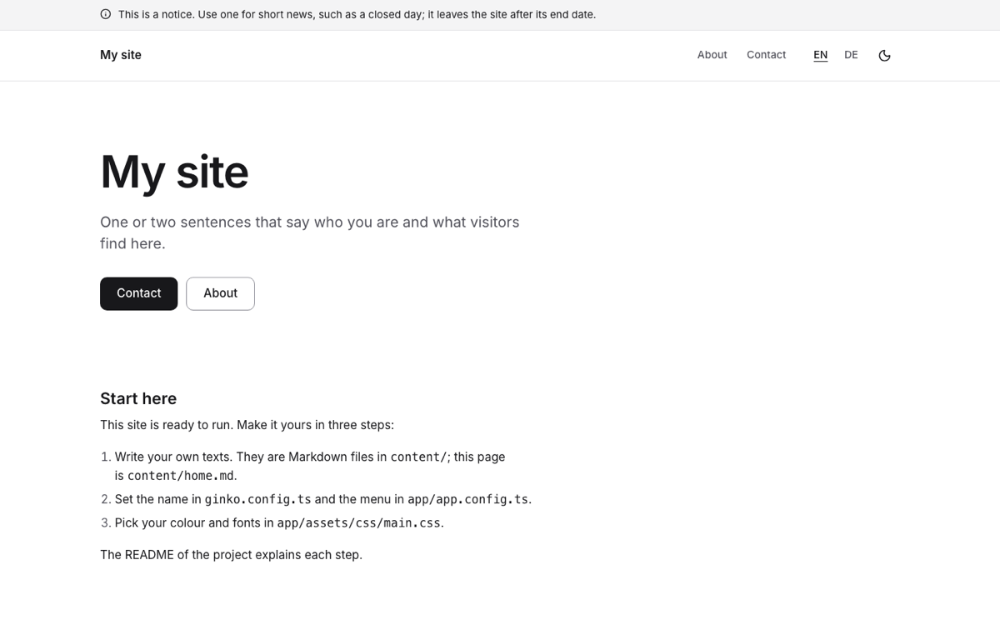
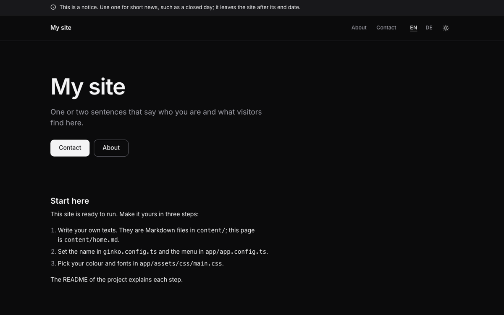

# Starter

A plain, complete website to start from: a home page, free pages (About, Contact), short notices, legal texts and
contact details, in English and German, with light and dark mode. Built with [Nuxt](https://nuxt.com) and
[Ginko](https://github.com/lupinum-dev/ginko). All content is Markdown in `content/`; the site needs no account and
no database.

| Light | Dark |
|---|---|
|  |  |

## Quick start

```bash
npm create ginko@latest my-site -- --template starter
```

This copies the template into `my-site`, keeps the languages you choose (`--locales en` for English only,
`--locales de,en` for German first), moves the sample dates to this week, sets the site id and writes a `.env` with a
new `NUXT_APP_SECRET`. Then:

```bash
cd my-site
npm install
npm run dev
```

Or copy the folder as it is, with both languages, through Nuxt's own command:

```bash
npm create nuxt@latest my-site -- -t github:lupinum-dev/ginko/templates/starter#release
```

Copy `.env.example` to `.env` and fill in `NUXT_APP_SECRET` (see below). The `#release` branch follows the latest
Ginko release, so both commands give you the same files.

## Deploy

[](https://vercel.com/new/clone?repository-url=https%3A%2F%2Fgithub.com%2Flupinum-dev%2Fginko%2Ftree%2Frelease%2Ftemplates%2Fstarter&env=NUXT_APP_SECRET&envDescription=Signs%20the%20share%20card%20URLs.%20Any%2032%20or%20more%20random%20characters.)

Any host that runs Node works: `npm run build` writes a server to `.output/`, started with
`node .output/server/index.mjs`. Set these variables where the site runs:

| Variable | What |
|---|---|
| `NUXT_APP_SECRET` | Signs the URLs of the share cards. 32 or more random characters (`openssl rand -hex 32`). |
| `NUXT_PUBLIC_SITE_URL` | The address of the live site, for example `https://www.my-site.com`. On Vercel the production address is used when this is not set. |

A build on Vercel stops with a message while the address is still `example.com`, so search engines never see wrong
links. Other builds (CI, your computer) only print a warning.

This site can also be built as static files (`npm run generate`, output in `.output/public/`). Then a notice leaves
the site only with the next build after its end date: add a daily rebuild (for example a Vercel cron job or a
scheduled GitHub Action).

## Develop, build, preview

| Command | What |
|---|---|
| `npm run dev` | the site with live reload on http://localhost:3000 |
| `npm run build` | the production build in `.output/` |
| `npm run preview` | runs that build locally |
| `npm run generate` | static files instead of a server |
| `npm run lint` | ESLint |
| `npm run typecheck` | TypeScript and Vue types |

`.github/workflows/ci.yml` runs lint, typecheck and build on every push. It needs no settings.

## Edit content

Every text is a Markdown file. The main language has no suffix (`about.md`); a translation adds the language code
(`about.de.md`). The number at the start of a file name sets the order.

| On the site | File |
|---|---|
| Home page: title, lead, text | `content/home.md`, `content/home.de.md` |
| Pages (About, Contact, …) | `content/pages/<n>.<name>.md`; the German file sets its own address with `slug:` |
| Notices above the header | `content/notices/<n>.<name>.md`: `text` (at most 140 characters), `until` (the last day it shows) |
| Name, address, email, phone (footer, search engines) | `content/site.md` |
| Privacy policy, terms, imprint | `content/legal/` (placeholders: replace them before you go live) |
| Site name, description for search engines | `ginko.config.ts` (`name`, `seo.description`) |
| Menu, the line under the name in the footer, footer links, profiles elsewhere | `app/app.config.ts` |
| Texts of buttons and labels | `i18n/site/<language>.json`; to change one, set it under `"site"` in `i18n/<language>.json` |

Notices show newest first: put the newest one at the top (the smallest number). At most two show at once.

## Make it yours

- **Name and menu.** `name` in `ginko.config.ts`; `nav` in `app/app.config.ts` lists pages by id
  (`pages/about` is `content/pages/1.about.md`), at most six.
- **Logo.** Put the file in `public/` and set `logo: { src: '/logo.svg', width: 120, height: 32 }` in
  `app/app.config.ts`. Without it, the header shows the name. `shortName` replaces a long name on phones.
- **Colour.** `--brand` and `--brand-foreground` in `app/assets/css/main.css`, once for light and once for dark
  (`.dark`), and the light value as `seo.color` in `ginko.config.ts` (the background of the share cards). Keep text
  on the colour at 4.5:1 or more; `DESIGN.md` has the rules and the colours of the other templates.
- **Fonts.** `--font-body` (and optionally `--font-heading`) in `main.css`. `@nuxt/fonts` downloads the font at build
  time and serves it from your site.
- **Organisation type.** `organization` in `app/app.config.ts` (`Organization`, `LocalBusiness` or `NGO`) tells
  search engines what you are; address and contact come from `content/site.md`.

`DESIGN.md` explains the tokens and components. The parts in `app/components/ui/` are
[shadcn-vue](https://www.shadcn-vue.com) components.

## Add a page

**A text page:** add `content/pages/3.services.md` with a `title`, an optional `summary` and the text below the
frontmatter. It appears at `/services` (`/de/<slug>` for the German file). Add `{ entry: 'pages/services' }` to `nav`
in `app/app.config.ts` to put it in the menu.

**A page with its own layout:** add a Vue file in `app/pages/`, for example `app/pages/team.vue`. It answers at
`/team` and `/de/team`. Start it with `<BlockPageHeader>` and call `usePageSeo()`, like `app/pages/[...slug].vue`, and
register it in `ginko.config.ts` under `pages` (`team: localized('/team')`), so `useGinkoPath()('team')` links to it.

For a German address of its own, add `definePageMeta({ i18n: { paths: { de: '/mannschaft' } } })` to the page (the
path without `/de`; the page then answers at `/de/mannschaft`) and register both addresses:
`team: { en: '/team', de: '/de/mannschaft' }`.

## Add or remove a language

The languages are the `locales` list in `app/routes.ts`; the first is the main language, whose addresses have no
prefix.

- **Remove one:** delete it from `locales`, then delete its files (`*.de.md`, `i18n/de.json`). Or start fresh with
  `npm create ginko@latest my-site -- --template starter --locales en`.
- **Add one** (for example French): add `'fr'` to `locales`, add `content/**/*.fr.md` translations (pages without one
  stay in the main language) and `i18n/site/fr.json` with the texts of `i18n/site/en.json` translated.

## Use Markdown components

Page texts are plain Markdown. [`@lupinum/ginko-components`](https://www.npmjs.com/package/@lupinum/ginko-components)
adds callouts, tabs, cards and more (`::callout` in a text). It is not installed, because it adds about 50 kB of
JavaScript to every page. To add it: `npm install @lupinum/ginko-components`, add `'@lupinum/ginko-components'` to
`modules` in `nuxt.config.ts`, and `components` (from `@lupinum/ginko-components/registry`) to `defineSite` in
`ginko.config.ts`.

## Add a contact form

The site sends no data to other companies, so it has no form. To add one, link to a form service of your choice
from the contact page (Markdown link), or embed its form in a Vue page. Name the service in your privacy policy.

## Remove a feature

| Feature | Delete |
|---|---|
| Notices | `content/notices/`, the `notices` brick in `ginko.config.ts`, `<SiteNotice />` in `app/layouts/default.vue`, `app/components/site/Notice.vue` |
| A legal text | its files in `content/legal/` |
| German | see "Add or remove a language" |
| Dark mode | `<SiteThemeToggle />` in `app/components/site/Header.vue`, `app/components/site/ThemeToggle.vue`, and `@nuxtjs/color-mode` with its `colorMode` options in `nuxt.config.ts` and `package.json` |
| Share cards | `nuxt-og-image` and `@takumi-rs/core` in `nuxt.config.ts` and `package.json`; then `NUXT_APP_SECRET` is not needed |

## Before you deploy

- [ ] `NUXT_PUBLIC_SITE_URL` (or `url` in `ginko.config.ts`) is your real address.
- [ ] `NUXT_APP_SECRET` is set where the site runs.
- [ ] The placeholders in `content/legal/` are replaced by your own texts, and the ones you do not need are deleted.
- [ ] `content/site.md` and the contact page show your real contact details.
- [ ] Every photo you added has alt text and a source in `MEDIA.md`.

## Move to the Studio

Ginko Studio is Lupinum's hosted editor: owners change texts and notices on their phone, without Git. It is open by
invitation, and Lupinum moves your content with you. The site stays the same code: each brick in
`ginko.config.ts` loses its `source: 'files'`, and its content then comes from the Studio. Until then, everything here
works without it. Ask at [lupinum.com](https://lupinum.com).

## Updating

Move all Ginko packages to the same version in one step:

```bash
npm install @lupinum/ginko@latest @lupinum/ginko-content@latest @lupinum/ginko-i18n@latest
```

The release notes list "Template files changed": compare those files with yours if you want the changes.

## License

Code: MIT (see `LICENSE`). Media: see `MEDIA.md`.
